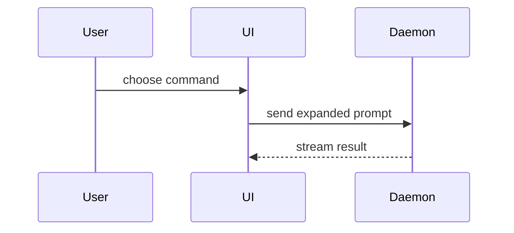

## Instructions（指令）

> **来源说明。** 改编自 `mattpocock/skills → skills/engineering/pr`（MIT，原样收录于
> `vendor/upstream-skills/mattpocock/skills/engineering/pr/SKILL.md`）。
> 为本仓库所做的改动：frontmatter 字段（`tags` / `triggers` / `allowed_tools` / `author` /
> `version`）、路径约定（`docs/specs`、`docs/tickets`、`work/<scope>`）、工具名
> （`read_file` / `write_file` / `edit_file` / `bash` / `grep` / `glob` / `task`），以及一节验证底线。
> 上游的 `disable-model-invocation` 在这里没有对应物——每个技能都可以通过 `skill` 工具发现，
> 所以直接去掉，而不做模拟。


写拉取请求正文时用这个模板：

```markdown
## 概述

<图、diff 草图，或目录树>

## 证据

- **之前：** <截图 / 输出 / 失败的测试运行>
  **之后：** <截图 / 输出 / 通过的测试运行>

## 合并风险

**门：** <单向门还是双向门>

<可选：说明>

**爆炸半径：** <一个词的描述>

<可选：合并可能带来的连带后果>
```

## 各节

跳过所有前言，正文保持简短。使用 `GLOSSARY.md` 里用户的领域语言。

### 概述

挑出能把要点说清楚的最小视图。

- 逻辑或算法用伪代码展示：

```text
on(save)
  if content is unchanged
    return cached result
  write new content
  return fresh result
```

- 运行时控制流用调用树展示：

```text
submitForm
  createSession
    persistPrompt
    launchAgent
  navigateToSession
```

- UI 结构用组件树展示，并把要紧的状态与模块边界一并带上：

```text
<SessionPage> (apps/example/src/routes/session.tsx)
  useSessionEvents()
  <SessionToolbar>
    <RunSkillButton> (packages/ui)
```

- 文件职责或一次大范围重构，用一层浅目录树展示：

```text
src/
├── commands/       # parses user actions
├── sessions/       # owns session state
└── transport/      # sends API requests
```

- 组件交互、控制流或数据流用 Mermaid 展示：



- 当要点是“什么变了”、而周围的形状已经存在时，用 `diff`。让 diff 的形状贴合主题。

组件变更：

```diff
 <SessionPage>
   useSessionEvents()
   <SessionToolbar>
+    <RunSkillButton />
   <SessionTimeline>
+    <SkillResultCard />
```

文件布局变更：

```diff
 src/
 ├── commands/
+│   └── show-me.ts       # expands the slash command
 ├── sessions/
-└── transport.ts
+└── transport/
+    ├── client.ts
+    └── stream.ts
```

调用树或调用栈变更：

```diff
 submitForm
   createSession
     persistPrompt
+    expandSkillMention
     launchAgent
-  navigateToSession
+  navigateToSession
+    subscribeToEvents
```

状态或控制流变更：

```diff
 on(save)
-  write content
+  if content is unchanged
+    return cached result
+  write new content
+  invalidate cache
```

- 当整块几乎都是新的、当省略上下文会藏起归属或顺序、或者当用户需要一个能直接抄的目标形状时，把整块展示出来：

```ts
function expandSkill(command: string): string {
  const skillName = command.slice(1);
  return `use the ${skillName} skill`;
}
```

#### 使用指导

每个视图都贴着它所支撑的那句短文字放。只保留两类必需的东西：回答用户当前问题的，以及让当前讨论点能被定下来的选项——以及它们所必需的调用、文件、props、状态和边界。

这些视图你可以用其中一个，也可以用几个，但不太可能全用上。用你的判断，不要让用户被淹没。

### 证据

能证明这次改动确实生效的具体证据。给出之前与之后。

截图是 S 级的——条件是环境已经为此搭好，而且改动是视觉上的。

基于执行的证据是 A 级的。测试结果、控制台输出。用伪代码展示那条现在失败、改完通过的测试。

### 合并风险

说明这是一扇单向门还是双向门。双向门你能走回来，单向门不能。回滚成本低的拉取请求风险更低。涉及破坏性操作、或涉及难以逆转的决定，都是单向门。

爆炸半径是这次拉取请求引入的改动可能造成的影响或波及范围。把所有可能性都考虑进去。例子有布局位移、对下游消费者造成破坏、移动端适配等。

## 本仓库的底线

- **用真实命令验证**，不要靠眼看：`./scripts/housekeeping_verify.sh`（守卫 + `tsc` + `vite build` +
  一份文档库报告）。后端测试套件加 `--full-suite`。
- **后端套件有 20 个既有的失败。**“不比那个基线更差”是诚实的判据；“测试是绿的”在这里不是一个你能做出的断言。
  用
  `pytest tests -q --ignore=tests/test_neo4j_document_enrichment.py --ignore=tests/test_pageindex_full_content_loader.py`
  对照，并把 `FAILED` 行与记录的基线做 diff。
- **规格、工单和笔记活在文件里**：`docs/specs/<slug>.md`、`docs/tickets/NNN-<slug>.md`、`work/<scope>/`。
  写在聊天消息里的一句结论，下一轮就丢了。
- **生态层**：智能体代码是 LangGraph 运行时里的 LangChain（`create_agent`），通常由 Deep Agents 脚手架
  （`deepagents`）包一层。动笔之前先决定这次改动属于哪一层——这就是 `lc-ecosystem-primer` 规则——并优先选
  能胜任的最高层。
