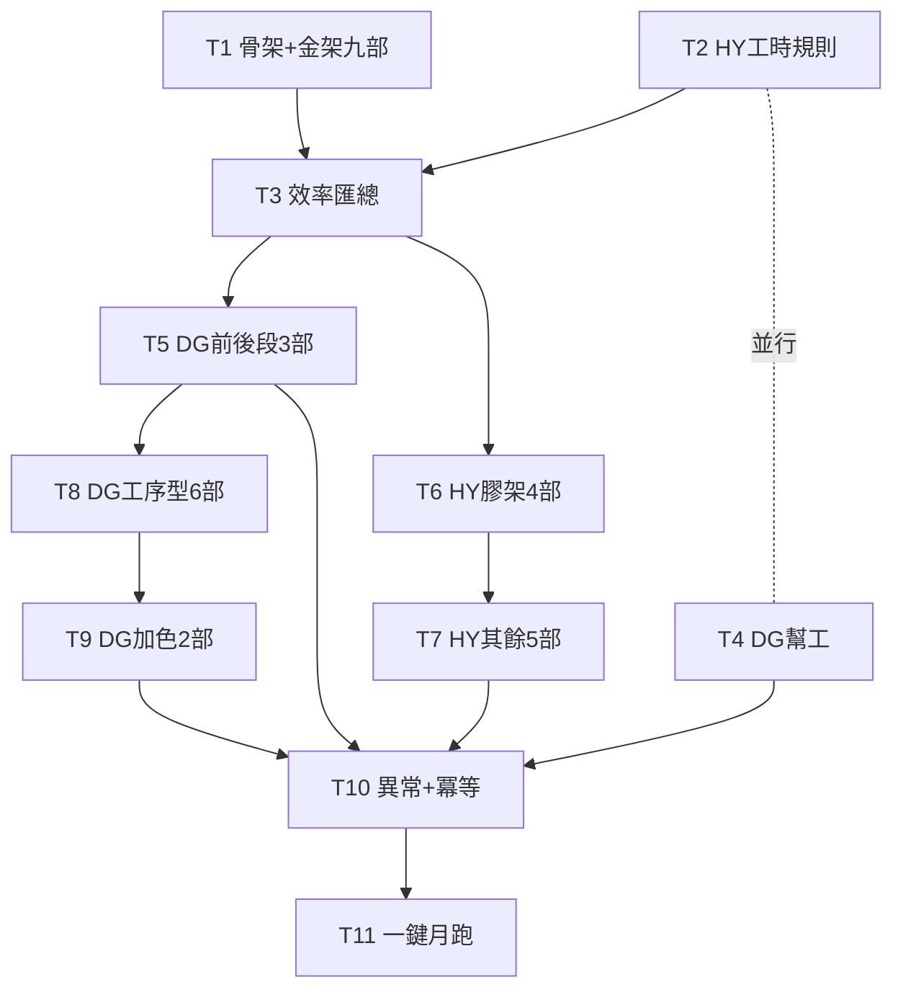

# 產出標工與效率計算工具 — 任務拆解（to-tickets）

- 對應規格：`specs/產出標工與效率計算-規格.md`
- 原則：每個任務是一條**完整的、可獨立驗證的路徑**（讀數 → 算 → 出表 → 對賬），不是按技術分層切。
- 驗收基準：2026 年 10 月手工表 / KPI 表數字。

---

## 任務拆解

### 1. **骨架 + DG 金架九部端到端**（tracer bullet）

- **Blocked by**：無
- **交付內容**：一條命令 `python -m stdhours --month 202610 --dept 金架九部`，讀該部門工作簿，算出 10 月產出標工，輸出「匯總 / 明細 / 異常」三張表。這條打通：`.xls/.xlsx` 讀取（含舊版 xls 轉換與快取）、標工引擎（新舊款判定 + 0.85 只對舊款 + 前後段報數取值）、報表層、異常清單。
- **驗收標準**：
  - [ ] 產出標工合計 = **5771.679**（手工表 2317.648 前段 + 3454.031 後段），相對誤差 ≤ 0.5%
  - [ ] 明細行數 = 523，且每行帶「檔案 / sheet / 行號」
  - [ ] 型別前綴 M3 / T14 / H128 / H129 / T15 一律判為新款（不乘 0.85）
  - [ ] 人工把某款號從標工庫刪掉 → 該行算 0，並出現在異常清單
  - [ ] 改壞輸入檔案路徑 → 明確報錯，不靜默出空表

---

### 2. **HY 工時規則引擎**

- **Blocked by**：無（可與任務 1 並行，介面在任務 3 對接）
- **交付內容**：讀 `2610全廠工時-XJ.xls` 的 `工時明細`，按人員分類規則匯出每部門「考核出勤工時」，並輸出「誰被排除、為什麼」的排除明細。
- **驗收標準**：
  - [ ] 配件部/鐳射組 = **973.67**、脾形中心 = **10794.47**、膠架五部 = **21529.57**，誤差 0
  - [ ] 浮動人員被排除（反例：若把浮動算進去，配件部/鐳射組會變 1282.67）
  - [ ] 離職人員被計入；固定人員、辦單/做辦人員被排除
  - [ ] 排除明細可按部門列出「工號 / 姓名 / 分類 / 工時 / 排除原因」

---

### 3. **效率匯總表（兩廠通用）**

- **Blocked by**：任務 1、任務 2
- **交付內容**：一張跨廠匯總表，每部門一行：產出標工、效率目標、目標定額工時、考核出勤工時、實際效率、差距、是否達標、異常筆數、口徑提示。
- **驗收標準**：
  - [ ] 效率 = 產出標工 ÷ 考核出勤工時，目標定額 = 產出標工 ÷ 效率目標
  - [ ] HY 各部門實際效率與 HY KPI 表相對誤差 ≤ 0.5%
  - [ ] DG 各部門效率目標取 DG KPI 表（配件一部 0.88、金架磨光 0.87、金架燒焊 0.85、金架九部 0.92、金架成品 0.80、脾形 0.84…）
  - [ ] 不達標部門用同一套判定（n < j 即不達標），不硬編碼

---

### 4. **DG 幫工工時（調入 / 調出）**

- **Blocked by**：無（與任務 2 **同時開工**；「參與效率考核」判定模組由先開工的一邊先落地 `hours/eligibility.py`，另一邊直接複用）
- **交付內容**：從 DG KPI 工作簿的 `幫工工時` 表推算每部門調入/調出：左表原部門（僅計參與效率考核者）→ 調出，右表借調部門（全部）→ 調入；逐筆依據取 `幫工明細`。
- **驗收標準**：
  - [ ] 調出：金架燒焊 468.5、金架磨光 104.5、脾形部 361.5、注塑噴塗 180.5、加色部 1698.98 全對
  - [ ] 調入：配件一部 546、金架成品 748、金架燒焊 346、金架磨光 405、脾形部 67.5、注塑成品 782.72 全對
  - [ ] 浮動/做辦/固定的借出工時不進調出——注塑成品部算出 16（KPI 是 43），差異 27h（浮動借出）在明細中標示
  - [ ] HY 側調入調出從月度配置檔讀手填值，不報錯

---

### 5. **DG 前後段型其餘 3 部**（金架燒焊 / 金架磨光 / 金架成品部）

- **Blocked by**：任務 1、任務 3
- **交付內容**：同模板複用，只需配置；三部進匯總表。
- **驗收標準**：
  - [ ] 三部產出標工與各自手工表 `月產出標工匯總表` 相對誤差 ≤ 0.5%
  - [ ] 新增部門時只改 YAML，不改 Python 代碼
  - [ ] 三部的效率與 DG KPI 表對齊（n 相對誤差 ≤ 0.5%）

---

### 6. **HY 膠架型 4 部**（膠架二 / 三 / 五 / 六部）

- **Blocked by**：任務 1、任務 3
- **交付內容**：HY 膠架模板 adapter（產量明細列名與 DG 不同），四部進匯總。
- **驗收標準**：
  - [ ] 四部產出標工與手工表誤差 ≤ 0.5%
  - [ ] 四部效率與 HY KPI 表誤差 ≤ 0.5%（膠架二 88.8%、三 89.8%、五 83.4%、六 43.0% 為對賬參考值）
  - [ ] 膠架六部那種「效率遠低於目標」的部門不被特殊處理，照算

---

### 7. **HY 其餘 5 部**（配件三部、鐳射、CNC中心含車片、脾形中心、加色部含噴塗滾磨）

- **Blocked by**：任務 6
- **交付內容**：工序型 adapter（按工序分列標工，而非前後段兩段）。
- **驗收標準**：
  - [ ] 五部產出標工與手工表誤差 ≤ 0.5%
  - [ ] 配件三部與 CNC中心「含車片」的合併口徑與 KPI 表的 `(含…)` 行一致
  - [ ] 五部效率與 KPI 表誤差 ≤ 0.5%

---

### 8. **DG 工序型 6 部**（脾形部、注塑啤件、注塑噴塗、注塑成品、配件一部、CNC圈形）

- **Blocked by**：任務 5（沿用 DG 前後段型的讀取與報表層）
- **交付內容**：六部進匯總。
- **驗收標準**：
  - [ ] 六部產出標工與手工表誤差 ≤ 0.5%（脾形部 7748.45、注塑啤件 2789.15、注塑噴塗 4216.15、注塑成品 5438.24、配件一部 14638.31、CNC圈形 1806.49 為參考值）
  - [ ] 制辦行（如 `注塑啤件部/啤件組/制辦`）按現有口徑不併入生產行
  - [ ] 六部效率與 DG KPI 表誤差 ≤ 0.5%

---

### 9. **DG 加色 2 部**（加色一部、加色一部-鐳射絲印）

- **Blocked by**：任務 8
- **交付內容**：加色專用 adapter——標工庫以「款號 + 工序組合」為鍵、12232 行 × 256 欄、`加腳` 減半、多餘鐳射絲印標工扣減。
- **驗收標準**：
  - [ ] 加色一部產出標工與手工表 `月度產出標工` 誤差 ≤ 0.5%
  - [ ] `加腳` + `配件` 組合的 ÷2 規則生效（用已知樣本行驗證）
  - [ ] 多餘鐳射絲印標工被扣減（總標工 − 該欄），不重複計
  - [ ] 兩部效率與 DG KPI 表誤差 ≤ 0.5%

---

### 10. **異常清單完備 + 冪等**

- **Blocked by**：任務 4、任務 7、任務 9
- **交付內容**：異常清單三類齊備（查無標工 / 標工為 0 / 報數為 0），每筆可定位到檔案+sheet+行號；同一款號多行合併統計筆數；同輸入連跑兩次輸出位元級一致（固定排序、去除時間戳等不穩定因素）。
- **驗收標準**：
  - [ ] 三類異常都有樣例（用當月真實缺標工款號 + 合成數據各驗一次）
  - [ ] 異常清單能按廠、部門、類型篩選，每筆帶來源定位
  - [ ] 連跑兩次，`匯總` / `明細` / `異常` 三張表 md5 完全相同
  - [ ] 同一款號 100 行缺標工，清單合併為 1 筆並記「100 行 / 合計報數 X」

---

### 11. **月度一鍵運行**

- **Blocked by**：任務 10
- **交付內容**：`--month YYYYMM --factory both` 一次跑完兩廠所有部門，無人工介入；月度配置檔（效率目標、HY 調入調出手填值、申訴扣減）與代碼分離，換月只改配置。
- **驗收標準**：
  - [ ] 兩廠全部部門一個命令跑完
  - [ ] 只改 `config/months/202611.yaml` 的月別與路徑，即可跑 11 月（用 10 月資料改名模擬驗證）
  - [ ] 缺少任一部門檔案時，明確報出「哪個檔案缺」，其餘部門照跑不被拖死
  - [ ] 執行完輸出一行摘要：跑了幾部、幾部通過對賬、幾筆異常

---

## 依賴圖

```
1 ─┬─────────────┬──────────────┐
   │             │              │
   └─ 3 ─┬─ 5 ────┼─ 8 ──── 9 ──┐│
         └─ 6 ─── 7 ────────────┼┴─ 10 ── 11
   2 ─┬────────────────────────┘
       └─ 4 ────────────────────┘
```



可並行開工的三條起跑線：**1 / 2 / 4**。
批次驗收：1→3 打通主鏈；5、6、7、8、9 逐批擴部門；10→11 收尾。
**任一批驗收不過，不進入下一批。**

---

## 進度

| 任務 | 狀態 | 驗收證據 |
|---|---|---|
| T1 骨架 + 金架九部 | ✅ 完成 | 5,771.679（前段 2,317.648 / 後段 3,454.031），525 行逐行 0 差異 |
| T2 HY 工時規則 | ✅ 完成 | 膠架五部 21,529.57、脾形中心 10,794.47、配件三部/鐳射組 973.67，均 0.00% |
| T4 DG 幫工工時 | ✅ 完成 | 調入 6 部門全對；調出 5/6 對（注塑成品部 16 vs KPI 43，差 27h 浮動借出，明細已標示） |
| .xls 讀取（前置） | ✅ 完成 | 自研 BIFF8 讀取器；33.8 MB 檔 0.1 s 開檔，與 LibreOffice 轉檔逐格比對 0 差異 |
| T3 效率匯總 | ✅ DG 已打通 | 金架九部 96.48%、金架燒焊部 73.46%，與 KPI **0.00%**；HY 側待 T6/T7 的 i |
| T5 DG 前後段型 4 部 | 🟡 2/4 | 金架九部 ✅；金架燒焊部 ✅（改用 `dg_equivalent`）；金架磨光/成品部 缺產量流（見下） |
| T8 DG 工序型 6 部 | 🟡 1/6 | CNC圈形部/生產 i ✅ 1,806.487（工時側待查）；其餘 5 部模板各異 |
| T5～T11 其餘 | ⬜ 未開始 | |

47 個測試全綠（`python -m unittest discover -s tests -p 'test_*.py'`）。

### DG 各部門接入狀態

| 部門 | i（產出標工） | m（工時） | n（效率） | 卡在哪 |
|---|---|---|---|---|
| 金架九部 | ✅ 5,771.679 | ✅ 5,982.307 | ✅ 96.48% | — |
| 金架燒焊部 | ✅ 8,884.684 | ✅ 12,095.367 | ✅ 73.46% | — |
| CNC圈形部/生產 | ✅ 1,806.487 | ❌ 1,085.07 vs KPI 2,501.57 | — | 工時分組推不出底數 2,643.07 |
| 金架磨光部 | ❌ | — | — | 架類需扣外發/粗磨；粗磨另在「粗磨明細」的「產出標工」欄 |
| 金架成品部 | ❌ | — | — | 產量明細只涵蓋裝配-包裝；PQC 549.05、車片 820 要另取 |
| 脾形部/注塑×3/配件一部 | ❌ | — | — | 工序型模板，產量明細欄位與前後段型不同 |
| 加色部/加色部-鐳射絲印 | ❌ | — | — | 最複雜：款號+工序組合為鍵、加腳減半 |

### 過程中發現、已寫進代碼的三件事

1. **標準工時表是左右兩塊**：`A:E` 前段表、`F:T` 後段表，各有自己的「款號」欄；當成一張表查會讓後段全部歸零。
2. **款號比對不區分大小寫**：表內有 16 個小寫款號（`m29059`），Excel VLOOKUP 不分大小寫，Python 分。
3. **本機 OpenOffice 4 的 headless 轉換會卡死**（profile 初始化掛住；11.8 MB 檔燒 575 秒 CPU 仍未產出）。
   故 `.xls` 走「預轉檔放 `cache/xlsx/`」路線，工具預設不再呼叫 soffice。
