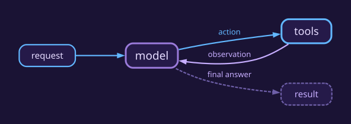
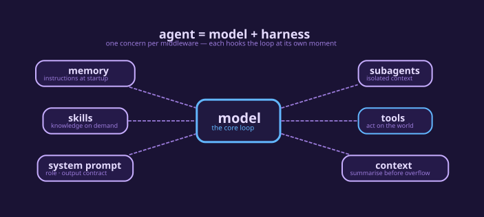

# 第 1 类 · 能直接用的 agent（案例 1–5）

> 五个能直接用的 agent，按"从最小到完整"排：1 基础 → 2 全工具 → 3 文档问答 → **4 个人助理** → **5 售后客服**。
> 后面第 2 类才是机制（HITL + 四个模式），用到时再查。
>
> 深度研究（多轮搜索 → 带引用报告）单独成篇：`docs/reference/deep-research-agents.md`。

## 两种 agent：LangChain agent（normal）与 Deep Agent

平台上的每个 agent 都有 `use_deepagents` 这个开关，默认 `false`。它不是"高级版/简化版"的关系 —— **两者用的是同一个推理循环，差别在于 harness 里塞了什么。**

| | **normal（LangChain agent）** | **Deep Agent** |
|---|---|---|
| 底层构造 | `create_agent(model, tools, system_prompt, middleware)` | `create_deep_agent(...)`，**内部仍然是 `create_agent`** |
| 系统提示词 | 平台拼装：guardrails + 角色 + 上下文（含工具强制规则、记忆/知识库说明） | **你自己写的那段**（平台只追加少量规则），品牌/角色全靠你 |
| 内置工具 | 注册表里勾的那些 | SDK 自带 `ls` / `read_file` / `write_file` / `edit_file` / `glob` / `grep` / `execute`（沙箱才可用）+ `task` |
| 文件系统 | **也有**（平台给普通 agent 默认挂 `FilesystemMiddleware`，工作区隔离） | 有，且可换 backend（`FilesystemBackend`、虚拟根、权限） |
| 子代理 | 有（`task` 工具，子代理可带自己的 prompt/工具） | 有，且规格更完整（子代理可指定独立 model） |
| 计划/待办 | 需要手动加 `todo_list` 中间件 | 同（`TodoListMiddleware`），案例 10/11 都开了 |
| **AGENTS.md 品牌/项目说明** | ❌ 不读进提示词（只是工作区里的一个文件） | ✅ `MemoryMiddleware` 读进系统提示词，**每次运行都生效** |
| **技能自动编目** | 靠 `skill` 工具按需加载（渐进披露） | `SkillsMiddleware` 先把技能目录/描述编目，再按需读全文 |
| 交接 / HITL | 平台中间件：`handoff`、HITL 策略、RAG、长期记忆、结构化输出都是这里给的 | 同样能配，但默认只带 SDK 那套 |

**我们平台的实测数字**（`select config->>'use_deepagents', count(*) from deep_agent_templates group by 1`）：
41 个 normal、30 个 deep；案例 1–9 全是 normal，**案例 10（深度研究）、案例 11（内容创作）是 deep**。

### 怎么选（三句话）

1. **要"平台帮你拼提示词"**（guardrails、工具强制、知识库/记忆说明）→ **normal**。
2. **要"提示词完全归我 + 品牌语气每次生效（AGENTS.md）+ 文件即交付物"** → **deep**。
3. **只是要多个子代理/待办/写文件** → 两者都能做，**选 normal 更省事**（平台已给普通 agent 挂了文件系统）。

### 两个容易踩的坑

- **同一个 agent 换类型 = 新聊天**：`use_deepagents` 改了以后旧会话不会迁移（提示词和工具集都变了）。
- **deep agent 的工具栏是"你自己声明 + SDK 自带"**：写 `native_tools` 时不要指望里面出现 `ls`/`write_file` —— 那些来自 SDK 的文件系统中间件，配置里看不到但运行时有。

# 案例 1 · 第一个 agent：create_agent 的三要素 + 四个例子

> 依据：**[https://docs.langchain.com/oss/python/langchain/agents](https://docs.langchain.com/oss/python/langchain/agents)**
>
> 一句话：*a model calling tools in a loop until a task is complete, shaped by a harness
> of prompt, tools, and middleware.*

## 开场（页面原文）

> Agent 是一个**在循环里调用工具的模型**，直到给定任务完成为止。
> （*An agent is a model calling tools in a loop until a given task is complete.*）



> Harness 是围绕这个循环的一切：**提示词、工具，以及任何塑造模型行为的中间件。**
> （*A harness is everything around that loop: the prompt, the tools, and any middleware
> that shapes the model's behavior.*）

> **Agent = Model + Harness**
> Harness 的职责：**在正确的时刻，把正确的上下文交给模型。**

## create_agent 就是一个可配置的 harness

> `create_agent` 高度可配置。最简单的用法是这样：

```python
from langchain.agents import create_agent

agent = create_agent(model="deepseek-flash", tools=tools)
```

> 在此基础上，**基础配置就是 `model=`、`tools=`、`system_prompt=` 三个参数**；
> 再往上要加能力，用中间件扩展 harness。

## 核心组件（Core components）



| 组件                        | 页面原话                                                                                                                                                   |
| --------------------------- | ---------------------------------------------------------------------------------------------------------------------------------------------------------- |
| **Model**             | 传一个模型标识字符串（`"provider:model"`），或一个已初始化的模型实例。                                                                                   |
| **Tools**             | 传任何 Python 可调用对象、LangChain 工具或工具字典。                                                                                                       |
| **System prompt**     | 塑造 agent 处理任务的方式。接受字符串或 `SystemMessage`。运行时要动态改，用中间件。                                                                      |
| **Structured output** | 用 `response_format=` 让 agent 返回**校验过的结构**。                                                                                              |
| **Agent state**       | 每个 agent 都用 `AgentState`（typed dictionary）管理执行上下文。内置字段是 `messages`（只追加）。要加自定义字段，继承它并用 `state_schema=` 传进去。 |

## 在平台上：模型 + 系统提示词 + 工具

三个位置填一次（Temperature 填 `0`）：

| 页面参数           | 平台上                  | 填什么                                                                                               |
| ------------------ | ----------------------- | ---------------------------------------------------------------------------------------------------- |
| `model=`         | Overview → Model       | `deepseek-flash`（Temperature `0`）                                                              |
| `system_prompt=` | Prompt → System Prompt | `You are a helpful assistant`                                                                      |
| `tools=`         | Tools 页签              | 三个：`web_search`、`python_execute`、`pg_query`（写文件用的 `write_file` 平台自带，不用勾） |

## 四个例子

每个例子各开新聊天，先发一句 `hi`。

| 问                                                     | 它用了                   | 结果                               | 用时 |
| ------------------------------------------------------ | ------------------------ | ---------------------------------- | ---- |
| 上海的天气如何                                         | `web_search` ×4       | 晴到多云，白天 24–25℃，夜间 15℃ | 8.1s |
| 1,234,567 乘以 891,011 等于多少？                      | `python_execute`       | 1,100,012,777,237                  | 4.8s |
| 用 pg_query 查一下 deep_agent_templates 有多少个 agent | `pg_query`             | 63                                 | 3.3s |
| 把这句话存成一份文档：标题《工具路由测试》             | `ls` → `write_file` | `generated/工具路由测试.md`      | 9.1s |

提示词只有 `You are a helpful assistant` 一句，没有一个字提工具，四个例子它都自己挑对了 ——
**挑哪个由工具自己的描述决定**。这就是页面那句 *a model calling tools in a loop*。

---

# 案例 2 · 工具多到 27 个，还挑得对吗（`case-2-all-tools`，id 159）

案例 1 只有 3 个工具。这一节把同一个问题推到 27 个工具：**工具一多，模型还会挑对吗？**

`case-2-all-tools`：`deepseek-flash`、Temperature `0`、**27 个工具**（`web_search`/`tavily_search`/`web_fetch`、
`pg_query`/`pg_list_tables`/`pg_describe_table`、`python_execute`/`sqlite_execute`、
`memory_store`/`memory_recall`、`think_tool`/`reasoning_chain`、`write_todos`/`read_todos`、
`bash`、`write_file`…），提示词是一份**中文能力清单**（"你可以搜索信息、查数据库、写文件…"）。

## 实测

| 问 | 它挑了 | 结果 | 用时 |
|---|---|---|---|
| `上海今天天气怎么样？` | `web_fetch` → `web_search` ×2 | 19℃ 实况 + 今日温度区间 | 11.5s |
| `把这句存成文件：hello world。` | `write_file` | `generated/hello_world.txt` | 6.1s |
| `用 pg_query 查一下 deep_agent_templates 有多少个 agent。` | `pg_query` | 69 | 5.9s |
| `上海今天天气怎么样？`（案例 1 的同题） | 案例 1：`web_search` ×4 | 同样的答案 | 8.1s |

## 两条要讲的判断

1. **工具数量不是主要矛盾，名字和描述才是。** 27 个工具里，模型按"名字 + 一句描述"挑，每次都挑到最具体的那一个
   （写文件用 `write_file`、查库用 `pg_query`、天气用 `web_search`）—— 和案例 1 的 3 工具表现一致。
2. **提示词里的能力清单是"索引"，不是"路由表"。** 中文那段只说了"你能干什么"，没有一条"天气 → 用 web_search"的规则；
   真正决定挑哪个的是工具自身描述。这也解释了为什么**加工具比加规则更省事**，以及为什么工具描述写得含糊会直接掉准确率。
3. 代价是**选错的空间变大、延迟变高**（同题 11.5s vs 8.1s）。「工具太多要不要拆」的答案在案例 4/9：
   拆成专家（subagents）或分派台（router）。

---

# 案例 3 · 文档问答：上传附件 → 读 → 标来源（`case-3-doc-chat`，id 326）

平台原本的「知识库对话」是**把整个文件夹的内容塞进提示词**（`api/knowledge/doc_chat.py`）。
这个案例把它做成一个 **normal agent**：不预载文档，改用工具按需读 —— 上传什么、读什么、答什么，且每条结论标来源。

`case-3-doc-chat`：`deepseek-flash`、温度 `0`、**只有 3 个只读工具**：`glob`（列附件）、`grep`（大文件里定位）、
`read_any_file`（文本 / PDF / 扫描件 / Word / PowerPoint / Excel 统一读取入口）。

## 三条规则（抄自 `doc_chat.py` 的 RULES）

| 参考实现 | agent 版 |
|---|---|
| 每条结论标 `[Source: filename.ext]` | 同样格式，去掉文件名前的 8 位存储前缀 |
| 开头声明读了多少文档 | `**[Documents loaded: N file(s)]**`（N = 本轮实际读的） |
| 读不到就明确说（原文 `The loaded documents do not contain information about …`） | 「读到的文档里没有关于 … 的信息」 |
| 数字/金额/日期原样引用，不换算口径 | 同 |
| 不许用自身知识补 | 同 |

预算：一轮最多读 3 个文件；长文件只读命中部分（doc_chat 的等价限制是 300 文件 / 1M 字符）。

## 实测（上传真文件，不是演示数据）

| 上传 | 问 | 工具 | 结果 |
|---|---|---|---|
| `星河项目交付说明.md`（322 B） | 项目编号和预算是多少 | `glob` → `read_any_file` | `XH-2026-014` / `人民币 128 万元`，各带 `[Source: 星河项目交付说明.md]` |
| `industry_analysis_report.pdf`（612 KB，11 页） | 这份 PDF 讲什么行业？2025 市场规模 | `read_any_file`（6s） | 全球眼镜行业；列出 6 家机构口径表，全部带来源 |
| 同上 | 有没有提到越南的监管要求？没有就说没有 | `grep` | **「读到的文档里没有关于越南监管要求的信息」** + 核对过程（监管章节只覆盖美/欧/中） |

**上传即开始**：附件上传后前端会替用户发一句"我已上传附件「X」"，agent 先回一行确认再读 ——
不需要用户再补一句"请读一下"。没有读文件工具的 agent 收到同样的话，会直接说明"缺什么工具"。

## 两条要讲的判断

1. **agent 版和面板版的差别是"按需读"而不是"全塞进去"。** 面板版一次把文件夹里能塞的都放进提示词，
   大库会顶满上下文；agent 版先 `glob`/`grep` 缩小范围，只读命中的 1–3 个文件，读不到就明说。
2. **"读不到"比"答得像"更重要。** 三条规则里最值钱的是那句缺席声明：它把"我不知道"从模型的礼貌变成了可验收的判据
   （我们的验收脚本就是按这句话断言的）。

---


# 案例 4 · 个人助理（Supervisor + 专家 + 外发审批）

教程：**[https://docs.langchain.com/oss/python/langchain/multi-agent/subagents-personal-assistant](https://docs.langchain.com/oss/python/langchain/multi-agent/subagents-personal-assistant)**

## Overview（页面原文 · 中文译文）

> supervisor 模式是一种多 agent 架构：一个中心的 **supervisor agent** 协调若干专职的
> **worker agent**。当任务需要几种不同类型的专业能力时，它最合适 —— 与其造一个要在多个领域里
> 挑工具的 agent，不如造几个各自专注的专家，由理解整体流程的 supervisor 来协调。
>
> 教程要搭的是一套个人助理系统，用一条真实的工作流来演示这套结构。系统协调两个
> **职责完全不同**的专家：
>
> - **calendar agent**：排期、查空闲、管理日程事件。
> - **email agent**：负责沟通、起草消息、发送通知。
>
> 还会引入 **human-in-the-loop review**，让人**批准 / 编辑 / 拒绝**动作（例如对外发邮件）。
>
> 从 `langgraph-supervisor` 迁移过来的，参考「Migrate from langgraph-supervisor」——
> 那里有 interrupt 与 resume 的前后对照。

## Why use a supervisor?（页面原文 · 中文译文）

> 多 agent 架构可以把**工具**切分给不同 worker，每个 worker 有自己的提示词或指令。
> 试想一个直接握着全部日历与邮件 API 的 agent：它要在**很多相似的**工具里挑、要记住每套 API
> 的确切格式、还要同时处理多个领域。**如果效果开始变差**，把相关工具与配套提示词拆成逻辑组
> 往往有帮助（一部分也是为了让后续迭代更好管理）。

## 结构：一共 3 个 agent（1 + 2）

教程把 worker 叫 subagent；**supervisor 自己也是一个 agent**。

```text
                supervisor                  ← 它自己也是一个 agent
                     │  只看得见「包装工具」
          ┌──────────┴──────────┐
   schedule_event            manage_email
          │                        │
   calendar agent              email agent      ← 两个 worker
   create_calendar_event       send_email
   get_available_time_slots
```

两条要点：

1. **supervisor 看不到 `create_calendar_event`** —— 故意的信息差：它只面对 2 个包装工具，选项少才不容易挑错。
2. **审批挂在外发那一层** —— `interrupt_on={"send_email": …}` 属于 email agent；挂到 supervisor 只能拦住“派活”。

## 教程的步骤

| 步骤                    | 教程做了什么                                                                                                                          |
| ----------------------- | ------------------------------------------------------------------------------------------------------------------------------------- |
| 1. 定义工具             | 三个 stub：`create_calendar_event`（要 ISO 时间）、`send_email`、`get_available_time_slots`                                     |
| 2. 建专家               | calendar agent（**把「下周二下午 2 点」解析成 ISO**）、email agent（推断收件人、写主题正文）                                    |
| 3. **包装成工具** | `schedule_event(request)`、`manage_email(request)` — **supervisor 只看到这两个高层工具，看不到 `create_calendar_event`** |
| 4. supervisor           | 按领域分派；一句话涉及两件事时，**一轮里同时调两个工具**                                                                        |
| 5. 两个例子             | ①「安排明天 9 点站会」→ 只调 `schedule_event`；②「下周二 2 点跟设计团队开会，并发邮件提醒」→ 同时调度两个                       |

## 平台上怎么还原

1. **建 agent**：名字 `case-4-assistant`，Model `deepseek-flash`，Temperature `0`。
2. **Tools 页签只勾 `Task (Subagent)`** —— supervisor 只该看到“派人”这一件事，具体 API 由专家自己拿。
3. **JSON 页签**贴两个专家（`interrupt_on` 写在 `email_expert` 身上，不是 supervisor 上 ——
   supervisor 的中间件只看得到 `task`，看不到专家手里的 `write_file`）：

```json
"subagents": [
  {
    "name": "calendar_expert",
    "description": "日程助手：把「下周二下午 2 点」这类说法换成具体时间，并生成日程文件（.ics）。",
    "type": "dictionary",
    "system_prompt": "你是日程助手。把自然语言时间解析成具体日期与时间（今天是 2026-10-31，周六）；需要算日期或时长时用 python_execute；确定后用 write_file 生成 generated/<标题>.ics（含 DTSTART/DTEND/SUMMARY）。最后用一句话确认安排了什么。",
    "tools": ["python_execute", "write_file"]
  },
  {
    "name": "email_expert",
    "description": "邮件助手：起草并发出邮件（写出 .eml 到 outbox）。",
    "type": "dictionary",
    "system_prompt": "你是邮件助手。根据要求写一封邮件，用 write_file 写到 generated/outbox/<收件人>-<主题>.eml，内容包含 To / Subject / 正文。发出前会有人工审批，你只需写好文件。",
    "tools": ["write_file"],
    "interrupt_on": {"write_file": {"allowed_decisions": ["approve", "reject"], "when": "writes_deliverable"}}
  }
]
```

4. **Prompt 页签**：`你是一个个人助理。日程问题交给 calendar_expert，邮件问题交给 email_expert；你自己不写文件、不算日期。一件事涉及两方时，分别派活再汇总。`

## 实测（`case-4-assistant`，id 323）

| 问 | 发生了什么 |
|---|---|
| `安排下周二下午 2 点跟 Alice 开 1 小时的会` | `task(calendar_expert)` → `ls` → `python_execute` 算日期 → `write_file` → `generated/与Alice开会.ics`；答「2026-11-03 周二 14:00–15:00」 |
| 同一句 + `然后给 alice@example.com 发封确认邮件` | 一轮两个 `task`；`email_expert` 写 `.eml` 前**打断** → 点批准 → `outbox/…eml` 出现 |

点聊天窗口右上角**日历图标**：11 月 3 日格子里是 `14:00 与 Alice 开会`，来源文件与 Files 面板一致；
面板底部写明「N 个日程的文件没写时区，时间按文件字面显示」—— 只读，不替模型编时区。

## 和教程的差异（要如实讲）

| 教程 | 平台 | 原因 |
|---|---|---|
| 三个 stub 工具 | `python_execute` 算 + `write_file` 存 `.ics` / `.eml`，**不新增工具** | 平台不鼓励为演示造 stub；副作用靠文件可观测 |
| 每个专家包成 1 个工具 | 用内置的 `task(description, subagent_type)` | 等价：supervisor 一样看不到专家的工具 |
| 真发信 / 真日历（SendGrid、Google Calendar） | 写文件 | 教程**自己也是 stub**；平台没有真通道 |
| `edit`（改参数再执行） | 只有批准 / 拒绝 | 改参数会触发重新规划，实测更乱 |

## 四个要讲的判断

1. **分层是为了“少选项”**：supervisor 只面对 1 个工具、每个专家只面对自己的 2 个 —— 选错的概率就下来了。
2. **信息差是设计出来的**：supervisor 不知道 `write_file`、也不知道 `.ics` 怎么写得出来；所以**约束要写在专家身上**。
3. **审批放在有副作用的那一层**：放 supervisor 只能拦住“派活”，拦不住“发信”。
4. **专家要有自己的中间件**：子代理原来既无 `interrupt_on` 也无文件系统，文件根本落不了盘（平台已修）。

---


# 案例 5 · 售后客服（handoffs：一个 agent，三步配置）

教程：**<https://docs.langchain.com/oss/python/langchain/multi-agent/handoffs-customer-support>**

## Overview（页面原文 · 中文译文）

> 状态机模式描述的是这样一类工作流：agent 的行为随着任务走到不同状态而改变。本教程用**工具调用
> 动态改变同一个 agent 的配置** —— 按当前状态更换它可用的工具与指令 —— 来实现一个状态机。状态可以
> 来自多个来源：agent 过去的动作（工具调用）、外部状态（比如 API 返回），甚至最初的用户输入
> （比如先跑一个分类器判断意图）。
>
> 本教程要搭的是一个售后客服 agent，它会：
>
> - 先收集保修信息再往下走；
> - 把问题分成硬件或软件；
> - 给出解决方案，或升级给人工；
> - 在多轮对话里保持状态。
>
> 和 subagents 模式（把子代理当工具调用）不同，**状态机模式用的是一个 agent**，它的配置随流程推进
> 而改变。所谓“一步”，只是同一个 agent 的另一套配置（system prompt + 工具），由状态动态选中。

## 流程（页面那张图的文字版）

```text
客户报问题 → 在保？ ──是──→ 问题类型？ ──硬件──→ 保修维修流程
                │                        └─软件──→ 排查步骤
                └──否──→ 问题类型？ ──硬件──→ 升级人工（付费维修）
                                    └─软件──→ 排查步骤
```

## 结构：1 个 agent + 3 步配置

| 步骤 | 这一步看得到什么 | 什么时候进 |
|---|---|---|
| `warranty_collector` | `transfer_to_issue_classifier` | 一开始（`default_step`） |
| `issue_classifier` | `transfer_to_resolution_specialist` | 保修状态问清之后 |
| `resolution_specialist` | `write_file` + `transfer_to_warranty_collector` + `transfer_to_issue_classifier` | 硬件/软件判定之后 |

**顺序不是靠提示词自觉，是靠工具集**：第一步手里根本没有进方案的转移工具，所以它进不去。

## 教程的步骤（9 节压成 5 行）

| 教程 | 做了什么 |
|---|---|
| 1. 定义 state | `current_step` / `warranty_status` / `issue_type` |
| 2. 建工具 | `record_warranty_status(...)` 返回 `Command(update={..., "current_step": ...})` |
| 3–4. 每步配置 + 中间件 | 字典里存 `prompt` / `tools` / `requires`；中间件读 `current_step`，覆盖 prompt 与工具，缺字段就 `raise` |
| 5. 建 agent | `state_schema=SupportState`、`middleware=[apply_step_config]`、加 checkpointer |
| 6–9. 跑 4 轮 + 回退 | 保修 → 分类 → 方案；再加 `go_back_to_*` 让客户改错的信息 |

## 平台上怎么还原（1 个 agent + 1 段 middleware）

Agents → New Agent，名字 `case-5-support`，Model `deepseek-flash`，Temperature `0`；
Tools 页签只勾 `write_file`；JSON 页签贴：

```json
"middleware": [{
  "type": "handoff",
  "config": {
    "default_step": "warranty_collector",
    "steps": {
      "warranty_collector": {
        "system_prompt": "你是售后客服，当前阶段：保修确认。先打招呼，再问设备是否在保修期内，不要一次问多个问题。客户回答后调用 transfer_to_issue_classifier。",
        "tools": [],
        "transfers": [{"to": "issue_classifier", "description": "客户已说明是否在保修期内"}]
      },
      "issue_classifier": {
        "system_prompt": "你是售后客服，当前阶段：问题分类。先请客户说明问题怎么发生的（即使开头提过也要确认），再判断硬件还是软件，然后调用 transfer_to_resolution_specialist。保修状态在对话历史里，自己回看。",
        "tools": [],
        "transfers": [{"to": "resolution_specialist", "description": "已判定硬件/软件"}]
      },
      "resolution_specialist": {
        "system_prompt": "你是售后客服，当前阶段：解决方案。回答最多 5 行，细节写进文件。文件名用 generated/support/<Current time 的日期时间>-<类型>.md（不要用客户名）。软件→排查步骤；硬件+在保→保修维修；硬件+过保→升级人工（写明平台没有真实工单系统）。客户说信息有误就用 transfer_to_warranty_collector / transfer_to_issue_classifier 回去改。",
        "tools": ["write_file"],
        "transfers": [
          {"to": "warranty_collector", "description": "客户说保修信息有误"},
          {"to": "issue_classifier", "description": "客户说问题类型判断有误"}
        ]
      }
    }
  }
}]
```

## 实测（`case-5-support`，id 325）

| 轮 | 客户说 | 用了什么 | 结果 |
|---|---|---|---|
| 1 | `Hi, my phone screen is cracked` | 无工具 | 只问保修状态（进不去下一步） |
| 2 | `Yes, it's still under warranty` | `transfer_to_issue_classifier` | 换配置：问"屏幕怎么坏的" |
| 3 | `The screen is physically cracked from dropping it` | `transfer_to_resolution_specialist` + `write_file` | 换配置：给保修维修流程；`generated/support/2026-10-31T1324-保修维修.md` |
| 4 | `What should I do?` | 无工具 | 只补充操作步骤（不再复述整份方案） |
| 5 | `Actually I made a mistake - my device is out of warranty` | `transfer_to_warranty_collector` | **回退**到保修确认（教程第 9 节） |

三次 hop 都落库成 `handoff` 消息，顺序 `issue_classifier → resolution_specialist → warranty_collector`。

> **回退那一轮可能连跳两次**：客户在"其实过保了"这句话里已经给出了新答案，所以
> `warranty_collector` 收到后立刻又转给 `issue_classifier`（实测出现过 4 跳）。判据要写"能回到保修"，
> 不能写"最后一跳必须是保修" —— 否则复跑会假失败。

## 和教程的差异（要如实讲）

| 教程 | 平台 | 原因 |
|---|---|---|
| `warranty_status` / `issue_type` 存进 state，prompt 用 `{warranty_status}` 插值 | 没有：事实留在**对话历史**里，prompt 写"自己回看" | 平台没有可编辑的 state 字段 |
| `requires` 缺字段就 `raise` | 没有这道校验；顺序靠"这一步手里有哪些转移工具" | 同上，属于要新增的能力 |
| `record_warranty_status` 返回 `Command` 写 state | `transfer_to_*` 写 `handoff_to` | 机制同构：工具改状态、中间件换配置 |
| `provide_solution` / `escalate_to_human`（stub 返回字符串） | `write_file` 写 `generated/support/*.md` | 平台没有工单系统，"升级人工"只是文件 + 一句告知 |
| 第 8 节：用摘要中间件压历史 | 中间件页签可加 `summarization` | 等价 |

## 三个要讲的判断

1. **一个 agent 也能"变成好几个人"**：换的是配置（prompt + 工具），不是进程，也不是子代理。
2. **顺序由工具集约束，不是靠模型自觉**：第一步没有"进方案"的工具，它想跳也跳不过去。
3. **回退要显式给**：只在方案步给 `transfer_to_warranty_collector`，客户改错才有路可走；给多了就等于没有流程。

## 复建自检（5 条）

- [ ] 第 1 轮只问保修，**没有** hop —— 判据：工具记录为空、没有 `handoff` 消息
- [ ] 第 2 轮出现 `transfer_to_issue_classifier`，回答变成"问问题怎么发生的"
- [ ] 第 3 轮出现 `transfer_to_resolution_specialist` + `write_file`，Files 面板多出 `generated/support/…md`
- [ ] 第 5 轮说"其实过保了" → 出现 `transfer_to_warranty_collector`（回退成功）
- [ ] 反证：把 `resolution_specialist` 的两个 `transfers` 删掉 → 客户说"搞错了"时它只能解释，退不回去

---


# 第 2 类 · 机制演示（机制一项 + 四个模式）

> 这些章节各讲**一个机制**，用最小例子证明它成立；业务场景请看第 1 类的案例 4（用 subagents + HITL）
> 和案例 5（用 handoff 状态机）。

# 机制 · 改文件前要人批准（Human-in-the-loop）

页面：**[https://docs.langchain.com/oss/python/concepts/human-in-the-loop](https://docs.langchain.com/oss/python/concepts/human-in-the-loop)**

文档的写法是**中间件**，不是提示词：

```python
from langchain.agents import create_agent
from langchain.agents.middleware import HumanInTheLoopMiddleware
from langgraph.checkpoint.memory import InMemorySaver

agent = create_agent(
    model="gpt-5.5",
    tools=[write_file, execute_sql, read_data],
    middleware=[
        HumanInTheLoopMiddleware(
            interrupt_on={
                "write_file": True,                                   # 四种决策都允许
                "execute_sql": {"allowed_decisions": ["approve", "reject"]},
                "read_data": False,                                   # 显式放行
            },
            description_prefix="Tool execution pending approval",
        ),
    ],
    checkpointer=InMemorySaver(),   # 打断要靠它持久化；平台聊天本来就有
)
```

平台上就是 **Middleware 页签** → 勾工具 → 选“每条都批 / 只批会改东西的”，保存后**开新聊天**。

## 实测（deep agent，`bash` 设成 `bash_may_mutate`）

| 步骤                                                              | 看到什么                                              |
| ----------------------------------------------------------------- | ----------------------------------------------------- |
| 发 `hi`，它自己 `cd … && ls -la … 2>/dev/null` 扫工作区     | **没有打断**（只读命令不批）                    |
| 发「用 bash 执行：`echo approved > …/generated/approved.txt`」 | 输入框变成审批卡，显示工具名和整条命令                |
| 点 **批准这一次**                                           | 命令执行，`approved.txt` 出现，内容是 `approved`  |
| 再点一次批准                                                      | **409**：没有待批的东西了（批准只对那一次有效） |
| 15 分钟不点                                                       | 按**拒绝**处理，并告诉模型“工具没执行”        |
| agent 配 `approval_policy: "never"`                             | 直接拒绝，不等人                                      |

## 两个必须讲的判断

1. **这是“人在环里”，不是“让模型小心点”。** 提示词里写“重要操作前先问我”，模型可以不听；
   中间件是**循环停下来**，等人。页面的四种决策里，平台只给 approve / reject 两个按钮 ——
   `edit`（改参数再执行）会让模型重新规划，实测批准后它常会再试一次。
2. **拦“调用”，不拦“工具”。** deep agent 用同一个 `bash` 干自己的活（扫目录、写临时文件）。
   按工具名拦，拦到的几乎都是它的簿记；所以要配谓词：只读命令放行、写文件只拦交付物
   （`other/`、`skills/` 里的不拦）。这就是 `InterruptOnConfig` 的 `when`。

> 每次决策都会在 `audit_logs` 留痕（`HitlApproval`）：谁批的、审的是哪些工具、什么决定。

---


# 案例 6 · 主 agent 把专家当工具（Subagents）

页面：**[https://docs.langchain.com/oss/python/langchain/multi-agent/index](https://docs.langchain.com/oss/python/langchain/multi-agent/index)**、
**[https://docs.langchain.com/oss/python/langchain/multi-agent/subagents](https://docs.langchain.com/oss/python/langchain/multi-agent/subagents)**

文档原句：*a central main agent coordinates subagents by **calling them as tools**.*
主 agent 决定调谁、给什么输入、怎么合并结果；**所有路由都经过主 agent**。

```python
from langchain.tools import tool
from langchain.agents import create_agent

subagent = create_agent(model="google_genai:gemini-3.6-flash", tools=[...])

@tool("research", description="Research a topic and return findings")
def call_research_agent(query: str):
    result = subagent.invoke({"messages": [{"role": "user", "content": query}]})
    return result["messages"][-1].content

main_agent = create_agent(model="...", tools=[call_research_agent])
```

平台上是**单分发工具**（文档里的 *single dispatch tool*）：agent 的 JSON 加一段

```json
"subagents": [
  {"name": "weather_expert", "description": "查询某个城市的实时天气（温度、天气状况）。",
   "type": "dictionary", "system_prompt": "你是天气助手，用 web_search 查实时天气。",
   "tools": ["web_search"]},
  {"name": "math_expert", "description": "做精确的算术计算。",
   "type": "dictionary", "system_prompt": "你是计算助手，所有计算都用 python_execute。",
   "tools": ["python_execute"]}
]
```

Tools 页签勾上 **`task`**，保存后开新聊天。

## 实测（`case-6-subagents`，`deepseek-flash`，temperature 0）

问一句：**「上海今天的天气怎么样？另外算一下 1234567 乘以 891011。」**

| 顺序 | 发生了什么                                                                                          |
| ---- | --------------------------------------------------------------------------------------------------- |
| 1    | 主 agent 一轮里发出**两个** `task`：`weather_expert`（查天气）、`math_expert`（算乘法） |
| 2    | 子代理内部各自调用工具：`web_search` ×3、`python_execute` ×1                                  |
| 3    | 结果回到主 agent，主 agent 汇总成一条回答                                                           |
| 4    | 落库：`tool_calls` 5 条、`subagent_spawns` 2 条（`{subagent, task, status:"completed"}`）     |

## 三个必须讲的判断

1. **描述决定委派。** `task` 工具的描述就是子代理清单——
   `Available agents for delegation are: - weather_expert: … - math_expert: …`。
   模型照它挑人。这和工具路由、技能触发是**同一个机制**：写清“什么时候该找我”。
2. **上下文隔离是真的。** 让子代理在自己的 prompt 里复述“你收到的全部信息”，它答的是
   `我收到的信息：计算 1234567 × 891011` —— 它**不知道**父对话里说过的“我叫卫平、我住在上海”。
   所以要在子代理身上生效的约束（用中文、别用表情、输出格式）**必须写进子代理的 system prompt**，
   写在不进它上下文的地方就等于没写。
3. **子代理不直接面对用户。** 它只把结果交回主 agent；用户看到的是主 agent 那一句总结。
   页面把“直接交互”标成一星，就是这个意思。

> 同步执行：主 agent 会**等**子代理返回才继续（文档的 *Synchronous (default)*）。
> 文档里还有一种 *Asynchronous*（后台跑、不阻塞），这一版平台没有。

## 对照实验：改描述，委派会变吗？

同一个问题、同一套工具，只动子代理的 `description`，问三次：

| 实验                | 配置                                                                                     | 结果                                                                               |
| ------------------- | ---------------------------------------------------------------------------------------- | ---------------------------------------------------------------------------------- |
| ① 描述匹配         | `weather_expert`：「查询某个城市的实时天气」                                           | 委派给 `weather_expert` ✅                                                       |
| ② 描述改成无关     | 同一个子代理，描述改成「整理会议纪要并输出要点」                                         | **仍然委派给它** —— 没变                                                   |
| ③ 两个候选都说得通 | `data_expert`：「查询【实时】天气…」和 `archive_expert`：「查询【历史】气候统计…」 | 「现在气温多少」→ `data_expert`；「往年 10 月平均气温」→ `archive_expert` ✅ |

**结论要如实讲**：路由不是只看描述 —— 任务文本、子代理名字、以及**候选有几个**都在参与。
② 之所以没变，是因为只有两个候选、任务里又出现了“天气”这个词，模型顺着**名字**也能找对。
描述真正的威力在 ③：**当两个候选都说得通时，只有描述能把它们分开。**

> 这一组数据可以直接从 `chat_sessions.subagent_spawns` 读出来（谁被派了、派的是什么任务），
> 比看回答文本可靠。

---


# 案例 7 · 把对话交给另一个角色（Handoffs）

页面：**[https://docs.langchain.com/oss/python/langchain/multi-agent/index](https://docs.langchain.com/oss/python/langchain/multi-agent/index)**、
**[https://docs.langchain.com/oss/python/langchain/multi-agent/handoffs](https://docs.langchain.com/oss/python/langchain/multi-agent/handoffs)**

文档原句：*Tool calls update a state variable that triggers routing or configuration
changes, switching agents or adjusting the current agent's tools and prompt.*

一个 handoff 工具**不改答案，改状态**：

```python
@tool
def transfer_to_specialist(runtime: ToolRuntime) -> Command:
    """Transfer to the specialist agent."""
    return Command(
        update={
            "messages": [ToolMessage(content="Transferred to specialist",
                                     tool_call_id=runtime.tool_call_id)],
            "current_step": "specialist",      # 触发行为变化
        }
    )
```

平台上是 **Middleware 页签 →「转交（handoff）」**：定义角色，再定义**谁 → 谁**。

```json
"middleware": [{"type": "handoff", "enabled": true, "config": {
  "default_step": "sales",
  "steps": {
    "sales":   {"label": "售前", "system_prompt": "…", "tools": ["web_search"],
                "transfers": [{"to": "support", "description": "技术故障交给售后"}]},
    "support": {"label": "售后", "system_prompt": "…", "tools": ["web_search","python_execute"],
                "transfers": [{"to": "finance", "description": "发票、账务问题转财务"}]},
    "finance": {"label": "财务", "system_prompt": "…", "tools": []}
  }}}]
```

**一条转交关系 = 一个自动生成的工具** `transfer_to_<目标>`（只有 `reason` 参数）。
不需要去 Tools 页签勾它们，也不允许手写 —— 目标写在工具名里，模型编不出不存在的角色。

## 实测（`case-7-handoff`，三个角色，CLI 验收）

| 轮次 | 用户说              | 发生什么                                           | 谁回答                                         |
| ---- | ------------------- | -------------------------------------------------- | ---------------------------------------------- |
| 1    | 我有发票问题        | `transfer_to_support` → `transfer_to_finance` | **财务**（「你好，我是财务专员…」）     |
| 2    | 另外，我有 500 错误 | `transfer_to_support`                            | **售后**（「500 属于服务端内部错误…」） |

每跳都留下痕迹，且**刷新后仍在**：`session.messages` 里是一条

```json
{"role": "handoff", "to": "finance", "reason": "…", "content": "转交给「财务」 · …"}
```

聊天里渲染成琥珀色卡片：`转交给「finance」· 用户咨询发票开错如何处理…`

> **跳数是模型判断，不是契约**：同一个问题（"发票开错了怎么处理"）复跑会得到 1 跳
> （售后自己答）或 2 跳（`support → finance`）。所以判据只能写"至少一次转交 + 回答在最后一跳之后"，
> 写死"必须两跳"会假失败。

## 四个要讲的判断

1. **转交是中间件的活，不是提示词的活。** 提示词写“遇到技术问题请转给售后”，模型可以不听；
   中间件是**换提示词、换工具**，由状态决定，不靠模型自觉。
2. **目标必须写在工具里，不能写在参数里。** 我们第一版是 `handoff(to="…")`，模型填了个
   `technical_support`（不存在的角色）→ 静默失效。改成 `transfer_to_finance` 之后，
   这类错误在结构上不可能发生 —— 和 subagents 的“一个子代理一个工具”是同一个道理。
3. **转交即交棒。** 平台给每个角色自动附加规则：“不属于你的直接转，不要先回答”。
   否则会出现“财务先答 500、再转给售后、售后没开口”的一轮两个嘴。
4. **这和 Subagents 正相反 —— 上下文是共享的。** 子代理只拿到那一句 `description`；
   handoff 是**同一段对话**换个角色继续说，前面的历史都在。所以：
   **要隔离用 subagents，要接力用 handoffs。**

> 页面还给了第二种实现（多个 agent 子图 + `Command(goto=…, graph=Command.PARENT)`），
> 那是把每个角色做成图节点；平台这一版实现的是第一种（单 agent + 中间件），
> 对“少角色、强接力”的场景够用。

---


# 案例 8 · 需要时才加载知识（Skills）

页面：**[https://docs.langchain.com/oss/python/langchain/multi-agent/skills](https://docs.langchain.com/oss/python/langchain/multi-agent/skills)**

文档原句：*Skills are primarily prompt-driven specializations that an agent can invoke
**on-demand** —— progressive disclosure of specialized prompts and domain knowledge.*

文档的实现是一个“加载技能”的工具：

```python
@tool
def load_skill(skill_name: str) -> str:
    """Load a specialized skill prompt.

    Available skills:
    - write_sql: SQL query writing expert
    - review_legal_doc: Legal document reviewer
    """
```

平台上是 **Skills 页签 + 内置 `skill` 工具**：技能内容存在库里，agent 需要时按 id 取。

## 实测（`case-8-skills`，只有 `skill` + `python_execute` 两个工具）

| 问题                                                   | 是否加载技能                                | 结果                   |
| ------------------------------------------------------ | ------------------------------------------- | ---------------------- |
| 帮我把这句话改得更简洁：今天天气不错                   | **0 次**                              | 直接改（7 字 → 5 字） |
| 帮我 review 这段 Python 代码：`def f(x): return x/0` | **`skill(skill_id="code-review")`** | 先加载技能，再作答     |

> 修之前两次都**不加载**：`skill` 工具的说明里没有列任何技能 id，模型不知道有
> `code-review` 这个东西。把技能清单写进工具描述（名称 + 一句话）之后才会调 ——
> 和 `task` 列子代理、`transfer_to_*` 把目标写进工具名，是**同一个机制**。

## 三个要讲的判断

1. **技能不增加能力，只改变“什么时候知道”。** 内容不变，变的是它什么时候进入上下文 —— 这就是
   *progressive disclosure*（渐进披露）。
2. **触发靠描述，不靠“存在”。** 工具描述里不写“有哪些、什么时候用”，技能就等于不存在。
   这一条和工具路由（1.2）、子代理委派、转交目标**完全同源**。
3. **技能 vs 子代理**：技能是“给同一个 agent 加知识”，上下文不断、不隔离；子代理是“另开一个
   上下文干活再回来”。知识多而任务单一 → 技能；任务长且要隔离 → 子代理。

---


# 案例 9 · 分派台 + 专家并行 + 汇总（Router）

页面：**[https://docs.langchain.com/oss/python/langchain/multi-agent/router](https://docs.langchain.com/oss/python/langchain/multi-agent/router)**

文档原句：*A routing step classifies input and directs it to specialized agents …
Zero or more specialized agents are invoked in parallel. Results are synthesized
into a coherent response.*

文档的两种实现：`Command` 路由到**单个**专家；`Send` 做**并行 fan-out** 到多个专家，再汇总。

**平台上没有 `Send`**（没有图/节点层），能落地的是“**分派台 agent + 子代理 + 主 agent 汇总**”
—— 也就是用 Subagents 那个机制，按 router 的写法用：先分类、再一轮并行派出、最后合并。

```json
"system_prompt": "你是一个分派台。判断问题涉及哪些领域，把每一部分并行交给对应专家
                  （一次发出多个 task 调用），再把结果合并成一条回答。你自己不查资料、不算数。",
"native_tools": ["task"],
"subagents": [
  {"name": "weather_desk", "description": "查询某个城市的实时天气与短期预报。", "tools": ["web_search"]},
  {"name": "math_desk",    "description": "做精确计算（算术、单位换算、百分比）。", "tools": ["python_execute"]}
]
```

## 实测（`case-9-router`）

问：**「上海今天天气怎么样？顺便算一下 1280 的 15% 是多少。」**

| 观察点       | 实测                                                                                     |
| ------------ | ---------------------------------------------------------------------------------------- |
| 分派内容     | 一轮里发出**两个** `task`：`weather_desk`（查天气）、`math_desk`（算百分比） |
| 专家各自干活 | 子代理内部 `web_search` ×2、`python_execute` ×1                                    |
| 汇总         | 同一条回答里既有 `192` 也有上海 19.9℃ / 湿度 68%                                      |
| 记账         | `subagent_spawns` 2 条（两个都 completed）、`tool_calls` 5 条                        |

## 三个要讲的判断

1. **Router 和 Subagents 是同一个机制，两种用法。** 区别只在 prompt：Subagents 是“需要时才叫一个
   专家”，Router 是“先分类，再把每一部分都派出去”。平台的差别不是能力，是**分派策略**。
2. **分类是模型做的，不是确定性的。** 这是和“真 router”（一次分类 → 固定分支）最大的差异：
   同一句话，模型可能派 0 个、1 个或多个专家。要确定性分类，得把分类拿去做成独立的工具/节点。
3. **汇总质量取决于专家返回的形态。** 实测这条回答里数字和天气挨在一起，读起来不整齐 ——
   因为子代理各说各的。要让汇总好看，得**在子代理的 system prompt 里约定输出格式**，
   而不是在分派台的 prompt 里补救（分派台看不到子代理的内部过程）。

> 平台没有 `Send` 的多路 fan-out（那是图层的概念）。所以“并行”在这里指的是
> **一轮里多个 `task` 工具调用** —— 模型一次发出，框架并发执行；不是图上的并行分支。

---


# 附录 · 复建自检清单（照案例 4 复建一遍）

照着做，每步都有**可观察的判据**。任一步判据不成立，先修这一步再往下走 —— 后面的现象都会失真。

## A. 建 agent

- [ ] Agents → **New Agent**，名字填 `case-4-assistant`
- [ ] Overview → Model 选 `deepseek-flash`，Temperature 填 `0`
- [ ] Prompt 页签 → System Prompt 填：
  `你是一个个人助理。日程问题交给 calendar_expert，邮件问题交给 email_expert；你自己不写文件、不算日期。一个请求涉及两件事时，分别派给两个专家并汇总结果。`
- [ ] **Save**（判据：顶部出现保存成功，工具条 `ID:` 变成一个数字）

## B. 工具

- [ ] Tools 页签 → **只勾 `Task (Subagent)`**
- [ ] 判据：面板显示 **`1/N selected`**；勾其他工具会破坏这个案例的分层

## C. 两个专家

- [ ] JSON 页签 → 找到 `"subagents": []`，替换成文档里那段（calendar_expert / email_expert）
- [ ] 判据：`"subagents"` 里两个对象，各含 `name` / `description` / `system_prompt` / `tools`
- [ ] 判据：**`email_expert` 的 `interrupt_on` 在自己的对象里**（不是写在 agent 顶层的 `middleware`）
- [ ] **Save**

## D. 开新聊天（这一步最容易漏）

- [ ] 关掉编辑器的旧聊天，**开一个新聊天**
- [ ] 先发 `hi`（首轮会带平台开场白，别拿它当结果）
- [ ] 判据：回复里出现 `case-4-assistant` 或你的 agent 名、以及工作区路径

## E. 例 1 · 单域

- [ ] 发：`安排下周二下午 2 点跟 Alice 开 1 小时的会`
- [ ] 判据 1：工具记录里有 **`task`**，且子代理是 `calendar_expert`
- [ ] 判据 2：子代理内部出现 `python_execute`（算日期）
- [ ] 判据 3：出现 **`write_file`**，Files 面板里多出 `与…开会.ics`
- [ ] 判据 4：回复里有具体日期（例：2026-11-03）与 14:00–15:00

## F. 例 2 · 跨域 + 审批

- [ ] **再开一个新聊天** → `hi`
- [ ] 发：`安排下周二下午 2 点跟 Alice 开 1 小时的会，然后给 alice@example.com 发封确认邮件`
- [ ] 判据 1：一轮里出现**两个 `task`**（calendar_expert + email_expert）
- [ ] 判据 2：**输入框变成审批卡**，待批的是 `write_file`，路径含 `generated/outbox/`
- [ ] 判据 3：点 **批准这一次** → Files 面板出现 `outbox/…eml`
- [ ] 判据 4：再点一次批准 → **409**（批准只对那一次有效）

## G. 看日程（右侧 Calendar）

- [ ] 点聊天窗口右上角的**日历图标** → 面板出现在右侧
- [ ] 判据 1：例 1 那天（例：11 月 3 日）格子里有 `14:00 与…开会`
- [ ] 判据 2：点那天，下方显示时间 / 参与者 / 来源文件 `generated/….ics`
- [ ] 判据 3：底部有「N 个日程的文件没写时区，时间按文件字面显示」（没有 TZID 时）
- [ ] 反证：删掉那个 `.ics`（或换一个没有日历的 agent）→ 刷新 → 面板显示“还没有日程”

## H. 反证（可选，但很值得做）

- [ ] 重跑例 2，这次点 **拒绝** → 判据：`outbox/` 里**没有**新文件，且答复里说明没发出去
- [ ] 把 `email_expert` 的 `interrupt_on` 删掉 → Save → 新聊天重跑 → 判据：**不再打断**
  （反向证明这次审批确实来自那一段配置）

## I. 常见失败对照

| 现象                          | 大概率原因                                                                              | 修法                                                            |
| ----------------------------- | --------------------------------------------------------------------------------------- | --------------------------------------------------------------- |
| 完全不派活，supervisor 自己答 | supervisor 的 system prompt 没写清“交给谁”，或 Tools 里没勾 `task`                  | 补 prompt / 勾 `task`                                         |
| 派了但**没有文件**      | 专家的 `tools` 里没写 `write_file`（或该环境没有工作区）                            | 在专家的 `tools` 里补 `write_file`                          |
| 例 2 **不打断**         | `interrupt_on` 写到了 agent 顶层 `middleware`，而不是专家对象里                     | 移到 `email_expert.intrrupt_on`（注意拼写：`interrupt_on`） |
| 打断后批准了但没文件          | `when: writes_deliverable` 把该路径当成了草稿（`other/`、`skills/` 不拦也不落地） | 让文件写到 `generated/`                                       |
| 刷新后转交/审批痕迹不见了     | 用的是旧会话                                                                            | 开新聊天重跑（历史记录已落库，但当前回合别复用旧上下文）        |
| 日历面板空白 | 这次会话没有写过 `.ics`，或 `.ics` 里没有 `DTSTART` | 看 Files 面板有没有 `.ics`；面板底部会列出“读不出日程”的文件名 |

> 整份清单跑完约 3–5 分钟。跑通后，这套配置就是“教程里的 supervisor + 专家 + 外发审批”
> 在本平台的完整对应物。
