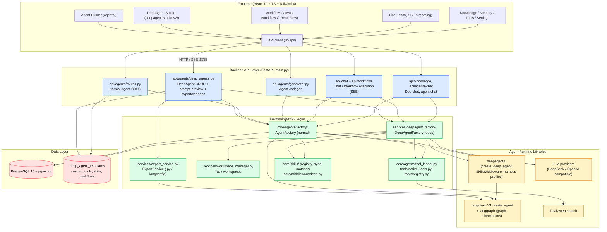
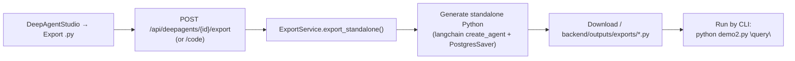

# LangConfig System Architecture

> Visual overview of the LangConfig platform (Agent IDE). Built with Mermaid — open this
> file in the IDE Markdown preview to render the diagram.

## What is `backend/api/agents/deep_agents.py`?

It is the **REST API router (controller) for DeepAgents** — registered in `main.py` as the
"DeepAgents configuration and export" router. It does **not** build agents and does **not**
export by itself; it:

| Endpoint group | Responsibility | Delegates to |
|---|---|---|
| `POST/GET /api/deepagents/`, `GET /api/deepagents/{id}`, `GET /templates` | DeepAgent CRUD + built-in templates | `models.deep_agent` (DB) |
| `POST /api/deepagents/prompt-preview` | System-prompt assembly preview | deepagents harness profiles |
| `/export`, `/code` | Export `.py` CLI / langconfig bundles | `services/export_service.py` (`ExportService`) |

The actual builders are `core/agents/factory/` (normal agents) and
`services/deepagent_factory/` (deep agents) — `deep_agents.py` only exposes them over HTTP.

## Runtime build path

```mermaid
flowchart LR
    P1["API call:<br/>POST /api/deepagents/{id}/chat"] --> P2["DeepAgentFactory.create_deep_agent()"]
    P2 --> P3["Load tools (native/custom/middleware)"]
    P3 --> P4["Stage skills into workspace<br/>+ FilesystemBackend"]
    P4 --> P5["deepagents.create_deep_agent<br/>(skills, middleware, subagents)"]
    P5 --> P6["LangGraph CompiledStateGraph"]
    P6 --> P7["SSE stream: tool calls + final answer"]
    P7 --> P8["Checkpointed in PostgreSQL"]
```

*Normal agents follow the same path via `AgentFactory.create_agent()` → langchain V1 `create_agent`.*

## Export path

