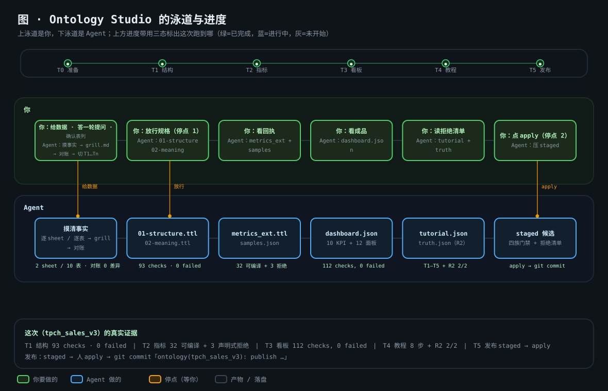
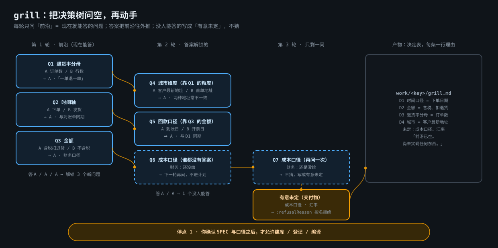
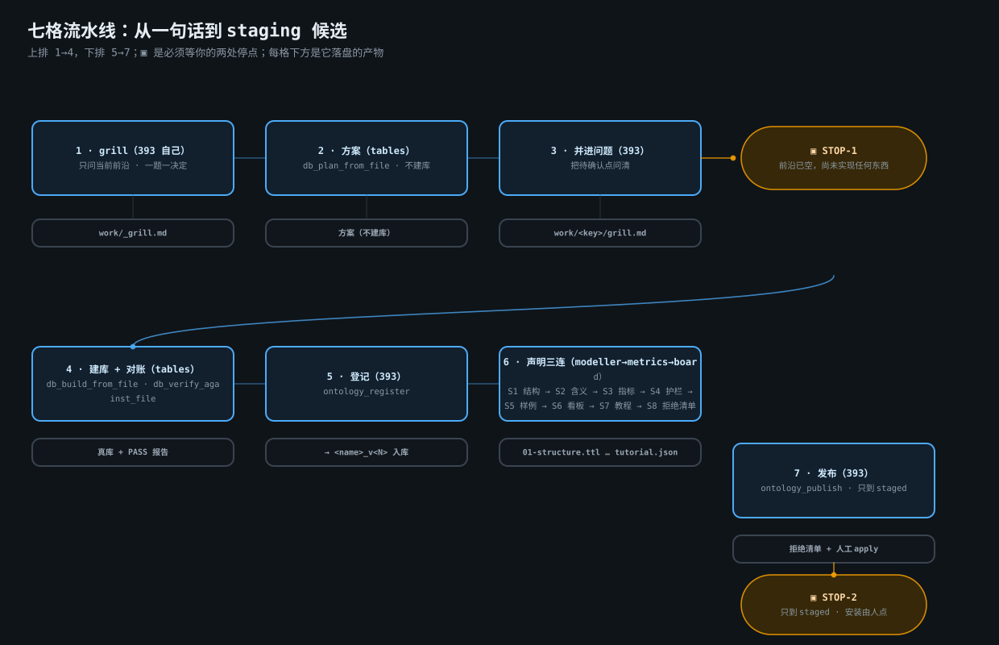
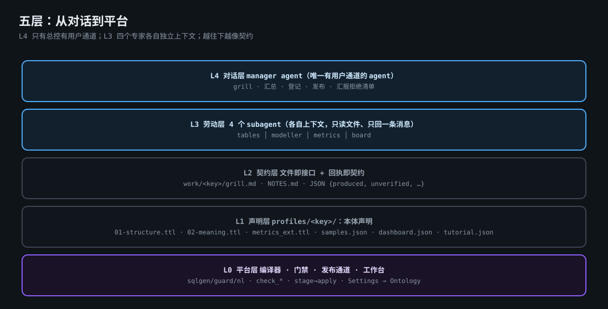
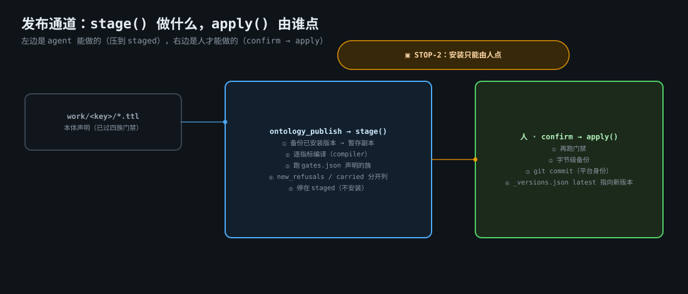
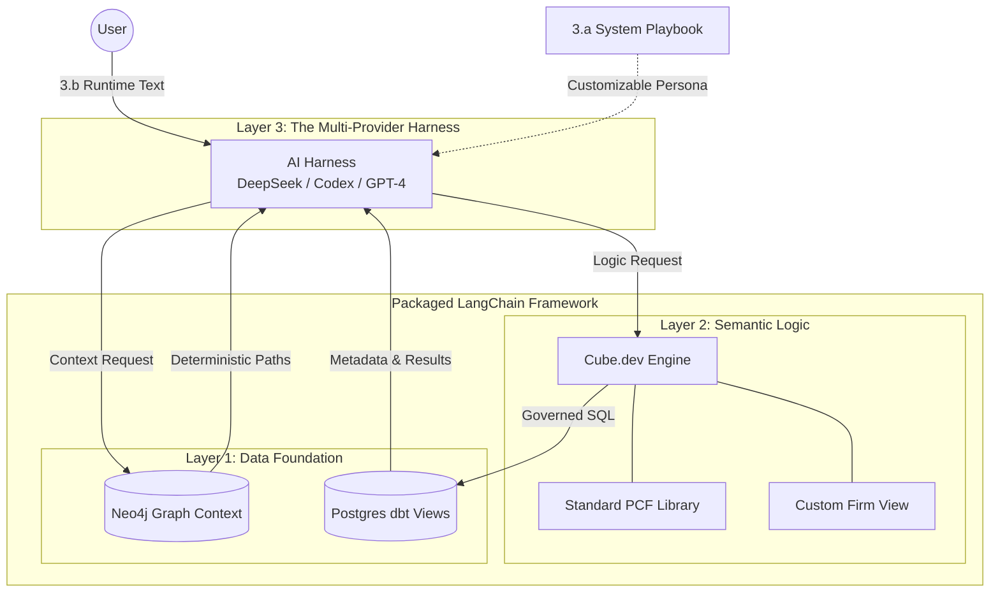
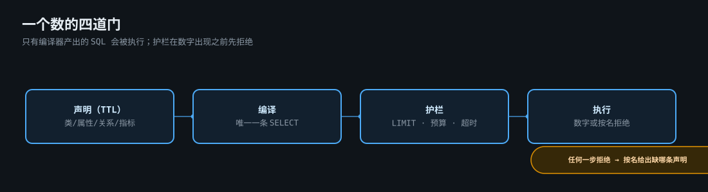
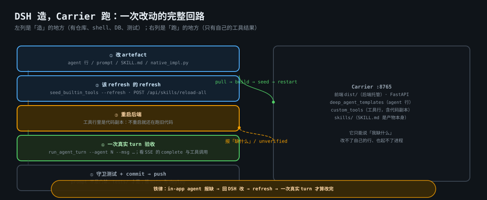

# 数据 Agent · 总文档（合并版）

> **版本** v1.1 · **日期** 2026-11-26 · **对应平台** main（deepagents 0.7.1）·
> 本文与 `data-agent.docx` / `data-agent.html` / `data-agent.pdf` **同源同版本**（三份都由本文生成）。

> **这一份是唯一权威**：以前分开的九份文档（`ontology-process` / `ontology-pipeline` /
> `ontology_architecture` / `ontology-agents` / `ontology-agent-boundaries` / `ontology-dsl` /
> `ontology-metrics-shapes` / `platform-facts` / `data-agent-runbook`）**已删除**，内容全部并入本文；
> 需要旧版请查 git 历史（见文末「附：旧文档去哪了」）。

**输入是数据（Excel/CSV 或生产库），输出是能看、能查、能复核的看板与教程。**
**结构（十三部分 + 附录）**

| # | 内容 | 解决什么问题 |
|---|---|---|
| 第零 | **概念（Concept）：什么才算数据 Agent**（明确目标 × 本体+LLM） | 先把"它是什么"立住 |
| 第一 | 概览 Overview（十段） | 五分钟建立全貌 |
| 第二 | 操作 Operation（十步 + 票梯 T0…T5） | 自己动手用一遍 |
| 第三 | 过程与票制 Process | 一票一文件、逐票验收 |
| 第四 | 架构 Architecture（含 4.1 本体：用 Palantir 的语言） | 为什么数字可信 |
| 第五 | Agent 与专家 Agents | 谁在干活、边界在哪 |
| 第六 | 声明 DSL 与平台事实 Declarations | 写声明要读的那一页 |
| 第七 | 数据边界 Boundary | 谁能碰数据库 |
| 第八 | **安装 Installation（前置条件）** | 装起来、验证装好了 |
| 第九 | **示例 Example（TPC-H 四层声明 + vs text2sql）** | 本体长什么样 |
| 第十 | **定制 Customization（八场景）** | 改成自己的口径 |
| 第十一 | 详解 Details（文件契约 · 四道门 · 轴 · 拒绝 · 版本 · 工具 · 验收 · 排错 · 术语） | 查细节 |
| 第十二 | **用 DSH 安装与操作 Carrier**（造 agent / deep agent / skill / tool，跑一轮，更新远端） | 亲手改它 |
| 附录 | A 一次实测 · B 英文原文 · C 旧文档去向 | 证据与出处 |



**读法**：横轴就是**票**——`T0 准备`（数据 + grill + 对账 + 切票）之后是 `T1 结构 → T2 指标 → T3 看板 →
T4 教程 → T5 发布`，每票一格里写着「你做什么 / Agent 做什么」，票下面一行是**这一票凭什么算完成**。
三条橙色"交接"线=必须等你的三个时刻（给数据 → 放行规格 → 点 apply），其余都是 Agent 自己走完。

> 图由 `scripts/build_data_agent_charts.py` 生成（手排坐标，SVG + PNG）。
> 连线是贝塞尔曲线 + 圆点箭头 + 低不透明度，停点用圆角胶囊——不用硬折线与尖三角。

---

# 第零部分 · 概念（Concept）：什么才算「数据 Agent」

这不是一句口号，是两个**可检验的条件**。两条都成立，才叫数据 Agent；缺一条，就是别的东西
（第 0.3 节有一张 2×2 的对照表说清"缺了会变成什么"）。

## 0.1 条件一：有明确的目标 —— **看得见，并且能找洞察**

| 这一条要求 | 具体的检验方式 | 在本系统里长什么样 |
|---|---|---|
| **看得见**：给定数据，能稳定地看到"是什么、多少" | 同一个问题问两次，答案是同一个数；数字能追到一条声明 | 看板（KPI + 面板）与 `ontology_inspect` 的编译结果 |
| **能找洞察**：能做比较、趋势、构成、异常，而不只是查一个数 | 每条洞察都能写成一条可复核的查询（分组 / 排序 / 比率 / 时间轴） | `netRevenueByRegion`、`netRevenueByMonth`、`returnRate`、`supplierRevenueByRegion` |
| **目标是为这批数据而定的**，不是泛泛地"帮我看看" | 目标能在 `grill.md` 里被写成决定，并在 `SPEC.md` 里落成 AC | 「按城市看每月销售与回款」→ AC-1…AC-n |
| **洞察不许是猜的** | 结论必须能落到声明；落不到就**按名拒绝**，而不是给一个像样的数 | 「毛利率」→ 拒绝并说明缺「成本口径」 |

**反过来说**：拿到数据先问"你想看什么、要看出来什么"，是这套系统的第一步（`grill`）。
目标不清时它不会硬编一块板，而是先问；问不出来就记成"有意未定"，后面按名拒绝。

> 「有明确的目标」不是一句愿望，它是**一次 grill 的产物**：追问到没有默契假设为止，把决定连同
> 一句理由落成 `grill.md`。这一条最容易被人跳过 —— 所以 §2 第 1 步单独写了一整节（含"为什么
> 定义错了不会报错"）。

## 0.2 条件二：**本体与 LLM 一起用**，缺一不可

| | 只有 LLM（text2sql 聊天） | 只有本体（人写 SQL / 查表） | **本体 + LLM（本系统）** |
|---|---|---|---|
| 谁能问 | 谁都能问 | 只有会写 SQL 的人 | 谁都能问，问的是**声明的名字** |
| 数从哪来 | 模型每次现编 SQL | 人每次现写 SQL | 编译器把**声明**编成唯一一条 SQL |
| 同一个问题问两次 | 可能两个答案 | 看人 | 同一个数 |
| 答不了的时候 | 硬给一个像样的数 | 报错或空 | **按名拒绝**：缺哪条声明说得清 |
| 口径是谁定的 | 没人定，模型猜 | 写 SQL 的人心里有 | `grill.md` 记「谁定的 + 一行理由」 |

**分工要具体**（不是"AI 辅助"这种空话）：

- **本体负责"闸门与事实"**：对象/属性/关联、指标口径、粒度、轴（发运月 vs 订单月）、护栏（LIMIT/预算/超时）、
  以及**拒绝**——被拒的问题带名字和缺失项。
- **LLM 负责"理解与表达"**：把你的话映射到菜单里的声明（`:askedAs` 别名）、把决定写成 `grill.md`/`SPEC.md`、
  把回执与拒绝翻译成人话；**它不负责产生数字**。
- **两者交汇在编译**：LLM 只负责"选哪条声明"，本体负责"这条声明算出什么"。
  所以数字永远可复核，而问句可以很自然。

### 0.2.1 一次交汇长什么样（TPC-H 实例）

```
你问：  按订单月看净收入，哪几个月掉得厉害？

① LLM 解析：命中 :askedAs「订单月净收入」→ 选中声明 :netRevenueByMonth
② 本体编译：SELECT date_trunc('month', orders.o_orderdate), Σ l_extendedprice*(1-l_discount) …
           → 80 行（1992-01…1998-08），Σ = netRevenue
③ 洞察：  LLM 只在"已算出的行"上做比较（哪几个月低于中位数），不重新造数
④ 追问：  「那毛利率呢？」→ 本体按名拒绝：缺「成本口径」声明 → LLM 解释缺什么
```

**四个动作里，② 和 ④ 由本体决定，① 和 ③ 由 LLM 负责。** 这就是"一起用"的意思：
**理解与表达归 LLM，事实与闸门归本体。**

## 0.3 缺一条会变成什么（2×2）

| | **有明确目标** | **目标不清** |
|---|---|---|
| **本体 + LLM** | **数据 Agent**（本系统）：目标落成 AC，数可复核，答不了按名拒绝 | 先 `grill` 问清目标；问不清就"有意未定"，不许硬编一块板 |
| **只有 LLM** | text2sql 报表：能出数，但同一个问题可能两个答案，口径无人定 | 聊天机器人：能说会道，不承担责任 |
| **只有本体** | 人肉 BI：口径清楚，但每次都要人写 SQL，普通人用不上 | 一堆没人查的表和文档 |

**所以"数据 Agent"= 明确目标 × （本体 + LLM）**。这两条是准入条件，也是评审判据：
一个自称数据 Agent 的东西，若给不出"数能追到哪条声明"，或答不出的问题没有名字，它就不满足前提。


<!--TOC-->

## 目录

> 点标题直接跳转（markdown 预览器、GitHub、Word 里都可点）。

- **[数据 Agent · 总文档（合并版）](#数据-agent-总文档合并版)**
- **[第零部分 · 概念（Concept）：什么才算「数据 Agent」](#第零部分-概念concept什么才算数据-agent)**
    - [0.1 条件一：有明确的目标 —— **看得见，并且能找洞察**](#01-条件一有明确的目标-看得见并且能找洞察)
    - [0.2 条件二：**本体与 LLM 一起用**，缺一不可](#02-条件二本体与-llm-一起用缺一不可)
    - [0.3 缺一条会变成什么（2×2）](#03-缺一条会变成什么22)
- **[第一部分 · 概览（Overview · 十段，每段一个要点）](#第一部分-概览overview-十段每段一个要点)**
- **[第二部分 · 操作（Operation · 用户手册）](#第二部分-操作operation-用户手册)**
    - [操作前：准备好三样](#操作前准备好三样)
    - [第 0 步 · 开口](#第-0-步-开口)
    - [第 1 步 · 先被 grill：把定义问空，再动手（**最重要，也最常被跳过**）](#第-1-步-先被-grill把定义问空再动手最重要也最常被跳过)
    - [第 2 步 · （Excel 路）确认建库方案](#第-2-步-excel-路确认建库方案)
    - [第 3 步 · 建库与逐值对账](#第-3-步-建库与逐值对账)
    - [第 4 步 · 确认主外键](#第-4-步-确认主外键)
    - [第 5 步 · 看规格与工单（停点 1）](#第-5-步-看规格与工单停点-1)
    - [第 6 步 · 逐票干活与验收（中途看结果）](#第-6-步-逐票干活与验收中途看结果)
    - [第 7 步 · 看成品](#第-7-步-看成品)
    - [第 8 步 · 发布（停点 2）](#第-8-步-发布停点-2)
    - [第 9 步 · 之后](#第-9-步-之后)
- **[第三部分 · 过程与票制（Process · 工作单元是「票」）](#第三部分-过程与票制process-工作单元是票)**
- **[第四部分 · 架构（Architecture · 流水线与本体）](#第四部分-架构architecture-流水线与本体)**
    - [4.1 本体（Ontology）——用 Palantir 的语言讲一遍](#41-本体ontology用-palantir-的语言讲一遍)
    - [4.2 流水线（Excel→库→本体→看板）](#42-流水线excel库本体看板)
    - [4.3 三层框架与模块化原则（英文原文，设计稿）](#43-三层框架与模块化原则英文原文设计稿)
    - [Architecture Blueprint: The Symbolic Core Framework](#architecture-blueprint-the-symbolic-core-framework)
- **[第五部分 · Agent 与专家（Agents）](#第五部分-agent-与专家agents)**
- **[第六部分 · 声明 DSL 与平台事实（Declarations）](#第六部分-声明-dsl-与平台事实declarations)**
    - [6.1 最小声明形状（四个可编译样例）](#61-最小声明形状四个可编译样例)
    - [6.2 指标与样例的字段](#62-指标与样例的字段)
    - [6.3 平台事实（路径基准 / profile 键 / 连接 / 生成物）](#63-平台事实路径基准-profile-键-连接-生成物)
- **[第七部分 · 数据边界（Boundary）](#第七部分-数据边界boundary)**
- **[第八部分 · 安装（Installation · 前置条件）](#第八部分-安装installation-前置条件)**
    - [8.1 最小可用清单](#81-最小可用清单)
    - [8.2 装起来（每步带验证）](#82-装起来每步带验证)
    - [8.3 装完验证](#83-装完验证)
    - [8.4 装完第一次对话长什么样](#84-装完第一次对话长什么样)
- **[第九部分 · 示例（Example · TPC-H 的四层声明）](#第九部分-示例example-tpc-h-的四层声明)**
    - [9.1 与 text2sql 的区别：同一批问题，两种行为](#91-与-text2sql-的区别同一批问题两种行为)
- **[第十部分 · 定制（Customization · 八个场景）](#第十部分-定制customization-八个场景)**
    - [10.1 改口径：净收入含税 → 不含税](#101-改口径净收入含税-不含税)
    - [10.2 加一个分组指标（带时间轴）](#102-加一个分组指标带时间轴)
    - [10.3 加维度：先把"哪一侧"写进名字](#103-加维度先把哪一侧写进名字)
    - [10.4 加一条声明式拒绝](#104-加一条声明式拒绝)
    - [10.5 改看板：加面板 / 把轴写进 note](#105-改看板加面板-把轴写进-note)
    - [10.6 改护栏：大表 / 窗口 / 页上限](#106-改护栏大表-窗口-页上限)
    - [10.7 改 NL 行为（拒绝优先 / 别名）](#107-改-nl-行为拒绝优先-别名)
    - [10.8 改平台层（prompt / 技能 / 工具 / 门禁）——**这不是配置**](#108-改平台层prompt-技能-工具-门禁这不是配置)
- **[第十一部分 · 详解（Details · 为什么数字可信）](#第十一部分-详解details-为什么数字可信)**
    - [8.1 逻辑与架构](#81-逻辑与架构)
    - [8.2 工具地图](#82-工具地图)
    - [8.3 验收：什么算"绿"](#83-验收什么算绿)
    - [8.4 一次实测（示例：TPC-H SF0.1，v3）](#84-一次实测示例tpc-h-sf01v3)
    - [8.5 排错手册（都踩过）](#85-排错手册都踩过)
    - [8.6 术语](#86-术语)
- **[第十二部分 · 用 DSH 安装与操作 Carrier（Install & Operate）](#第十二部分-用-dsh-安装与操作-carrierinstall-operate)**
    - [12.1 两台东西，各自答什么问题](#121-两台东西各自答什么问题)
    - [12.2 装 DSH](#122-装-dsh)
    - [12.3 装 Carrier](#123-装-carrier)
    - [12.4 五类 artefact：改哪里，怎么变成可见](#124-五类-artefact改哪里怎么变成可见)
    - [12.5 造一个 agent](#125-造一个-agent)
    - [12.6 造一个 deep agent（父 + 专家团）](#126-造一个-deep-agent父-专家团)
    - [12.7 造一个 skill](#127-造一个-skill)
    - [12.8 造一个 tool：两条路，别混](#128-造一个-tool两条路别混)
    - [12.9 跑一个 agent，并判断它真的成了](#129-跑一个-agent并判断它真的成了)
    - [12.10 用 DSH 更新一台远端 Carrier](#1210-用-dsh-更新一台远端-carrier)
    - [12.11 踩过的坑（都有实测，写下来防第二次）](#1211-踩过的坑都有实测写下来防第二次)
    - [12.12 一张清单（照着做，不要凭记忆）](#1212-一张清单照着做不要凭记忆)
- **[附：旧文档去哪了](#附旧文档去哪了)**
- **[附录 · 图与源文件](#附录-图与源文件)**
- **[附：版本与修订](#附版本与修订)**

<!--/TOC-->
---

# 第一部分 · 概览（Overview · 十段，每段一个要点）

### 1 · 一句话
**你给数据，它给一块"每个数都能追到声明"的看板；装不装由你点。**

### 2 · 两种数据来源，只有前三步不同
| | 路 A：上传 Excel / CSV | 路 B：生产库 |
|---|---|---|
| ① | 读文件：**每个 sheet 都读**，报行列数/表头/类型/空值 | 摸库：这台服务器上有哪些库 |
| ② | 出只读方案 → **等人点头** | 看表：列、主键、索引、行数 |
| ③ | 建库（需确认）→ **逐值对账 0 差异** | 主外键三档线索 |
| 之后 | 登记 → 结构 → 指标 → 看板+教程 → 发布（完全相同） | 同左 |

### 3 · 你只做三件事
1. **给数据**（文件，或库名 + 服务器 + 角色）；
2. **答一轮提问**（每题带推荐答案，回「是」即可）—— 这一步叫 grill，见 §2 第 1 步；
3. **发布时点 apply**（它只能压到 staged）。

### 4 · 内部八步（谁做、产什么）
| 步 | 谁 | 产什么 |
|---|---|---|
| ① 摸清数据 | `tables` | 事实清单（sheet/表/列/类型/空值） |
| ② 写成决定 | 总控 | `grill.md`（决定+理由+有意未定） |
| ③④ 建库/摸库 + 对账 | `tables` | 真库 + 对账回执（0 差异）+ PK/FK |
| ⑤ 规格 + 切票 | 总控 | `SPEC.md`(AC-n) + `tickets/` |
| ⑥ 登记 + 声明三连 | 总控 + `modeller`/`metrics`/`board` | `<name>_v<N>` + 01/02 TTL、指标、看板、教程 |
| ⑦ 逐票验收 | `ontology_verify_stage`（只读工具；派 `verifier` 的设计见 §四） | PASS/FAIL + 失败项名 |
| ⑧ 压 staged | 总控 | staged 候选 + 编译/门禁/拒绝清单 |
| ⑨ 安装 | **你** | apply → git commit + `latest` 指向新版本 |

### 5 · 两处必须等你
- **停点 1**：规格 + 工单——你不放行，它不开工。
- **停点 2**：装不装——它永远只能 staged，apply 只有人能做。

### 6 · 数字从哪来（四道门）
`声明（TTL）→ 编译（唯一一条 SELECT）→ 护栏（LIMIT/预算/超时/按名拒绝）→ 执行`
**没有工具接受"自由 SQL"作为发布口径。**

### 7 · 三种"不回答"，都是交付物
| 形式 | 长什么样 | 给谁 |
|---|---|---|
| 声明式拒绝 | 指标上写 `:refusalReason "缺什么"` | 两条 NL 路径都按名拒绝 |
| 样例式拒绝 | `samples.json` 的 `refused_by_name` | 门禁跑 |
| 教程拒绝页 | `tutorial.json` 的 `kind:"refusals"` | 人读 |

### 8 · 验收：什么叫"绿"
四族门禁 + 逐票 `ontology_verify_stage`；**NOT RUN ≠ 通过**；未验项按名列进回执的 `unverified`。

### 9 · 一次实例（示例，数字属这一次）
TPC-H SF0.1：结构 8 类/61 列/9 关系（93 checks 绿）· 指标 35 条（33 可编译 + 2 声明式拒绝）· 看板 10 KPI + 12 面板（112 checks 0 failed）· 教程 8 步含 5 条拒绝 · R2 真跑 2/2。

### 10 · 现在做不到的（明说）
- 同一物理表要 join 两次（供应商↔客户**配对流向**）→ 按名拒绝；
- 客户侧地区分组（两条路径都可达、选路不唯一）→ 按名拒绝；
- 面板的**像素**没有测试；验收工具没有查库门，行数由总控或人复核。

---

# 第二部分 · 操作（Operation · 用户手册）

> 这一部分只讲**你**。每步四行：**你做 / 它做 / 你会看到 / 卡在哪。**

### 票梯：Agent 的每一步都是一张票

| 票 | Agent 做什么（负责人） | 交付物 | 验收（谁签） | 这次的真实证据 |
|---|---|---|---|---|
| **T0 准备** | 摸清事实 → grill（≤9 问）→ 建库/摸库 + 逐值对账 → 写 SPEC → 切出 T1…Tn（`tables` + 总控） | `grill.md`、`SPEC.md`、`tickets/TICKET-NN.md`、真库 | 你放行（**停点 1**） | 2 sheet / 10 表，对账 0 差异 |
| **T1 结构** | 写 `01-structure.ttl`（类→表、属性→列、关系→join）+ `02-meaning.ttl`（含义、定义类）（`modeller`） | 两个 TTL（+ 可选 `03-concept-definitions.ttl`） | `ontology_verify_stage(stage="structure")` | `93 checks · 0 failed` |
| **T2 指标** | 写 `metrics_ext.ttl`（指标/护栏/声明式拒绝）+ `samples.json`（含按名拒绝样例）（`metrics`） | 指标、样例、guard 配置 | `stage="metrics"` → `check_samples` + generic | 33 可编译 + 2 条声明式拒绝 |
| **T3 看板** | 写 `dashboard.json`（KPI + 面板，轴写进 note）（`board`） | 10 KPI + 12 面板 | `stage="board"` → `check_dashboard` | `112 checks, 0 failed` |
| **T4 教程** | 写 `tutorial.json`（8 步含 `refusals`）+ `truth.json`（定义类手写谓词）（`board`） | 教程 + truth | generic 的 T1–T5 + R2 | 8 步含 5 条拒绝 · R2 2/2 |
| **T5 发布** | `ontology_publish` 压到 **staged**，跑四族门禁，列出编译/拒绝清单（总控） | staged 候选 + 拒绝清单 | `stage="publish"` + **你点 apply**（**停点 2**） | apply → git commit |

> **一票一个文件、一票一个专家、一票一次验收**：验收写不出来就别开工；`FAIL` 把失败项名字带回重派；
> `NOT-RUNNABLE` 说明票写坏了，回切票。**没有回执 = 没做完。**


## 操作前：准备好三样

| 要准备 | 例子 | 为什么 |
|---|---|---|
| 数据在哪 | 一个 Excel/CSV；或库名 + 服务器 + 角色 | 它不猜数据源 |
| 想看什么 | 「按城市看每月销售与回款」 | 决定指标与看板 |
| 口径底线 | 「金额含税」「退货只算 R」 | 它会写成决定并留理由 |

> 生产库不在本平台服务器上时，请给：地址、端口、角色、库名。密码走环境变量（`TPCH_DB_*` 这类），**不进对话**。

## 第 0 步 · 开口
- **你做**：一句话说清数据在哪、想看什么。
- **它做**：读数据（文件逐 sheet / 库逐表），报一张**事实清单**。
- **你会看到**：行列数、表头、类型、空值；非业务表（日志/登记表）被点名。
- **卡在哪**：非业务表要**声明式排除**（`exempt_tables` + 理由）。

## 第 1 步 · 先被 grill：把定义问空，再动手（**最重要，也最常被跳过**）

> 这一节比别的都长，因为它值得。跳过它省下的是一轮问答，代价是整块看板重算 —— 而重算这档账
> **不会报错**（见 1.3 的三次真实故障：编译全绿、门禁全绿，数就是错的）。

### 1.1 它是什么：一次有终点的盘问

grill = 动手之前，把你那句「我想按城市看每月销售」，问到**没有一件事是被默默假设的**。
它产出**已定的决定**，不是计划、不是表、不是代码。技能结尾那句话是硬规定：

> 「**前沿已空。尚未实现任何东西。** 确认后我再继续。」
> —— `backend/skills/builtin/grilling/SKILL.md`（`grill-me` 只是指向它的指针）

三个要素同时成立，才算 grill 过：

| 要素 | 意思 | 反例（很多人以为这也算 grill） |
|---|---|---|
| **决策树** | 要定的一切是一棵树：每个决定分叉出依赖它的决定 | 平铺 20 个问题 —— 那是问卷，不是访谈 |
| **前沿（frontier）** | 前置条件已钉死、**现在就能答**的那一小批问题 | 问一个答案依赖另一道未答题的问题（把轮次压成一张表） |
| **一轮问完就停** | 答案会重塑这棵树，重新算前沿，再问下一轮 | 连问三轮不等人 —— 等于替你把答案也编了 |



图里读三件事：① 第 2 轮的问题在第 1 轮答完之前**根本不该问**；② 每答一轮，前沿往外推一格；
③ **没人能答的那一问不进计划，进 `grill.md` 的「有意未定」**。

### 1.2 一轮长什么样（照这个形状回复就行）

```
❓ Q1 —— 退货率的分母：用订单数，还是订单行数？
   A) 订单数（一单退一次，算一次）    B) 订单行数（按行退）
➡️ A。你的原话是「一单退一单」；且退货行只占全部行的很小一部分，按行算会把小单放大。

❓ Q2 —— 时间轴：按下单日期，还是发货日期？
   A) 下单（o_orderdate）    B) 发货（l_shipdate）
➡️ A。与财务对账单同期；选 B 会让最后一个月少一截（在途订单还没发）。
```

**你的回复可以极短：「1 是，2 是，Q2 改成 B」。** 这不是偷懒，是格式设计出来的结果：每题的措辞都让
「是」= 接受推荐答案，所以同意的部分只要一个字。

三条铁律（`grilling` 的原文要求，不是本平台发明的）：

1. **一题只装一个决定。** 需要说"以及"的地方，是两个问题。
2. **每题必须带推荐答案。** 没有推荐的问题，是把我的活推给你。
3. **能自己查的绝不问你。** schema、空值率、文件在不在、上次构建定了什么 —— 它自己查
   （要长查就派 `tables` 去查，不占你的时间）；一轮**不超过约 9 问**，多了就拆轮。

### 1.3 为什么重要：**定义错了不会报错**

错有三种，代价完全不是一个量级：

| 错在哪 | 谁会发现 | 代价 | 本系统怎么拦 |
|---|---|---|---|
| 错在代码 / SQL | 编译器、门禁、测试 | 分钟级，而且**会报错** | 四道门（第十一部分） |
| 错在「没人同意的定义」 | **只有人** | 整块看板重算 | **grill** |
| 错在细节，但门禁全绿 | **没有人** | 汇报里错一个季度 | grill + 声明式拒绝 |

第二、三行是同一件事的两面：**门禁验的是「声明之间一致」，验不了「声明本身对不对」。**
`:expr` 里写 `grossRevenue` 还是 `netRevenue`，编译都过、门禁都绿、数字都算得出来 —— 唯一能拦住它的
地方，是 grill 里那句「毛利率你说的是含税还是不含税？」

三次真实故障，全都落在"grill 该问清、编译器拦不住"的那一格（细节见第十一部分）：

| 故障 | 编译 / 门禁 | 真正的问题 |
|---|---|---|
| 「毛利率」被 NL 解析成 `grossRevenue` | 全绿 | 答的不是你问的那个问题 |
| 月度指标挂在 `l_shipdate`（84 行）而不是订单月（80 行） | 全绿 | 图能画，但最后一个月少一截 |
| 区域指标实际走的是供应商路径（`supplierRevenueBy*`） | 全绿 | 名字对、数对、口径不是你想的那个 |

**共同点：没有一个会报错。** 会报错的数会停下来；不会报错的数会进汇报 —— 所以"先跑起来再改"
在这套系统里是**最贵的一句话**：grill 里改一个决定是一句话；落成 `:sql` 之后改，是改声明 +
重编译 + 重跑门禁 + 重新发布。

### 1.4 为什么大多数人会跳过它（以及系统怎么不让你跳）

| 跳过的人这么想 | 实际发生什么 | 系统的对策 |
|---|---|---|
| 「我知道我想要什么」 | 你想要的是**结论**，不是**口径**；结论一句话，口径要三行 | 每题带推荐：你的成本是回一句「1 是」 |
| 「先跑起来再改」 | 落成 `:sql` 之后，"改"是重编译 + 重跑门禁 + 重发版 | **停点 1** 卡在建库之前：没有你的「确认」，不建库、不登记 |
| 「问那么多很烦」 | 只问它查不到的事，一轮 ≤ 9 问，答完就停 | 事实它自己查（`db_plan_from_file` 不建库，很便宜） |
| 「先让 AI 猜，猜错我再纠正」 | 猜错的数**看起来是对的**，你不会去纠正 | 猜不了的记「有意未定」→ 问到时**按名拒绝**（§10.4） |
| 「这些我都熟，不用写下来」 | 下一个专家看不到这次对话（上下文彼此隔离） | 决定**必须落盘** `grill.md`，否则等于没定（§4.2「交接契约」） |

### 1.5 产物：`work/<key>/grill.md`

一张决定表，每行带一句**理由** —— 理由是给半年后的你和下一个专家看的（决定本身随后会被写成声明）：

```markdown
# grill · <key>

| # | 决定 | 答案 | 理由（写"为什么"，不写"是什么"） |
|---|---|---|---|
| D1 | 时间口径 | 按下单日期（`o_orderdate`） | 与财务对账单同期 |
| D2 | 金额 | 含税、扣退货 | 财务口径；税率不进本体 |
| D3 | 退货率分母 | 订单数 | 业务原话「一单退一单」 |
| D4 | 城市维度 | 客户最近一次下单的城市 | 发货城市与客户城市经常不一致，取哪个要写明 |

## 有意未定（**不是欠债，是交付物**）

| 未定 | 谁能定 | 现在怎么处理 |
|---|---|---|
| 成本口径 | 财务 | 毛利率按名拒绝（`:refusalReason`），不猜 |
| 汇率 | 财务 | 只做单币种；多币种不出数 |
```

**「有意未定」是这份文件里最值钱的一段**：它把"不知道"变成一个可执行的声明 —— 问到时按名拒绝，
而不是编一个数。没有它，未知会以「0」的形状出现在看板上，而且没人会去查。

### 1.6 这一步的验收，和一句诚实说明

**你要做的三件事**（做完才进第 2 步）：

1. 回答一轮问题（回「是 / 改哪条」，一次不超过约 9 问）；
2. 扫一眼 `SPEC.md` 的验收标准（AC-1…AC-n）—— 它写的必须是你想要的东西；
3. 说「就按这个做」—— 这是**停点 1**，之后才建库、才登记。

这三件事对应三个文件，别混为一谈（常见误解是"grill 过就等于验收标准有了"）：

| 文件 | 只回答一个问题 | 谁读它 |
|---|---|---|
| `grill.md` | **为什么这么定**（决定 + 一行理由 + 有意未定） | 你、下一票的专家 |
| `SPEC.md` | **做到什么算完**（AC-1…AC-n，每行可检查） | 停点 1 的你、验收那一步 |
| `tickets/TICKET-NN.md` | **谁、怎么切、被谁阻塞**（一票一条能单独演示的窄路径） | 执行专家 |

⚠️ **诚实说明：`grill.md` 目前没有门禁。** 系统靠"总控先写 grill 再派活"这个约定，**没有**代码检查
"没 grill 过就不许 `ontology_register` / `ontology_publish`"（已登记在第三部分「九、还没做的事」）。
所以这一步真正守不住的时候，你能做的检查只有一句话：**「`grill.md` 在哪？给我看。」**
—— 这也是本节写得这么长的原因：它是全流程里唯一**没有代码兜底**的关键步骤。

> 相关：为什么 grill 只能由总控做、不能派给 subagent —— subagent 收不到你的回答（§3.3）。

## 第 2 步 · （Excel 路）确认建库方案
- **你做**：确认表/列/类型/主键，要不要拆表。
- **它做**：出**只读方案**，等你点头。
- **你会看到**：表名、列名、类型、主键候选、外键候选。
- **卡在哪**：列名保持原文；文件名里的业务含义不猜。

## 第 3 步 · 建库与逐值对账
- **你做**：放行「建吧」。
- **它做**：建表 → **逐值对账**（行数 + 每列合计，0 差异）→ 主外键候选（命名/同名/值集三档）。
- **你会看到**：对账回执。**对账不过，后面不许走。**
- **卡在哪**：没有主键的表被点名（粒度未定 ⇒ 指标算不出来）。

## 第 4 步 · 确认主外键
- **你做**：确认哪两张表怎么连。
- **它做**：只把**已声明**的边交给编译器。
- **你会看到**：关系清单（父表 → 子表，按哪列连）。
- **卡在哪**：中文列名常不同名，靠"取值集合相同"这条线索；三档分开报。

## 第 5 步 · 看规格与工单（停点 1）
- **你做**：看 `SPEC.md`（AC-1…AC-n）与 `tickets/TICKET-NN.md`，说「就按这个做」。
- **它做**：切纵向切片（一票一条能单独演示的窄路径）。
- **你会看到**：几票、每票交付什么、被谁阻塞。
- **卡在哪**：写不出可检查验收行的票，它不开工。

## 第 6 步 · 逐票干活与验收（中途看结果）
- **它做**：一次一票一个专家 → 专家回 JSON 回执 → **换上下文**做验收（设计上是只读 `verifier` 专家；现状见 §四 ⚠）。
- **你会看到**：每票结论行（门禁数字 + PASS/FAIL）+ `unverified`。
- **卡在哪**：FAIL 带回失败项名重派；NOT-RUNNABLE 说明票写坏了。

## 第 7 步 · 看成品
- **你会看到**：KPI + 面板 + 一页教程（约 8 步，含"这块板答不了什么"）。
- **它做**：每个面板写清口径；轴的差别写进 note。
- **卡在哪**：拒绝清单是交付物，每条写清缺哪条声明。

## 第 8 步 · 发布（停点 2）
- **它做**：`ontology_publish` 压 staged，重跑四族门禁，报 `compile/gates/new_refusals/carried`。
- **你做**：Settings → Ontology → Pending publishes → **apply**。
- **你会看到**：apply 后一条 git commit，`latest` 指向新版本。
- **卡在哪**：apply 后再改 = **新版本（v2）**，不覆盖 v1。

## 第 9 步 · 之后
口径变了 / 数据更新了 → 重开一票，走同样票制；旧版本留档，号码永不复用。

---

---

# 第三部分 · 过程与票制（Process · 工作单元是「票」）

> 这份是 **agent 393（Ontology Builder）的流程说明**，写法对齐 `docs/talent/PROCESS.md`：
> 一句话、七格明细、谁负责什么、真实数字、还没做的事。
>
> 与其它文档的分工：
> - 第五部分 = **结构**（一个 builder 模板 + 每个本体一个实例；命名与版本契约）
> - 第四部分 = **总体设计**（五层、失败模式、验收）
> - **本文件 = 过程**（每回合推进哪一格、谁产什么、停在哪、凭什么算做完）
> 三处冲突时，**过程以本文件第三部分为准**，结构以第五部分为准；
> **"谁可以碰数据库"（为什么 shell 不算）见本文件第七部分。**

---

### 总览图

> **历史版**七格流水线图（`data-agent-pipeline-legacy.dot`）**已删除**：它和上面两张图讲同一件事，
> 但把用户动作、agent 步骤、停点、产物塞进一张图里，插进文档就是一块灰。git 历史里还能找到。


- 图里三列：**左 = 用户动作**（绿）· **中 = 这一格谁做**（橙=393、蓝=tables、紫=声明三连）· **右 = 产物**（绿点线）
- 棕八角 = 两个停点；右下三块蓝框 = **真实跑出来的样例结果**（见第六节）

### 一句话

**七格、两个停点、五类产物。** 393 是这条链上**唯一能跟用户说话**的角色；四个专家只能看到派活的那段提示词、
只能回一条消息。所以：**所有要问人的事，由 393 问完并写进文件**；专家只读文件、只交文件 + JSON 回执。




> **下文的 `393` 是本机 Ontology Builder 的 agent id。** 它随安装而变 —— 例如同一套代码在
> ECS 上那个角色是 `392`。要找人**按名字**找（`Ontology Builder`），不要把 id 写进脚本或文档；
> 本文写 id 只是为了指代方便。

### 零、工作单元是"票"，不是"阶段"

一条用户的话要走完：**grill → 规格 → 工单 → 逐票干活 → 逐票验收**。七格/七阶只是**票的类型**，
票才是被派出去、被验收、被关掉的东西。

| 步 | 谁 | 产物 | 技能 |
|---|---|---|---|
| grill（盘问需求到可执行细节） | 393 | `work/<key>/grill.md`：每个决定 + 一行理由 + 有意未定项 | `grill-me`（→ `grilling`） |
| 写规格 | 393 | `work/<key>/SPEC.md`：问题、决定与决定人、范围、**验收标准 AC-1…AC-n** | `to-spec` |
| 切工单 | 393 | `work/<key>/tickets/TICKET-NN.md`：交付 / 负责人 / 输入 / **验收（带 AC 编号 + verify 调用）** / 阻塞 | `to-tickets` |
| 逐票干活 | 执行专家（tables / modeller / metrics / board） | 该票的产物 + JSON 回执 | —— |
| 逐票验收 | **393 调 `ontology_verify_stage`**（设计上是只读的 `verifier` 专家，**尚未装进 393 的行**，见 §四） | `verdict / checks / failed / unverified` | 工具 `ontology_verify_stage` |

一张票**没写验收行就不许开工**；`verdict=NOT-RUNNABLE` 说明工单没写好，回 `to-tickets` 补。

### 一、七格明细

| # | 谁 | 输入 | 做什么 | 产物 | 验收（`ontology_verify_stage`，机械可执行） | 现在的状态 |
|---|---|---|---|---|---|---|
| **1** | 393（`grilling` 技能） | 用户上传的 Excel + 业务问题 | 只问"当前前沿"能问的；一题只装一个决定；**每题必须带推荐答案**（措辞让「是」= 接受推荐）；能自己查的绝不问 | `work/_grill.md`（登记后改名 `work/<key>/grill.md`） | 收尾必须说「**前沿已空。尚未实现任何东西。**」；每个决定、答案、一行理由、**有意未定项**都要落盘 | ✅ 已跑通（会话 2101/2103） |
| **2** | `tables` | 上传文件 | `db_plan_from_file`：sheet → 表、列 → 类型、行数、样例、**只有人能拍板的问题** | 方案（回执 JSON 的 `produced/facts/needs_human`）+ `work/<key>/PLAN.md` | **不建库**（工具本身 confirm 默认 false） | ✅ 实测：`# 方案（还没有建库）：orders_probe.xlsx → …` |
| **3** | 393 | 第 2 格的方案 | 把 `needs_human` 并进下一轮问题；答案写回 `grill.md` | 更新后的 `grill.md` | **STOP-1**：没有用户「确认」，不许进第 4 格 | ✅ 停点守住（2103 未建库） |
| **4** | `tables` | 已确认的映射 | `db_build_from_file(confirm=true)` → `db_verify_against_file` 逐值对账 → `db_review` 给 PK/FK 候选 | 真库（带建库标记）+ 对账报告 + 约束清单 | **对账必须 PASS**；PK/FK 由人点头后 `db_review(apply=true)` | ✅ 375 同一套工具实测：3 sheet → 3 表，PASS，3 PK + 1 自然键 FK |
| **5** | 393 | 对账 PASS 的库 | `ontology_register(name, datasource, theme, kind)` → 平台分配 **`<name>_v<N>`**（永不复用） | `profiles/<key>/`、`profiles/_versions.json` 的新条目 | 客户给名字、平台给版本号；`latest` 指针只指一个 | ✅ **17 个族**，`latest` 只在已退役的那一族上留空（详见 5.2） |
| **6** | `modeller` → `metrics` → `board` | `grill.md` + 库 + 上一格 `NOTES.md` | S1 结构 / S2 含义 → S3 指标 / S4 护栏 / S5 样例 → S6 看板 / S7 教程 / S8 拒绝清单 | `01-structure.ttl` `02-meaning.ttl` `metrics_ext.ttl` `samples.json` `dashboard.json` `tutorial.json` | 每格自己跑编译与门禁；`metrics` **只追加**，不许改结构；回执缺一项 = 没做完 | ✅ 11 个 profile 有 `dashboard.json`；`store_monthly_v1` 四道门禁 0 失败 |
| **7** | 393 | 全套声明 | `ontology_publish`：**只到 staged**，拒绝清单按名交出来 | staged 版本 + 拒绝清单 | **STOP-2**：`ontology_publish` 从不安装，人在 Settings → Ontology 里 `confirmed=true` 才 apply | ✅ 设计如此；apply 是人工动作 |

### 二、三个不许合并的分工

| 谁 | 能写什么 | 绝不能做什么 |
|---|---|---|
| **393（总控）** | 只写 `work/<key>/grill.md`、`work/<key>/NOTES.md` | 写 `*.ttl` / `dashboard.json` / `samples.json` / `<key>_settings.json`（声明是专家的活）；自己量数 |
| **专家** | 自己那一格的文件 | 向用户提问（看不到用户；要人决定的写 `needs_human`）；跨格作业（一次只派一格） |
| **人** | 停点放行（STOP-1）、发布 apply（STOP-2）、PK/FK 确认 | —— |

**为什么必须分开**：把一份连贯的模型切成两个上下文，最大的风险是**声明漂移**（结构说一种粒度、指标按另一种算）。
`metrics` 只能追加，就是为了让"结构"只有一个作者。

### 三、回执契约（专家 → 总控的唯一通道）

专家的最后一段必须是 ```json 块```，四项：

```json
{"produced":   ["orders_test_xlsx（4 行，对账 PASS）"],
 "facts":      {"rows": 4, "amount_sum": 426.74, "verify": "PASS"},
 "unverified": ["未建外键：客户档案 没有唯一键"],
 "needs_human":["orders.客户 是否建成指向 客户档案.客户 的外键？"]}
```

- **没有回执 = 没做完**：393 要重派一次，并把「上一格没给回执」写进 task 提示词。
- `needs_human` 由 393 去问用户（能并进下一轮就并进）。
- `unverified` **不许**在汇报里说成已验证。
- 393 **不许转述数据**：把路径和决定交过去，让专家自己量——转述一次就多一个出错点。

### 四、每一票都由**另一个专家**验收：回执是声明，不是证据

执行专家交回 JSON 回执之后，验收该由**另一个上下文**做：同一个上下文既干活又签字，
"验证通过"只等于"同一个模型说了两遍"。工单上的验收行会被翻成一次只读工具调用，
回一段 JSON：`verdict`（PASS / FAIL / NOT-RUNNABLE）+ `checks` + `failed` + `unverified`。
工具是**只读**的（`backend/features/ontology/stage_checks.py`）：它不修任何东西，只回答"这一格到底成没成"。

> ⚠ **现状（2026-11-26 查库）**：393 的 `subagents_config` 里只有 `tables` / `modeller` / `metrics` /
> `board` 四个执行专家（外加被禁用的 `general-purpose`）——**第五个只读的 `verifier` 专家还没装进行里**。
> 所以今天的验收是 **393 在同一个上下文里直接调 `ontology_verify_stage`**：机械、只读、可复核，
> 但**没有换上下文**。这条差距记在「九、还没做的事」里；补法是把一个 `verifier` 子智能体
> （工具只给 `ontology_verify_stage` / `read_file` / `ls` / `ontology_inspect`）加进 393 的行。

| 执行专家刚交回 | 验收调用（谁调见上面的 ⚠） | 不过的典型原因 |
|---|---|---|
| `tables` 出方案 | `stage="plan"` · `plan_path=work/<key>/PLAN.md` · `sheets="orders,customers"` | 方案漏了某个 sheet；**或者库里已经有这个库了**（说明它偷偷建了） |
| `tables` 建库 + 对账 | `stage="build"` · `db_name=…` · `expect='{"orders": 4, "customers": 4}'` | 表不存在 / 行数不精确等于文件 |
| `modeller`（S1/S2） | `stage="structure"` · `ontology_key=…` | `01-structure.ttl` / `02-meaning.ttl` 缺失或空；`check_structure` 门禁红 |
| `metrics`（S3–S5） | `stage="metrics"` · `ontology_key=…` | 看板引用的指标**没有声明**；`samples.json` 解析失败；`check_samples` 门禁红 |
| `board`（S6） | `stage="board"` · `ontology_key=…` | 面板 `kind` 不在渲染器域内（会渲成空白却不报错）；`check_dashboard` 门禁红 |
| 发布前 | `stage="publish"` · `ontology_key=…` | profile 不在盘上，或 `_versions.json` 里没有这个版本 |

三条规矩：

1. **PASS 才关票；FAIL 不许往下走**：把 FAIL 的**检查名**原样带回给同一个专家重派，或把需要人决定的部分写进 `needs_human`。
2. **门禁没跑 = 不是绿**：`_run_gate` 把 `notrun` 原样报出来（仓库既有规矩：没跑的检查要说出名字，不许算作通过）。
3. **验收本身也是可测的**：`backend/tests/test_ontology_stage_checks.py`（8 项）钉住了每一条——方案漏 sheet 必须红、
   面板 kind 越域必须红、看板引用了未声明的指标必须红、版本没登记必须红、未知 stage 是调用方错误而不是检查失败。

**实测（真实本体 `store_monthly_v1`）**：

```
structure  PASS  01-structure.ttl 15383B · 02-meaning.ttl 13273B · check_structure pass
metrics    PASS  metrics_ext.ttl 18584B · 8 个看板指标全部已声明 · check_samples pass
board      PASS  kpis=4 panels=4 · kind ∈ {matrix, ranked, series} · check_dashboard pass
build      FAIL  expect {"月度经营": 999} → got 12      ← 故意写错，证明它真的会红
```

### 五、用户只在五个地方出现

393 是链上**唯一**能跟用户说话的角色，所以用户的动作可以完全枚举出来——这也是这条流水线能自动化的原因：

| # | 用户动作 | 触发哪一格 | 393 怎么接 |
|---|---|---|---|
| 1 | **上传 Excel / 说业务问题** | 第 1 格 grill 的输入 | 先 `list_files` 确认文件在工作区，再开始问 |
| 2 | **回答一轮 grill 问题** | 第 1 格 → `grill.md` | 答案立刻落盘；一轮问完就停（不连问） |
| 3 | **「可以，建吧」** | **STOP-1** 放行第 4 格 | 没有这句话，`db_build_from_file` 不许 `confirm=true` |
| 4 | **确认 PK / FK** | 第 4 格尾 | `db_review` 的候选要人点头才 `apply=true` |
| 5 | **Settings → Ontology `apply`** | **STOP-2** | `ontology_publish` 只到 staged；apply 是人在界面上的动作 |

反过来：**专家永远不会出现在这张表里**——它们看不到用户，只能回一条 JSON 回执。这就是"回执契约"存在的原因。

### 六、样例结果（从已发布的本体里取的，不是示意）

| 本体 | 规模 | 建出来的东西 |
|---|---|---|
| **`store_monthly_v1`**（门店月度经营） | 3 个 TTL + `samples.json` + 看板 | **4 KPI**：`revenueTotal` `trafficTotal` `avgTicket` `returnRate`；**4 面板**：门店×月矩阵(revenueTotalByStoreMonth)、月度趋势(series)、客单价排名(ranked)、退货率排名(ranked)；`dashboard.json` **49 项检查 0 失败**，真值门禁 R2 当场对库重算 |
| **`meeting_v1`**（会议决议闭环） | 3 个 TTL + 11 个文件 | **9 KPI**：`meetingCount` `manHours` `attendanceCount` `itemCount` `closeRate` `overdueRate` …；**26 个面板**；源数据 3 562 行原始 CSV，口径按「会议 / 决议事项」两级分开声明（L6 教训） |
| **`new_coldchain_v6`**（ABC 冷链） | 1 个 TTL + 看板 | **10 KPI**：`tripCount` `onTimeRate` `overloadRate` `externalShare` `loadUtilization` …；**6 面板**：slope / matrix / sankey / composition / bubble；同一族第 **4** 个版本（v3–v6 并存，`latest` 指 v6） |

全量：`profiles/_versions.json` 里 **17 个族**（`latest` 除已退役的 `orders_demo` 外都已设）；`profiles/` 下 **19 个 profile 目录**，其中 **12 个带 `dashboard.json`**、**13 个带 `samples.json`**。

**怎么自己核对**（不用信这份文档）：

```bash
python3 - <<'EOF'
import json, pathlib
d = pathlib.Path('backend/features/ontology/profiles/store_monthly_v1')
dash = json.loads((d/'dashboard.json').read_text())
print(dash['title'], '| kpis:', [k['metric'] for k in dash['kpis']])
print('panels:', [(p['metric'], p['kind']) for p in dash['panels']])
EOF
```

### 七、框架事实（这是 deepagents 原生能力，不是我们自造的）

| 事实 | 证据 |
|---|---|
| 四个专家 = **deepagents 原生子 agent** | `config.subagents[].type = "dictionary"`；`_prepare_subagents()` 把工具名解析成 `BaseTool`；`create_deep_agent(subagents=…)` 注入 SDK 的 `SubAgentMiddleware` |
| 派活用 **SDK 的 `task`** 工具 | 会话 2103 的 `task` 返回 `{"graph": null, "update": {files, messages}}`，是 SDK 的形状；`native_impl.task` 那个占位已从 manager 工具里移除 |
| 子 agent **没有 `skills` 字段** | `_prepare_subagents` 只接受 `name / description / system_prompt / tools / model`——技能只能由**主 agent 的 `config.skills`** staged 到工作区，子 agent 用 `read_file` 去读 |
| 393 现在自己有一把只读"看库"的钥匙 | `native_tools` 补了 `db_describe`（`db_list_databases` 已在整理中被它吸收）：`db_describe()` 列服务器上的库、`db_describe(db_name=…)` 列表、`db_describe(db_name=…, table=…)` 看列与主外键。它之前用 `psql -lqt` / `information_schema` 是**因为没有这个工具**，不是因为懒 |
| 验收该由**另一个上下文**做 | 设计：`verifier` 子智能体（工具只给 `ontology_verify_stage` / `read_file` / `ls` / `ontology_inspect`，没有写工具、没有 `db_execute`）。**现状**：它没装进 393 的行，验收由 393 自己调只读的 `ontology_verify_stage`（§四 ⚠） |
| `general-purpose` 是 SDK 自动加的 | 我们用描述写着【禁用】的占位顶替；**这是提示词约束，不是框架约束** |

### 八、真实数字（2026-11-25 查库/查盘）

| 指标 | 值 |
|---|---|
| 本体族（`_versions.json`） | **15**，`latest` 全部已设 |
| profile 目录 | **19**（`new_coldchain` 有 v3–v6 四个版本并存的例子） |
| 带 `dashboard.json` 的 profile | **11** |
| 393 的会话 | **9**（今天 05:40–05:45 有一轮真实运行：`ls` → `task(tables)` → 方案，**未建库**） |
| 端到端证据 | `store_monthly_v1`：14/15 指标、看板 49 项检查 0 失败、真值门禁 R2 实跑；`ticket_ops_v1`：已登记 + 建库（24/4/3 行，3/3 PASS） |

### 九、还没做的事（按优先级）

1. **S0 的"怎么做"没挂到专家身上**。`tables` 目前只有四专家共用的纪律提示词；流程细节在技能
   `db-excel-to-postgres` 里，但**没人加载它**（393 的 `skills` 现在是 `grilling` / `to-spec` / `to-tickets` / `evidence-first-delivery` 四个；`db-excel-to-postgres` 仍然不在里面）。两条可选路：
   ① 把技能挂到 393（技能 staged 后 `tables` 用 `read_file` 读）；② 把流程写回 `tables` 的 `system_prompt`。
2. **393 实际上有 shell**。它的 `native_tools` 里没有 `execute`，但 deepagents 的 `FilesystemMiddleware`
   在磁盘后端激活时会注入 `execute`——会话 2103 里就有一次 `execute`（`ls -la`）。所以"总控不许量数"
   现在只是**提示词约束**，它随时能 `psql`。
3. **`general-purpose` 没有框架级关闭**。占位描述只能挡住提示词层面的派活；真要关，得在 SDK 的
   harness profile 里排除（`assembly.py` 已有一处 `register_harness_profile(excluded_tools=…)` 的先例）。
3b. **`verifier` 专家还没装进 393 的行**。2026-11-26 查库：393 的 `subagents_config` 是
   `tables` / `modeller` / `metrics` / `board` + 禁用的 `general-purpose` —— 没有第五个只读专家。
   所以今天的验收是 393 在**同一个上下文**里调 `ontology_verify_stage`：机械、只读，但没有「换上下文」。
   补法：给 393 加一个 `verifier` 子智能体（工具只给 `ontology_verify_stage` / `read_file` / `ls` /
   `ontology_inspect`），并让每票在关票前派它一次。
4. **`grill.md` 存在与否没有门禁**。现在靠"393 先写 grill 再派活"这个约定；没有任何检查保证
   "没 grill 过就不许 `ontology_register` / `ontology_publish`"。
5. **`execute` 相关步骤没有超时/产物校验**：`modeller`/`metrics`/`board` 跑编译与门禁都走 shell，
   失败时只回文本，门禁结果没有结构化回执（这一点 `check_structure` 等 gate 的退出码是最好的证据源）。

### 十、谁负责什么（一张表收尾）

| 环节 | 负责人 | 机器强制 | 人工 |
|---|---|---|---|
| 澄清需求（grill） | 393 | 无（只有提示词） | **放行 STOP-1** |
| 建库 + 对账 | `tables` | `confirm=false` 不建库；`verify` 非 PASS 不许继续 | 批准建库、批准 PK/FK |
| 结构与含义（S1/S2） | `modeller` | 编译 + 结构门禁 | 复核业务含义 |
| 指标 / 护栏 / 样例（S3–S5） | `metrics` | 编译 + 门禁；只追加 | 决定口径冲突 |
| 看板 / 教程 / 拒绝清单（S6–S8） | `board` | `check_dashboard`（D0/D1 + 真值 R2） | 决定要不要上板 |
| 版本与登记 | 393 | 平台分配 `<name>_v<N>`，永不复用 | 指定客户要的名字 |
| 发布 | 393（staged）+ 人（apply） | `ontology_publish` 只到 staged | **apply** |

---

# 第四部分 · 架构（Architecture · 流水线与本体）

## 4.1 本体（Ontology）——用 Palantir 的语言讲一遍

Palantir 的 Ontology 把业务世界拆成两层：**语义层**（Object types / Properties / Link types / Interfaces）
与**动能层**（Action types / Functions），并强调"没有执行力的本体只是数字盆景"。
我们的数据 Agent 用的是同一套拆法，区别只在**声明写在 TTL 里、数由编译器现算**。
先说清一件事：**本体是这套系统的中心**，看板、教程、问答都只是它的三种读法。

| Palantir 的说法 | 我们的对应物 | 落在哪 | TPC-H 例子 |
|---|---|---|---|
| **Object type**（对象类型） | `owl:Class` + `:physicalTable` + `:primaryKey` | `ontology/01-structure.ttl` | `:LineItem` → `lineitem`，主键 `l_orderkey,l_linenumber` |
| **Property**（属性） | `owl:DatatypeProperty` + `:physicalColumn` | 同上 | `:lineItemExtendedPrice` → `l_extendedprice` |
| **Link type**（关联类型） | `owl:ObjectProperty` + `:physicalColumn` + `:references` | 同上 | `:lineItemOrder` → `lineitem.l_orderkey = orders.o_orderkey` |
| **Interface / 派生对象** | `owl:equivalentClass` / `:physicalPredicate` 的**定义类** | `02-meaning.ttl`、`03-concept-definitions.ttl` | `:LateShippedLine` = `l_shipdate > l_commitdate` |
| **Function / Measure**（函数与度量） | 指标：`:aggregate` `:grain` `:universe` `:formula` `:groupBy` `:unit` `:timeBucket` | `metrics_ext.ttl`（编译成唯一一条 SELECT） | `netRevenue` = Σ `l_extendedprice × (1 − l_discount)` |
| **Action type**（动作类型） | 写路径：`db_execute`（只 DML）/ 声明式 actions | profile 的 `features.actions`；**本 profile 关闭（只读）** | 只读本体，不写源库 |
| **Semantic layer**（语义层） | 声明文件 = 唯一事实源 | `profiles/<key>/ontology/*.ttl` | 8 类 / 61 列 / 9 关系 |
| **Kinetic layer**（动能层） | 编译器 + 护栏 + 发布通道 | `compiler/` + `ontology_publish` | 声明 → SQL → 护栏 → 数字或按名拒绝 |

**一句话对照**：他们的本体是"点出来的对象图 + 动作"，我们的本体是"写下来的声明 + 编译器"。
两者承认同一件事——**业务语义必须在数据与应用之间显式描述一次**，否则每份报表各自解释一遍。

### 4.1.1 与他们不同的三处（照抄会踩坑）

| 主题 | Palantir 的做法 | 我们的做法 | 为什么这么选 |
|---|---|---|---|
| 声明在哪 | 平台 UI 里点对象/属性/动作 | **TTL 文本**，进 git、可 review、可 diff | 声明要能被审计与回滚；UI 点击无法 code review |
| 数从哪来 | 物化对象存储 + 函数计算 | **每次编译**：声明 → 唯一一条 SELECT → 护栏 → 执行 | 小数据量下避免同步延迟与口径漂移；拒绝发生在**编译期**而不是报表里 |
| 谁能让变更生效 | 平台内发布 | **staged → 人 apply**（agent 永远不能装） | 口径变更=经营决策，必须留一道人工闸门 |

### 4.1.2 用他们的说法把 TPC-H 讲一遍（30 秒）

- **对象类型**：`SalesOrder` · `LineItem` · `Customer` · `Supplier` · `Part` · `Nation` · `Region`
- **关联类型**：`lineItemOrder`（明细→订单）· `orderCustomer`（订单→客户）· `customerNation` / `supplierNation`（→国家）· `nationRegion`（→地区）
- **派生对象**：`LateShippedLine`（发货晚）· `LateDeliveredLine`（到货晚）· `ReturnedLine`（退货行）——不是表，是谓词
- **度量**：`netRevenue` · `netRevenueByMonth`（订单月，80 行）· `supplierRevenueByRegion`（**供应商侧**地区）· `returnRate` · `lateRate`
- **动作**：本 profile 关闭——它是一份"能看、能问、会拒绝"的本体，不是写入端

> 参考：[Palantir Foundry · Ontology](https://www.palantir.com/docs/foundry/ontology/overview) ·
> [What Palantir Means by "Ontology"（TopQuadrant）](https://www.topquadrant.com/blog/what-palantir-means-by-ontology) ·
> [The Ontology and your SDK（osdk-ts）](https://github.com/palantir/osdk-ts/blob/718be7c10524d5aa3086fbfd38785c0abd0a2c87/docs/content/%28docs%29/concepts/ontology.mdx)

## 4.2 流水线（Excel→库→本体→看板）

状态：**分层实现**，每一层都注明「已实现并验证 / 已设计未建」。写这份文档的目的不是描述理想，而是把每一块的
**边界、契约和失败模式**固定下来，让下一步可以只改一处而不动其它。

阅读顺序：§1 目标与用户流 → §2 分层总图 → §3 agent 拓扑与职责 → §4 交接契约 → §5 运行时机制 → §6 写入与
版本层 → §7 发布通道与门禁 → §8 文件/数据布局 → §9 失败模式与护栏 → §10 证据与验证 → §11 部署 → §12 开放决策。

---

### 1. 目标与用户流

**用户只说一句话**：「这是我们的 Excel，做成能看的东西。」系统要把这句话变成：一个**可编译、可拒绝、可复核**
的本体 + 一块**每个数字都能追到声明**的看板，且中途**两处必须停下来问人**。


两条铁律贯穿全篇（来自既有实践，不是本设计的发明）：

1. **声明是唯一真相**：数字由声明编译出来；改声明数字才动；想让门禁变绿就改期望值，是作弊。
2. **不能问人「拒绝」**：没有对应字段的能力写进拒绝清单，按名给理由；未知 ≠ 不合格。

---

### 2. 分层总图




关键：**L4 不写声明，L3 不碰用户，L1 不跑自己的门禁**。每一层只拥有自己那一件事。

---

### 3. Agent 拓扑与职责

#### 3.1 manager（`Ontology Pipeline`）

| 项 | 内容 |
|---|---|
| 工具 | `task` · `write_todos` · `read_file` · `ls` · `ontology_inspect` · `ontology_register` · `ontology_publish` |
| pin 技能 | `grilling`（问人）—— **不 pin** `grill-me`（它只是指向 `grilling` 的指针，多一跳） |
| 拥有 | 两处停点、版本号分配（通过 register）、发布（staged）、拒绝清单汇报 |
| 禁止 | 写 TTL / `dashboard.json`、量数、替专家做决定 |

#### 3.2 四个专家

| 专家 | 做什么 | 工具子集 | 产出 |
|---|---|---|---|
| `tables` | Excel/CSV → PostgreSQL：先 `db_plan_from_file` 出方案，人确认后 `db_build_from_file(confirm=true)`，再 `db_verify_against_file` 逐值对账 | `read_any_file` `db_plan_from_file` `db_build_from_file` `db_verify_against_file` `db_review` | 真库 + 建库标记 + 对账报告 |
| `modeller` | S0 草图 → S1 结构 → S2 含义 | `ontology_open` `ontology_inspect` `read_file` `write_file` `edit_file` `execute` `db_query_agent` | `01-structure.ttl` `02-meaning.ttl` |
| `metrics` | S3 指标 → S4 护栏 → S5 样例（**只追加**） | 同上 | `metrics_ext.ttl` `samples.json` |
| `board` | S6 看板 → S7 教程 → S8 拒绝清单 | `ontology_inspect` `read_file` `write_file` `edit_file` `execute` | `dashboard.json` `tutorial.json` |

**`metrics` 的只追加规则**：它可以新增指标、护栏、样例，**不得改结构**。需要改结构 → 回 `needs_human`，由
manager 重新派 `modeller`。理由：把一份连贯的模型切成两个上下文，最大的风险是**声明漂移**（结构说一种粒度，
指标按另一种算）；`ontology_publish` 跑全族门禁是最后仲裁，但不能替代这条规则。

#### 3.3 为什么 grill 不是 subagent

`grilling` 的产出是**对话**（问一轮、停下等、答案重塑决策树、再问下一轮）。subagent 只见 task 提示词、只回
一条最终消息，**看不到用户的回答**。所以 grill 只能由 manager 做；grilling 里「派子智能体去查事实」正好派给
`tables`（`db_plan_from_file` 不建库，很便宜，且它产出的正是「待确认点」）。

---

### 4. 交接契约

#### 4.1 文件是唯一共享内存

deepagents 的 subagent 与父 agent **共享 backend（文件系统），不共享 messages**；父 agent 只收到子 agent 的
**最后一条消息**（或 `response_format` 的 JSON）。源码依据：`deepagents/middleware/subagents.py` 的
`_EXCLUDED_STATE_KEYS = {"messages", "todos", "structured_response"}`，以及每个 subagent 都用
`FilesystemMiddleware(backend=backend, …)` 构建。

因此**决定必须落盘**，否则等于没定：

| 文件 | 谁写 | 谁读 | 内容 |
|---|---|---|---|
| `profiles/<key>/_brief.md` | `ontology_register` | 全部专家 | 名字、key、库名、主题、kind（输入，不是声明） |
| `work/<key>/grill.md` | manager | modeller/metrics/board | 每个决定 + 答案 + 一行理由 + **有意未定项** |
| `work/<key>/NOTES.md` | 每个专家追加 | 下一个专家 + manager | 产物、未验证项、需要人决定的项 |
| `work/<key>/*.ttl`、`dashboard.json` | 对应专家 | 发布通道 | 声明本身 |

#### 4.2 返回值是契约，不是散文

每个专家带 `response_format`（`SubAgentConfig.response_format` 已支持，dict schema）返回：

```json
{"produced": ["work/orders_v1/metrics_ext.ttl"], "facts": ["订单表 6 行 · 金额 NUMERIC"],
 "unverified": ["金额单位未确认"], "needs_human": ["退货率的分母是订单数还是订单行数？"]}
```

manager 靠这三个字段判断能不能往下走，**不需要**读专家的工具输出（这正是 context quarantine 的意义）。

#### 4.3 两处停点

| 停点 | 位置 | 条件 | 之后的动作 |
|---|---|---|---|
| STOP-1 | grill 之后、建库之前 | grilling 输出「前沿已空」+ 用户确认方案与口径 | 派 `tables` build |
| STOP-2 | publish 之后、apply 之前 | `ontology_publish` 停在 staged，人工在 Settings → Ontology 确认 | 平台 apply（再跑门禁、字节级备份后提交） |

STOP-1 用对话（问不到 `interrupt_on`，因为它是**语义**决定）；STOP-2 可以配 `interrupt_on=["ontology_publish"]`
做硬闸，但发布通道本身的 staged/apply 已经是硬闸，优先用它。

---

### 5. 运行时机制（映射到 deepagents 0.7.1）

| 需求 | 机制 | 备注 |
|---|---|---|
| 计划不是散文 | `TodoListMiddleware` → `write_todos` | 默认栈自带 |
| 大输出不进 manager 上下文 | subagent + `response_format` | 父只见最终消息 |
| 真实文件 + `execute` | `LocalShellBackend`（LangConfig 已用 `use_local_sandbox`） | `permissions` **不覆盖** `execute` |
| 每级独立预算 | 每个 subagent 自己的 summarization + 栈 | 单回合 300 步上限，一级一回合 |
| 结构化回执 | **不用 `response_format`**：见下方「实测踩到的三个坑」 | `mode: "fork"` 尚无 |
| 人工硬闸 | `interrupt_on`（需 checkpointer） | 只在写入类工具上用 |
| 技能按需加载 | `skills=[...]`（每 subagent 各自 `SkillsMiddleware`，**不继承**） | 专家各自 pin `db-ontology-build` |
| 记忆常驻 | `memory=["AGENTS.md"]` | 放硬规则（10 条），不放流程 |

#### 实测踩到的三个坑（2026-11-25，真回合）

设计写得再顺，这三个都是跑起来才暴露的，且每一个都会**静默毁掉整个架构**：

1. **`task` 有两个实现，平台那个是占位。** `tools/native_impl.py` 的 `task` 返回
   `"[SUBAGENT TASK QUEUED] … the framework will route this"` —— **没有任何东西会路由它**。它一旦进了
   `native_tools`，就盖住了 `SubAgentMiddleware` 真正的 `task`（实测：编译图里的 `task` 描述里写的是
   "e.g. research / code / writer / general"，我们的四个专家一个都没出现）。**修法**：manager 的
   `native_tools` 里不写 `task`，让 SDK 自己的那个成为唯一的。
2. **`general-purpose` 会被自动加进来。** 只要没有同名 spec，SDK 就补一个「拥有主 agent 全部工具」的兜底
   —— 管理者绕过四个专家的后门。**修法**：自己给一个同名 spec，描述写「【禁用】」，prompt 只回一句
   「请按台阶改派」—— 名字被占住，兜底就不会生成（不用动全局 harness profile 注册表，那会波及同模型的所有
   agent）。
3. **结构化输出在这台机器上不可用。** `response_format` 传 JSON schema dict 时：不带顶层 `title` 直接
   `Unsupported function`；带了 `title` 会变成 `ToolStrategy`，而它是**强制 `tool_choice`**——本部署的
   deepseek-v4-flash 在 thinking 模式下回答 `Thinking mode does not support this tool_choice`。两次都是
   **子 agent 已经被选中之后**才失败，所以看起来像「派了活但没回执」。**修法**：回执改成 prompt 合同
   （专家最后必须给一个 ```json 回执块```），管理者没有回执就当作没做完、重派一次。

**必须验证而不是假定**（否则设计只是纸面）：

1. `general-purpose` 默认 subagent 不出现在 `task` 列表里（否则 manager 可以绕过 4 个专家）；
2. `tables` 写的文件 `modeller` 能读到（同一 backend）；
3. `response_format` 的 JSON 真的作为 tool message 内容回来；
4. 撞步数上限的专家**大声失败**回到 manager，不静默截断；
5. UI 里能看到派活与回执（`messages.py` 已把 `task` 作为 `tool_start` 呈现，子 agent 内部 token 需要
   `subgraphs=True`，当前没有 → 一级运行期间是黑箱，靠 `NOTES.md` 留痕）。

---

### 6. 写入与版本层

#### 6.1 客户给名字，平台给版本（已实现，32 项测试）

`features/ontology/versioning.py`：`<base>_v<N>`，N = registry ∪ `profiles/` ∪ `gates.json` 最大值 +1，**永不复用**；
每族一个 `latest`，旧构建保留 `superseded_by`；`kind ∈ {customer, demo, trial, tutorial}`。

#### 6.2 登记（已实现，21 项测试；尚未接到 agent）

`services/ontology_register.py`：一次调用写四处 —— `profiles/<key>/`（profile 骨架 + `_brief.md`）、
`gates.json`（`pending_install`）、Settings → Ontology 行（带 version/kind/latest）、`_versions.json`。

三条设计要点：
- **骨架不发明决定**：`guard.big_tables` / `default_window_days` 刻意不写（那是 S0/S4 的实测结论）；
- **不带口令字面量**：dsn 引用 `${ONTOLOGY_DB_*}`（门禁 X2 会拒字面量）；
- **重试不是新版本**：latest 已登记但没建（无 `01-structure.ttl`）时，再调返回同一个 key，不铸 v2。

---

### 7. 发布通道与门禁




- **agent 永远不能 apply**，这是设计：不对称才是重点（agent 干活，人决定含义变更）。
- 门禁族：`check_structure` `check_ontology_generic` `check_samples` `check_dashboard`（+ ABox 两个，若声明）。
- **stage 门禁是门禁族的子集，2026-11-25 补了一处漏**：`metrics` stage 原先只跑
  `check_samples`，于是 TICKET-04 在「8 个指标没有 `:businessDescription` 指明来源」（C5b）的情况下
  拿到了 PASS —— 样例门禁证明的是数字，不是声明。现在 `metrics` stage = samples + `check_ontology_generic`，
  已验证对 `orders_demo_v1` 立刻转红并点名 C5b。
- `profiles/<key>/dashboard.json` → `services/ontology_dashboard.py` → 工作台面板；`check_dashboard` 负责
  「每个面板引用已声明指标或已声明的洞」。

---

### 8. 文件与数据布局

```
backend/features/ontology/
  gates.json                 ← 每个 key 的门禁族声明（pending_install → 构建后清掉）
  versioning.py              ← 版本规则（唯一分配数字的地方）
  profiles/
    _versions.json           ← 登记表：base → latest + 版本链 + kind
    <key>/
      _brief.md              ← 登记时的事实（输入）
      <key>_settings.json    ← ns/dsn/guard/features（声明之外的配置）
      01-structure.ttl 02-meaning.ttl metrics_ext.ttl
      samples.json dashboard.json tutorial.json
backend/services/
  ontology_register.py       ← 登记（写仓库四处）
  ontology_publish.py        ← stage/apply/ledger
  ontology_dashboard.py      ← dashboard.json → 面板
backend/outputs/users/<n>/agents/agent_<id>/   ← agent 的沙箱（upload/ work/ generated/）
```

**边界**：agent 只能写自己的沙箱；`profiles/`、`gates.json` 只有**平台服务**（`ontology_register`/`publish`）能写。
这正是 grill 里「先读声明文件」必须翻译成 `ontology_open`/`ontology_inspect` 的原因——沙箱里看不见仓库。

---

### 9. 失败模式与护栏

| 失败模式 | 谁挡住 |
|---|---|
| 方案映射错误（列类型、缺表头、重复表头） | `db_plan_from_file` 出方案 + STOP-1；`db_verify_against_file` 逐值对账 |
| 库名打错 → 空本体 | `ontology_register` 探库（`database does not answer`） |
| 定义漂移（结构 vs 指标） | `metrics` 只追加规则 + publish 全族门禁 |
| 专家自己拿主意（用户该定的） | 专家无用户通道，只能 `needs_human`；决定只从 `grill.md` 来 |
| 声明写进不存在的 key | `ontology_publish` 校验 key/路径；`stage()` 拒绝对路径与 `..` |
| 悄悄把门禁改绿 | 只读沙箱 + 门禁期望值在仓库；publish 记录 new_refusals |
| 一次做完 S0–S8 撞步数 | 一级一回合（`recursion_limit=300` ≈150 次工具调用） |
| manager 绕开专家 | 关掉 `general-purpose`（待验证） |
| 长回合「没问题」但没产物 | 交付物是文件 + `produced[]` 字段；门禁与对账是外部仲裁 |

---

### 9b. 让 truth / 门禁真的跑起来（2026-11-25，全流程演练暴露）

`store_monthly_v1` 跑通后剩下两处 `NOT RUN`，都不是「先放着」：一处是声明缺文件，一处是门禁写得只认
logistics 的表名。修法都落在**通用性**上，不是给某个本体开后门：

| 问题 | 修法 | 证据 |
|---|---|---|
| `R2 definition == hand SQL` 永远 NOT RUN（没 `truth.json _definitions`） | 声明一个**定义类** `:ReturnedStoreMonth`（谓词式，`退货额 > 0`）+ 用它作 `:where` 的计数指标 + `truth.json` 的 `_definitions` | R1/R2 真跑：`[PASS] R2 :ReturnedStoreMonth entails 退货额 > 0`（12 vs 12） |
| 定义类过不了 `check_structure`：`names :primaryKey`、`no class is property-less` | `check_structure` 对**定义类**（有 `:physicalPredicate` / `owl:equivalentClass`）豁免 S1a/S1b3 | 定义类没有列也没有自己的主键；要满足这两条只能重复声明基类主键、再给同一列起第二个属性名 —— 那正是 S1d「一个属性名只属于一个 domain」禁止的 |
| `D3` 十二个恒等式只认 `tripCountByWeek` 等 logistics 指标 | 看板可**自己声明** `identities`（`{grouped, whole, width?, weights?}`）；声明了自己的，就不再跑内置清单 | 5 条真跑：营业额按门店/按月加总 = 合计、客流按门店、退货率（**营业额为权**）、客单价（客流为权） |
| `D5` 的第二路线写在门禁里、且只认 logistics 表 | 看板可声明 `independent_sql`：`{label, sql, metric}`，**指名它验证哪个指标**，门禁就真的比 | 4 条真跑：`revenueTotal` / `trafficTotal` / `returnRate` / `avgTicket` 与手写 SQL 相等 |
| `independent_sql` 只被塞进 truth、从不比较 | 上一条的同一个修法：加了 `metric` 字段后才进比较循环 | 之前「声明了 4 条第二路线，一条都没比」——检查跑起来却什么都没证明 |

量纲这条值得单独记：**第二路线必须与声明的单位一致**。`returnRate` 声明 `:unit percent` + `:scale "100.0"`，
编译值 2.214269；手写 SQL 若不自乘 100 就得到 0.022143，D5 判红——第一次就是这么红的，改的是手写 SQL
（乘 100、round 6 位），不是把门禁放宽。

仍然 NOT RUN（都是**前提不适用**，不是漏做）：

- `window gate: no metric declares :supportsSlot :TimeWindow` —— 本库唯一时间列是 **TEXT** `月份`
  (`YYYY-MM`)。`TimeWindow` 会编译成 `月份 >= now() - interval`，在库里直接类型报错；趋势线按 `:month`
  分组即可。声明它才是错的。
- `F1` 交叉过滤 —— 这块板**没有可过滤维度**（`emit_filter` 空）。现在它写成一条**声明式 scope**：
  `dashboard.json` 的 `no_filterable_dimension: true`（或 `filters: []`），F1 于是判
  `PASS the board declares no filterable dimension — and emits none`，而不是 NOT RUN ——
  **并且声明必须与面板一致**：一旦某个面板 `emit_filter`，同一条会判红。声明了自己的 scope，就不再跑
  内置的 logistics 维度（routeVersion / storeZone / liability），那三条只属于那块板。

### 10. 证据与验证

| 层 | 验证方式 | 现状 |
|---|---|---|
| 版本编号 | `backend/tests/test_ontology_versioning.py`（32，含变异测试） | 绿 |
| 登记 | `backend/tests/test_ontology_register.py`（21） | 绿 |
| 技能参数作用域 | `backend/tests/test_skill_params_scope.py`（5） | 绿 |
| Excel → 库 | 真文件：2 sheet → 2 表，`Row counts match`，逐列和对 PASS | 绿（本机实测） |
| 单个 builder agent | 真对话：不猜 key、`ontology_open` 取库名、24 表 / 2 087 行与独立 `count(*)` 一致 | 绿（本机 + ECS） |
| 门禁全套 | `python -m scripts.ontology_gates` | 60 runs · 8 failed · 40 NOT RUN（与干净 HEAD 完全同集，均为环境/声明问题） |
| manager + 5 | — | **未建** |

---

### 11. 部署形态

- 本机：`uvicorn main:app --host 0.0.0.0 --port 8765 --workers 1`；前端 `npm run build`，dist 由后端服务。
- ECS `8.216.56.149`：`git pull --ff-only` + `alembic upgrade head` + `systemctl restart langconfig`；
  `seed_all.py` 的 `[10.7/10]` 会注册唯一的 `Ontology Builder`（幂等，凭据总取本机 `.env`）。
- 出厂快照 `deep_agents_merge.sql` 里 builder 行的口令是 `null`（导出脱敏）→ 新装机器必须跑 seed 第 10.7 步。

---

### 12. 开放决策与下一步

1. **实现 manager + 4 专家（含 grill 步骤）**：先骨架 + 5 项运行时验证（§5 列表），再放一个真实 key 跑通。
2. **`general-purpose` 关闭方式**：注册 harness profile（beta API）还是用一个同名 spec 顶替——先验证再选。
3. **`grill.md` 与 `_brief.md` 的关系**：前者是「这次讨论定了什么」，后者是「登记时已知的事实」；
   同一条事实出现两处时要有一条优先级（建议：`_brief.md` 是事实，`grill.md` 是决定，冲突以 grill 为准并回写 brief）。
4. **`new_coldchain_v7`**：做完，还是删声明（号继续占住）。
5. **工具实现搬家**：`seed_ontology_*_tool.py` 里的代码字符串 → `backend/tools/ontology_*.py`。
6. **`mode: "fork"`** 升级到支持它的 deepagents 版本后，可让 `metrics` 直接看到 ST0 草图，省一个文件往返。

## 4.3 三层框架与模块化原则（英文原文，设计稿）

This finalized document reflects your modular vision: **packaging the data and logic foundation into a stable "Body" while maintaining an open "Harness" for different AI "Brains."**

---

## Architecture Blueprint: The Symbolic Core Framework

**A Modular, Semantic-Enabled Data & AI Stack for Enterprise Transformation**

**Author:** Weiping
**Version:** 2.0
**Status:** Approved for Implementation
**Core Objective:** Enabling high-precision data intelligence through a modular architecture that packages a governed data and logic foundation, accessible through a provider-agnostic AI harness.

---

### 1. Philosophical Foundation: Modular Intelligence

The "Symbolic Core" separates the **Body** (the fixed data and logic) from the **Brain** (the AI provider). By packaging the Data Foundation and Semantic Logic inside a standardized framework, the organization ensures that business rules remain deterministic, while the reasoning engine (DeepSeek, Codex, etc.) remains interchangeable.

---

### 2. The Three-Layer Framework

#### Layer 1: The Data Foundation (The "What")

* **Role:** Defines the physical assets and their structural relationships.
* **Relational Storage (Postgres):** Cleaned production data modeled via **dbt**. Every column is enriched with business descriptions stored as SQL comments.
* **Graph Context (Neo4j):** Maps the organizational entities (e.g., *Person → Skill → Job → Entity*).
* **Packaging:** This layer is exposed to the AI Agent as a **Technical Metadata Service**.

#### Layer 2: The Semantic Layer (The "How")

* **Role:** Centralizes the computational formulas and measurement logic via **Cube.dev**.
* **2A: Standard Library (Industry PCF):** Uses global standards (APQC/SCOR) for universal metrics like ROE or Asset Turnover.
* **2B: Custom View (Firm-Specific):** Encodes unique strategic drivers (e.g., *Partner Conversion Rate*).
* **Packaging:** This layer is exposed to the AI Agent as a **Governed Logic Service**, preventing the AI from "inventing" math.

#### Layer 3: The Context Bridge (The "Interaction")

This layer links the User's intent to the Foundation (L1) or the Semantics (L2) based on the specific query.

* **3.a: System Context (The Playbook):** Pre-defined, customizable "Skill" prompts stored in the agent framework. These define the persona and specific business lenses (e.g., *Restructuring Analyst Skill*).
* **3.b: User Context (The Brief):** Dynamic, direct text provided by the user at runtime. This allows the user to inject real-time business cases or additional text descriptions to guide the analysis.

---

### 3. Systematic Drill-Down Diagram



---

### 4. Operational Workflow: Packaging & Execution

By packaging Layer 1 and Layer 2 inside the **LangChain/LangConfig** framework, the system operates in a deterministic "Conductor" mode:

1. **Input:** The **Harness** receives a query guided by the **System Playbook (3.a)** and the **User's Brief (3.b)**.
2. **Navigation:** The Agent queries the **Graph Context (L1)** to resolve business terms to their symbolic nodes.
3. **Logic Fetching:** The Agent requests the specific **Computational Components (L2)** from the Semantic Layer.
4. **Deterministic Execution:** The Semantic Layer executes the governed formula against the **Data Foundation (L1)**.
5. **Synthesis:** The AI Provider (The Brain) receives the results and provides a governed answer through the provided context.

---

### 5. Implementation Checklist

| Step        | Layer                     | Action                                                            |
| :---------- | :------------------------ | :---------------------------------------------------------------- |
| **1** | **Foundation (L1)** | Set up Postgres/dbt views and Neo4j entity graph.                 |
| **2** | **Semantics (L2)**  | Encode PCF Standards and Firm Custom drivers into Cube YAML.      |
| **3** | **Packaging**       | Wrap L1/L2 access into LangChain tools using**LangConfig**. |
| **4** | **Context (L3.a)**  | Draft "Skill" playbooks for different executive personas.         |
| **5** | **Context (L3.b)**  | Enable runtime text-injection for user-specific briefs.           |
| **6** | **Harness**         | Connect DeepSeek or Codex as the reasoning provider.              |

---

**🚀 commit -m "Finalized Modular Architecture: Governed Body + Flexible Brain v2.0"**

---

# 第五部分 · Agent 与专家（Agents）

Status: **live** (2026-11-12). Versioning, the single builder template and the retirement of the six
per-key builder rows are done; what remains is listed at the end.

> 分工：**本文件 = 结构**（一个 builder 模板 + 每个本体一个实例；命名与版本契约）。
> **过程**（每回合推进哪一格、谁产什么、停在哪、凭什么算做完）在
> 见本文件 **第三部分（过程与票制）** 与 **第四部分（架构与流水线）**。历史版七格流水线图
> （`data-agent-pipeline-legacy.dot`）已于 v1.0 删除，不再作为权威；需要时查 git 历史。
> **数据边界（谁可以碰数据库、shell 为什么不算）**见本文件 **第七部分**。
> 三处冲突时：过程以第三部分为准，结构以第五部分为准，边界以第七部分为准。

### The decision

A customer says a **name**, not a version: 「新鸿」 → `sunhing`. The platform assigns the version, so
a new ontology is **never written over an older one**:

| What a human says | What the platform builds |
|---|---|
| `--base sunhing` (first time) | `sunhing_v1` |
| `--base sunhing` (again, months later) | `sunhing_v2`; `sunhing_v1.superseded_by = sunhing_v2` |
| `--key abc` (a legacy name with no version) | `abc`, recorded as its family's v1 |

Why never in place: the key is quoted by a published URL, a Settings row, a staging directory, a
publish history entry, a gate declaration and a `.env` variable. Overwriting it moves all six
silently; a new number moves none of them.

Why one builder template instead of one agent per key (measured on the nine ontology agents that
exist today): the seven builder prompts were the same text with four substitutions — `sunhing_v1`,
`chinook`, `meeting_hub`, `clinic_db` — copied into 348/349/355/376/378/379. The tools underneath
(`ontology_open`, `ontology_inspect`, `ontology_publish`) already take `ontology_key` as an
argument, and 348/349 carry a 9-tool set while the rest carry 11, so the copies had already
diverged. One template plus a per-key instance is the same product with one prompt to fix.

### Rules the code enforces

`backend/features/ontology/versioning.py` is the only module that assigns numbers.

1. Next number = **max over everything that exists** (registry, `profiles/` directory, `gates.json`
   declaration) **+ 1**. A key registered by any route still gets a free number.
2. A number is **never reused** — not after a delete, not after a failed build, not when the next
   build is smaller. Removing `sunhing_v3` from disk does not make the next build v3.
3. Exactly one build per family is `latest`. Every older build keeps `superseded_by` pointing at
   the build that replaced **it**, so the chain walks both ways (`v1→v2→v3`).
4. `kind` is required and recorded:
   - `customer` — a client deliverable; nothing in the repo deletes it.
   - `demo` — a shipped illustration that must keep running (TPC-H, retail, logistics, clinic, the
     talent ontology behind the hiring feature, the measured ebl/eff/meeting builds).
   - `trial` — throwaway (`probe_key`), safe to delete.
   - `tutorial` — teaching material (`talent_steps`), must keep running.
5. A key is a **name, not a path**: `../x`, `a/b`, `Sun Hing`, `_x`, `9abc`, `x_v`, `x_v0`,
   `sunhing_1` and `sunhing_v01` are refused before anything is created, and `profile_dir()` proves
   the resolved path stays under `profiles/`. `services/ontology_publish.stage()` already refused
   absolute paths and `..`; a test now pins that too.

The registry is `backend/features/ontology/profiles/_versions.json` — committed, human-readable,
edited by hand only to correct a mistake.

### Current inventory (backfilled 2026-11-12)

| family | latest | chain | kind |
|---|---|---|---|
| `new_coldchain` | `new_coldchain_v6` | v3 → v4 → v5 → v6 | customer |
| `sunhing` | `sunhing_v1` | v1 | customer |
| `tpch` `retail` `logistics` `clinic` `abc` | the key itself | v1 | demo |
| `ebl_ops` `eff_ops` `meeting` `talent` | `_v1` / the key | v1 | demo |
| `talent_steps` | the key | v1 | tutorial |
| `probe_key` | the key | v1 | trial |

`new_coldchain_v7` is declared in `gates.json` but has no profile directory: a build that was
started and not finished. The number stays reserved, so the next cold-chain build is **v8** and
cannot collide with a half-built v7.

Inventory at any time:

```bash
cd backend && .venv/bin/python features/ontology/versioning.py
```

### Adding an ontology

```bash
cd backend
.venv/bin/python scripts/seeds/in/add_ontology_builder.py \
    --base chinook --datasource chinook --theme "音乐零售" --kind customer     # dry run
## … read the plan, then:
.venv/bin/python scripts/seeds/in/add_ontology_builder.py \
    --base chinook --datasource chinook --theme "音乐零售" --kind customer --apply
```

The script registers five artefacts (builder agent row, `gates.json` declaration, Settings →
Ontology row, `.env` variable, profile directory check) and **now also the version** in the
registry. Notes:

- A rebuild of a family **reuses the family's password variable** (`SUNHING_DB_PASSWORD`), because
  v2 reads the same database; inventing `SUNHING_V2_DB_PASSWORD` is how a deployment ends up with
  one blank password and a profile whose dsn cannot connect.
- The Settings row carries `version`, `kind`, `latest` and `superseded_by`. The workbench ignores
  those fields; an audit does not have to list directories to answer "which build is the customer
  running?".
- `--no-agent` registers everything **except** a per-key agent row. That is the path to the single
  builder template: the key is handed to the one agent instead of minting a row per customer.
- A re-run against the same `--key` is idempotent — it refreshes label/datasource and records
  nothing new. It never mints v2 of nothing.

### Gates

`backend/tests/test_ontology_versioning.py` (32 checks) pins: monotonic numbering across the three
sources, no reuse after a delete, the supersede chain, idempotent re-recording, the four kinds, the
refused key shapes, path containment, the publish path guard, registry round-trip and
corrupt-registry refusal, plus two checks against the **real** repository state (every family's
`latest` is its highest version; the next number for every existing family is free). Mutation-tested:
returning the highest existing number instead of +1, and dropping the supersede loop, each turn the
suite red.

### The single builder (agent 393)

`backend/scripts/seeds/in/seed_ontology_builder_single.py` writes one agent, `Ontology Builder`:

- **no ontology in the row.** No `ontology_key` in `skill_params`, no key in the prompt. The key arrives
  in the conversation; the prompt says so in its second paragraph and forbids inventing one.
- **one database binding = the ontology server.** `config.database` is a custom block with
  `dbname=postgres` (the server's default database) and an encrypted password. That is what lets one
  agent serve many ontologies: `db_query(db_name="<key's db>", sqls=[...])` names the database per
  call, and `execute` uses `psql -d <db>`.
- **the tool superset** (12: adds `db_query` on top of the retired rows' 11), so measuring is one
  round-trip per batch and the rebuild path (`ontology_open`) exists.

`scope: conversation` in the skill's frontmatter is what makes this buildable. Before it,
`db-ontology-build` declared `ontology_key: required`, so `core/skills/params.resolve` returned a
problem and `assembly` raised — a keyless builder could not start at all ("set
config.skill_params[...]"), which is the opposite of asking the user. A conversation-scoped parameter is
never defaulted from the agent, never reconciled against `config.database` (one agent, many databases,
so there is no single right answer), and never required as a build condition. A per-key agent that
still supplies the values keeps rendering exactly as before —
`backend/tests/test_skill_params_scope.py` pins both halves, including that a plain `required: true` elsewhere
still fails by name.

**393 的 `native_tools` 现况（2026-11-26 查库，13 个）**：`write_todos` · `read_file` · `write_file` ·
`edit_file` · `ls` · `ontology_inspect` · `ontology_verify_stage` · `ontology_register` ·
`ontology_publish` · `db_describe` · `ontology_gate_doc` · `ontology_start_pack` · `db_query_agent`。
（`db_query` 这个旧名已从库里删掉；但 **393 的 `subagents_config` 里仍残留三处 `db_query`** ——
`tables` / `modeller` / `metrics` 的工具表还指着那条已经不存在的行，等于那三个专家没有查库工具。
2026-11-26 已改正为 `db_query_agent` 并重生成了 agents 快照。）

Proven with a real turn (local, 2026-11-12): agent 393 was asked, without acting, which ontology it
would write — it answered that it does not know yet and would read `profiles/<key>/_brief.md` +
`<key>_settings.json` once given the key, and that its connection defaults to `postgres` so it names the
database per call. A second turn had it measure `sunhing_kpi` with one `db_query` batch; its answer
(24 tables, 2 087 rows) matched an independent `count(*)` sum exactly.

### How the four experts actually run (framework facts)

The four experts are **deepagents' native subagents**, not a home-grown delegation scheme:

| Fact | Evidence |
|---|---|
| Each expert is a dictionary subagent | `config.subagents[].type = "dictionary"`; `_prepare_subagents()` (`services/deepagent_factory/support.py:137`) resolves the tool names into real `BaseTool` objects |
| Delegation uses the SDK's `task` tool | `create_deep_agent(..., subagents=…)` (`assembly.py:1023`) injects the SDK's `SubAgentMiddleware`; a real turn (session 2103) returned the SDK's shape `{"graph": null, "update": {files, messages}}` |
| The platform's own `task` must NOT be bound | `tools/native_impl.py` has a placeholder `task` that returns `[SUBAGENT TASK QUEUED]`; if it is bound to the manager it shadows the SDK's and no expert can ever start. It was removed from the builder's `native_tools` for exactly this reason. |
| A subagent spec cannot carry `skills` | the factory accepts only `name / description / system_prompt / tools / model`. A skill reaches an expert only if the **manager's** `config.skills` stages it into the workspace and the expert reads it with `read_file` |
| `general-purpose` is injected by the SDK | we substitute a same-named spec whose description says 【禁用】; that is a **prompt-level** block, not a framework one (no gate enforces it) |
| Experts cannot talk to the user | they return one message; the contract is a JSON receipt (`produced / facts / unverified / needs_human`) — "no receipt = not done", and the manager re-dispatches |

The manager is also the only role allowed to write `work/<key>/grill.md` and `work/<key>/NOTES.md`; the
declarations (`*.ttl`, `dashboard.json`, `samples.json`, `<key>_settings.json`) belong to the experts.

### The manager works in tickets, and a separate expert signs each one off

Since 2026-11-25 the manager's loop is **grill → spec → tickets → work → verify**, not "seven rungs":

| Step | Who | Artefact | Skill |
|---|---|---|---|
| grill the requirement to executable detail | 393 | `work/<key>/grill.md` | `grill-me` (which loads `grilling`) |
| write the spec (with AC-1…AC-n) | 393 | `work/<key>/SPEC.md` | `to-spec` |
| cut it into tracer-bullet tickets | 393 | `work/<key>/tickets/TICKET-NN.md` (交付 / 负责人 / 输入 / 验收 / 阻塞) | `to-tickets` |
| do one ticket | tables · modeller · metrics · board | that ticket's artefacts + JSON receipt | — |
| verify that ticket | **`verifier`** (5th expert, read-only) | `verdict / checks / failed / unverified` | tool `ontology_verify_stage` |

A ticket without a checkable acceptance line may not start; `verdict = NOT-RUNNABLE` means the ticket was
badly written — go back to `to-tickets` rather than working.

### A receipt is a claim — the verifier expert checks it

Since 2026-11-25 the builder holds **`ontology_verify_stage`** (row `custom_tools.tool_id =
ontology_verify_stage`, category `ontology`, live). It is the mechanical answer to "did that expert meet
its target?", and it is deliberately **read-only** — a check that repairs is not a check.

| After delegating | Verification |
|---|---|
| `tables` plan | `stage="plan"` + `plan_path` + `sheets` — the plan must name every sheet **and the database must not exist yet** |
| `tables` build | `stage="build"` + `db_name` + `expect='{"table": rows}'` — exact per-table row counts |
| `modeller` S1/S2 | `stage="structure"` — both TTLs present + `check_structure` gate |
| `metrics` S3–S5 | `stage="metrics"` — every board metric is declared + `samples.json` parses + `check_samples` gate |
| `board` S6 | `stage="board"` — panel kinds inside the renderer's domain (`bar/table/series/ranked/matrix/composition/hole/slope/sankey/bubble/treemap/parallel`) + `check_dashboard` gate |
| before publish | `stage="publish"` — profile on disk + version registered in `_versions.json` |

Implementation: `backend/features/ontology/stage_checks.py` (pure checks + the existing gate scripts).
A gate that could not run is reported as `notrun`, never as green. Tests:
`backend/tests/test_ontology_stage_checks.py` (8) — including "a panel kind the renderer cannot draw must fail"
(the 2026-11-13 incident: nine blank panels while every gate stayed green).

### What a build needs, in the order it needs it (2026-11-26, from three full runs)

This section is the operator's summary of three rebuilds of the same TPC-H dataset (v1 retired, v2
retired, v3 applied). Everything below is measured, and every rule has a "why" that came from a
failure — not from taste.

#### 0. First call of every ticket: `ontology_start_pack(ontology_key=…)`

It returns the profile's paths, the database that profile declares (host/port/dbname/role, with
`${VAR:-default}` shown unresolved so the deployment variables are visible), the gates to ask about,
the three documents to read ONCE, the four path bases, and the "do not search" list.

Measured: the first ~40 tool calls of a build used to be `ls` / `find` / "read another profile as an
example". With the start pack that phase is one call, and the dashboard ticket's input dropped from
32.1M to 2.42M tokens.

#### 1. Data comes in two ways, and only the first three steps differ

| | Excel / CSV | an existing database |
|---|---|---|
| 1 | `read_any_file` — sheets, headers, inferred types, null counts (every sheet, not just the first) | `db_describe(ontology_key=…)` — list databases on the declared server |
| 2 | `db_plan_from_file` (read-only proposal) → **wait for a human** | `db_describe(db_name=…, table=…, ontology_key=…)` — columns, keys, indexes |
| 3 | `db_build_from_file` (write; needs confirm) then `db_verify_against_file` — row counts + per-column totals, difference must be 0 | `db_review` — PK/FK candidates in three separate tiers: naming convention, same name, equal value sets |
| 4 | `db_review` | — |
| then | `ontology_register(name, datasource, dsn_json=…)` → `<name>_v<N>` | the same |

`dsn_json` is how a database that is NOT on this deployment's server is declared at registration.
`ONTOLOGY_DB_*` describes the platform's own database and nothing else.

#### 2. Every database read goes through `ontology_key`, never through a shell

```
db_query_agent(db_name=…, ontology_key=<key>, sqls=[...])     # batch: one connection, one round-trip
db_describe(db_name=…, table=…, ontology_key=<key>)
db_execute(...)                                              # writes: DML only, DDL refused
```

`psql` / `psycopg2` inside `execute` or `python_execute` is refused (exit 126) on purpose: those
calls bypass the read-only/single-statement/truncation guards **and** they never reach the usage
ledger. Measured on a run that tried it twice: both attempts failed on the connection anyway
(`role "…" does not exist`), and the run then spent calls rediscovering the credentials.

#### 3. Ask the gates, do not read the gates

```
ontology_gate_doc(stage="structure" | "metrics" | "board")   # which gates + every check label
ontology_gate_doc(gate="check_dashboard")                    # one gate, its purpose, its checks
```

The label list is enough to satisfy a gate; its implementation is only needed when a specific check's
*judgement* is the question. Measured: one metrics ticket burned ~50,000 characters of shell output
on `sqlgen.py` + `check_samples.py` because the field names were not documented anywhere — that is
what §6.2 (指标与样例字段) now answers.

#### 4. `brief=True` when validating a batch

```
ontology_inspect(ontology_key=…, source_dir="work/<key>", brief=True)                  # names + first-line refusals
ontology_inspect(ontology_key=…, source_dir="work/<key>", metric="<name>", brief=True) # value + plan_rows
```

Measured: one metric 576 → 212 chars (−63%), a question 501 → 222 (−56%). The full form (compiled
SQL, plan estimate, guard notes) is for studying one metric, not for "does this compile yet".

#### 5. The four path bases

| Where | Base |
|---|---|
| file tools (`read_file`, `write_file`, …) | the **agent workspace**: `work/<key>/…` (and `/work/<key>/…` means the same thing) |
| shell `execute` | `backend/` (`features/ontology/…` works; the repo-root docs need `../docs/…`) |
| documents | the **repo root** |
| profile | `features/ontology/profiles/<key>/` |

Measured: three calls in one turn died as `File '/work/…' not found` because the agent used the
shell's spelling in a tool whose base is the workspace; it then re-explored to recover.

#### 6. Two axes are never "obvious" — name them or refuse them (measured three times)

| Trap | What happened | Rule |
|---|---|---|
| month | `netRevenueByMonth` bucketed on `l_shipdate` (84 months to 1998-12) while the decision said order month (80 months) | a metric's name must state its axis; the order-month variant stays **refused by name** with the reason (cross-table bucketing is not implemented) |
| region | `netRevenueByRegion` walked `lineitem→supplier→nation→region` — the SUPPLIER side — while the decision said customer region; both paths are declared, so the compiler picked one without saying so | names now say `supplierRevenueBy…`; the customer-side question is **refused by name** (no path-qualified grouping) |
| average | `avgOrderValue` = `avg(o_totalprice)` (tax+discount included) vs `avgLineValue` = netRevenue/lineItems — two different numbers, both "average" | declare both, name both, and say which is which on the board |

**Identities do not catch an axis error**: grouping by another column leaves the total unchanged, so
`Σ groups = total` stayed exact in both errors above. An axis is only proven by (a) the name saying
it, and (b) one hand-written SQL that groups by the declared column.

#### 7. Every number in prose names its source

`python -m scripts.check_claims work/<key>/NOTES.md work/<key>/grill.md` — a number that a reader
acts on needs `metric:` / `sql:` / `table:` / `Q<n>` / `anchor` on its line. Counts of the ARTEFACT
(lines, classes, triples, checks) are exempt: the file is its own proof. Measured: three prose
numbers in one build were wrong or unreproducible, and each was caught by a human, not a gate.

#### 8. Refusals are deliverables, so they are listed by name

A refused question names the declaration it is missing — never "unsupported". The four that recur:

| Question | What is missing |
|---|---|
| "revenue by customer region" | a path-qualified grouping declaration (two declared paths reach `region`) |
| "revenue by order month" | cross-table bucketing (the bucket column must live on the metric's own grain) |
| "merged A/R returned amount" | an explicit "these two sets may be merged" declaration (they are different sets) |
| "gross margin" | a cost-basis declaration (`partsupp.ps_supplycost` apportionment) |

The tutorial's `kind: "refusals"` step is where these live for the reader; `samples.json`'s
`refused_by_name` entries are where they live for the gate.

#### 9. What the pipeline does NOT enforce (say so out loud)

- `check_dashboard`'s D3 "groups sum to the total" family **names other ontologies' metrics** when
  they do not exist here — those lines are `NOT RUN`, printed, and never counted as passed.
- The `window gate` is `NOT RUN` for a profile with no `:supportsSlot :TimeWindow` declaration.
- A panel's rendered pixels are not tested anywhere: `check_dashboard` proves the declaration and the
  numbers it fetches, not the SVG.
- The verifier has no read-only SQL door, so "the receipt says 11 panels have these row counts" is
  `unverified` until a human or the manager's own query checks it.

### Current state of the experts (2026-11-25)

| Expert | tools | note |
|---|---|---|
| `tables` | 6 — `read_any_file` · `db_plan_from_file` · `db_build_from_file` · `db_verify_against_file` · `db_review` · `db_query_agent` | `db_query` was renamed to `db_query_agent` and the old row deleted; the expert had kept the dead name until 2026-11-25 |
| `modeller` | 10 — `ontology_open` · `ontology_inspect` · file tools · `execute` · `db_query_agent` | writes S1/S2 |
| `metrics` | 9 — `ontology_inspect` · file tools · `execute` · `db_query_agent` | writes S3–S5, **append-only** |
| `board` | 9 — now includes `ontology_inspect` | it needs the registered metric list to write `dashboard.json`; it was missing until 2026-11-25 |
| `verifier`（**设计，未装**） | 4 — `ontology_verify_stage` · `read_file` · `ls` · `ontology_inspect` | 设计目标是 read-only by construction；2026-11-26 查库：393 的行里只有 tables/modeller/metrics/board，这一条还没落地 |

A gate now covers this: `tests/test_db_tool_and_skill_naming.py::test_no_subagent_expert_binds_a_tool_that_is_not_live`
fails if any `config.subagents[].tools` names a tool that is retired or gone.

### The pitfall the first prompt had (measured)

The first version of the prompt told the agent to read `profiles/<key>/<key>_settings.json` and
`profiles/<key>/_brief.md` to learn which database a key belongs to. A test turn with `meeting_v1`
showed the agent reporting that **those files are not in its workspace** — and it was right: an agent's
workspace is its own sandbox (`outputs/users/<n>/agents/agent_<id>`), not the repository. The prompt was
asking for something unobtainable, so the honest-looking answer ("I would read …") was unactionable, and
on a less careful model it would have degraded into guessing the database from the key.

The platform already had the right tools; the prompt now names them:

- `ontology_open(ontology_key="<key>", dest="work/<key>")` copies the INSTALLED ontology (profile
  included) into the workspace and prints the profile's facts, including the database name. This is the
  rebuild path.
- `ontology_inspect(ontology_key="<key>")` asks the compiler for facts without copying anything.
- Both reporting "no such key" means the ontology was never registered — the answer is to tell the user
  to run `add_ontology_builder.py --base <name> --datasource <db> --no-agent`, not to create a folder.

Re-tested after the fix, same question, agent 393: it called `ontology_open` (10 files opened), read
`work/meeting_v1/meeting_v1_settings.json` with `read_any_file`, and answered `meeting_hub` from **two
independent sources** that agreed, without writing or publishing anything. `meeting_hub` is what the
repository's `profiles/meeting_v1/meeting_v1_settings.json` declares, checked separately.

### Retirement of the per-key rows

`backend/scripts/seeds/in/retire_ontology_builders.py` (dry run by default, `--restore` to undo) set
`is_public=false` on 348, 349, 355, 376, 378, 379 and recorded
`config.superseded_by = "Ontology Builder"` + `config.retired = {at, reason, superseded_by}`. Nothing
was deleted: each row keeps its prompt and its key, so a key those rows alone knew about is still
readable, and one command puts them back. `--require-target` refuses to retire towards an agent that
does not exist.

### Not done yet

1. **Unify nothing else**: the six retired rows also lacked `ontology_key`-free prompts, but they are
   now invisible; if one is ever restored it should be re-pointed at the versioning rules first.
2. **Move the tool implementations** out of `backend/scripts/seeds/in/seed_ontology_*_tool.py` into
   `backend/tools/ontology_*.py` so a tool's code is not a string inside a seed script.
3. `new_coldchain_v7` needs a decision: finish it, or delete the declaration and keep the reserved
   number.

---

# 第六部分 · 声明 DSL 与平台事实（Declarations）

## 6.1 最小声明形状（四个可编译样例）

Every declaration below is the smallest thing that passes the gate named next to it. Copy the
shape, change the names. **Do not read another profile's TTL to learn the syntax** — measured
2026-11-26, one build spent ~30 shell reads doing exactly that.

The four blocks are parsed by `backend/tests/test_context_cost_guards.py`, so a shape that stops being
valid turtle fails the test rather than silently teaching a wrong example.

### 1. An object class: its table, its primary key, and one column

Gate: `check_structure` (S1a–S1c). Every class needs `:physicalTable` + `:primaryKey`; every
column you need downstream needs its own `:physicalColumn` with `rdfs:domain` pointing at the class.

```turtle
@prefix : <https://cube.local/ontology/example#> .
@prefix owl: <http://www.w3.org/2002/07/owl#> .
@prefix rdfs: <http://www.w3.org/2000/01/rdf-schema#> .

:lineitem a owl:Class ;
    rdfs:label "订单明细行" ;
    :physicalTable "lineitem" ;
    :primaryKey "l_orderkey,l_linenumber" .

:l_extendedprice a owl:DatatypeProperty ;
    rdfs:label "未折扣金额" ;
    :physicalColumn "l_extendedprice" ;
    rdfs:domain :lineitem .
```

### 2. A relationship: the join the compiler is allowed to make

Gate: `check_structure` (S1d–S1e). The FK column belongs to the **child** class; `:references`
names the parent class. The compiler builds joins only from these declared edges.

```turtle
@prefix : <https://cube.local/ontology/example#> .
@prefix owl: <http://www.w3.org/2002/07/owl#> .
@prefix rdfs: <http://www.w3.org/2000/01/rdf-schema#> .

:lineitemHasOrder a owl:ObjectProperty ;
    :physicalColumn "l_orderkey" ;
    :references :orders ;
    rdfs:domain :lineitem ;
    rdfs:range :orders .
```

### 3. A metric: aggregate + grain + universe, then the group keys

Gate: `check_ontology_generic` C5b (+ `check_samples` for a value). `:grain` is the object the
aggregation is over (no implicit DISTINCT); `:businessDescription` must name the physical source
with the ASCII marker `table:`; `:askedAs` is the menu the question matcher reads.

```turtle
@prefix : <https://cube.local/ontology/example#> .
@prefix owl: <http://www.w3.org/2002/07/owl#> .
@prefix rdfs: <http://www.w3.org/2000/01/rdf-schema#> .

:netRevenueByRegion a owl:DatatypeProperty ;
    rdfs:label "各地区净收入" ;
    :aggregate "sum" ;
    :grain :lineitem ;
    :universe :lineitem ;
    :formula "l_extendedprice * (1 - l_discount)" ;
    :groupBy :regionName ;
    :unit "money" ;
    :askedAs "各地区净收入是多少" ;
    :businessDescription "净收入按客户地区求和：table: lineitem.l_extendedprice*(1-table: lineitem.l_discount) 分组 table: region.r_name" .
```

### 4. A definition class: a predicate, not a table

Gate: `check_ontology_generic` R1/R2. `owl:equivalentClass` with a restriction is what makes
"退货行""迟交行" computable — the class owns no column of its own.

```turtle
@prefix : <https://cube.local/ontology/example#> .
@prefix owl: <http://www.w3.org/2002/07/owl#> .
@prefix rdfs: <http://www.w3.org/2000/01/rdf-schema#> .

:ReturnedLine a owl:Class ;
    rdfs:label "退货行" ;
    owl:equivalentClass [ a owl:Restriction ;
        owl:onProperty :l_returnflag ;
        owl:hasValue "R" ] .
```

### What is deliberately NOT here

- `:refusalReason` on a metric: refusals currently live in `samples.json` / `tutorial.json`
  (`kind: "refusals"`), not in the TTL, so a refused number has no metric shape to copy.
- `:supportsSlot :TimeWindow`: only meaningful when the profile declares a time dimension; see
  §第三部分（过程与票制）.
- Anything about the dashboard's panel kinds: see `ontology_gate_doc(gate="check_dashboard")`,
  which prints every D-numbered requirement instead of a prose summary that could drift.

## 6.2 指标与样例的字段

**This page exists so a build never has to `sed` `sqlgen.py` / `check_samples.py` to learn a field
name.** Measured 2026-11-26: one metrics ticket spent ~50,000 characters of shell output reading
those two files. Every list below is extracted from the source by
`backend/tests/test_context_cost_guards.py`, so a rename fails a test here instead of teaching the old name.

> 例子只用于说明**形状**。里面的指标名、库名、地区名都是**示例**——真实 case 一律来自
> `<key>_settings.json` 与 `work/<key>/grill.md`；不要把它们抄进别的本体。

### 1. A metric declaration (overlay TTL)

```turtle
@prefix : <https://cube.local/ontology/example#> .
@prefix owl: <http://www.w3.org/2002/07/owl#> .
@prefix rdfs: <http://www.w3.org/2000/01/rdf-schema#> .

:metricName a owl:DatatypeProperty ;
    rdfs:label "中文名" ;                       # 菜单/页面上看到的字
    :aggregate "sum" ;                          # 见下面第 2 节的可选值
    :grain     :SomeClass ;                     # 聚合发生在哪个对象上（没有隐式 DISTINCT）
    :universe  :SomeClass ;                     # 哪些行在口径内（分母的边界）
    :formula   "price * (1 - discount)" ;       # 列的算术；不能引用另一个指标的聚合值
    :groupBy   :dimA ; :groupBy :dimB ;         # 多维度＝重复写，不要写成一个列表
    :unit      "money" ;                        # money / count / percent / ratio / hours / …
    :scale     "100.0" ;                        # 仅 percent：乘 100 发生在 SQL 里，渲染不再乘
    :askedAs   "各地区净收入是多少" ;            # 菜单别名：NL 匹配读它（C5a 强制至少一条）
    :businessDescription "… table: 表.列 …" .   # 必须含 ASCII 的 `table:` 指名来源（C5b）
```

### 2. `:aggregate` — the values the compiler actually implements

`count` · `sum` · `ratio_of_sums`

Anything else is refused **by name**. 一个"平均"通常**不是** `avg`，而是 `ratio_of_sums`
（分子/分母两个已声明的量），因为逐行平均与总量相除不是同一个数。

### 3. `samples.json` — a field name that is not here does not exist

Top level: `samples` (列表) — 每条样例是一个对象。测试会逐字比对下面这些键与 `check_samples.py`：

| key | 含义 |
|---|---|
| `question` | 用户真的会怎么问（中文就用中文） |
| `intent` / `metric` / `key` / `keys` | 这条样例期望解析到哪个指标 / 哪个分组键 |
| `expect` / `value` / `rows` | 期望的值或行（数值请用**这次真跑出来**的数） |
| `route` | 走的是哪条路（规则 / 编译器 / 拒绝） |
| `refused_by_name` / `refused_by_names` | 期望**按名拒绝**的样例，值写缺的那条声明 |
| `tolerance` | 比较容差（浮点与 Decimal 的差异要写明） |
| `scale` | 该样例的倍率（与指标 `:scale` 对应） |
| `unresolved` / `result` / `name` | 解析不出时的记录方式 |

一条样例要么给出**可复算的期望值**，要么写成 `refused_by_name` 并写清**缺哪条声明**。
"看起来合理"的数字不是样例。

### 4. What a refusal must look like

- 指标层面：`compile_metric` 抛 `Refusal`，句子必须点名**缺哪条声明**（`:aggregate` 缺失、
  `:grain` 缺失、引用了未声明的列、同一物理表要两次别名 join……）。
- 样例层面：`refused_by_name` 里的名字就是那条被拒绝的问题；`_why` 写清缺什么。
- 不要把"能算但口径未定"写成拒绝——那是指标的 `:businessDescription` 里该说明的边界。

## 6.3 平台事实（路径基准 / profile 键 / 连接 / 生成物）

Measured 2026-11-26: one ontology build spent ~35 shell reads rediscovering these. Each fact below
is implemented somewhere in the repo, and the pointer is what makes the sentence checkable —
`backend/tests/test_context_cost_guards.py` asserts every path named here still exists.

### Tool behaviour

| Fact | Proof |
|---|---|
| `ontology_open` copies a profile skeleton into `dest`; relative `dest` resolves against the agent's workspace root, not the server cwd | `backend/scripts/seeds/in/seed_ontology_open_tool.py`, `backend/services/user_roots.py` |
| `ontology_publish(source_dir=…)` collects **text** files only; `include` limits the set (exact path, folder, or glob) and missing names are reported in `skipped` | `backend/scripts/seeds/in/seed_ontology_publish_tool.py::_collect_from_dir` |
| A publish starts from the **installed** ontology, so a partial `include` cannot delete files it did not mention | `backend/services/ontology_publish.py::stage` |
| `ontology_verify_stage(stage=…)` runs per-stage file/JSON checks **plus** the stage's gate scripts | `backend/features/ontology/stage_checks.py` |
| `ontology_gate_doc(stage="structure")` prints every check label that stage's gates print | `backend/tools/native_impl.py::STAGE_GATES` |
| The stage→gate mapping is asserted against the stage code, so it cannot go stale silently | `backend/tests/test_context_cost_guards.py` |

### Profile keys (who reads them)

| Key | Read by | Meaning |
|---|---|---|
| `ontology_dir` | `check_structure`, `stage_checks._ontology_dir` | where the TTL declarations live (`"ontology"` or `"."`) |
| `exempt_tables` | `check_structure` S1f | tables this ontology deliberately does not model, `{table: reason}` — printed, never silently dropped |
| `guard.big_tables` | `backend/features/ontology/compiler/guard.py` | `{table: date_column}` whose plain listings get a time window |
| `guard.default_window_days` | same | how wide that window is; `0` means "refuse an unbounded listing instead of narrowing it" |
| `ui.currency` | `run_dashboard._fmt` (+ `check_dashboard`) | money glyph; `""` = account units, no symbol |
| `dsn` | `backend/features/ontology/compiler/dsn.py::resolved` | `"${VAR:-default}"` supported; falls back to `POSTGRES_*/ONTOLOGY_DB_*` per field |
| `ns`, `overlay` | `sqlgen.reconfigure` | turtle namespace + which file carries the metric overlay |

### Database placement

| Fact | Proof |
|---|---|
| The platform's own database listing is `:5433`; an ontology's data may live on another server declared by its profile | `backend/services/db_admin.py`, `backend/services/ontology_register.py::_db_reachable` |
| Registering such an ontology passes the connection: `ontology_register(..., dsn_json='{"host": …, "port": …}')` | `backend/scripts/seeds/in/seed_ontology_register_tool.py` |
| `stage="build"` answers `not-applicable` (not FAIL) for a database that already existed on its declared server | `backend/features/ontology/stage_checks.py::check_build` |
| Every DB read goes through `db_query_agent` / `db_query_langgraph` / `db_describe`; shell and python connections are refused with exit 126 | `backend/core/tools/db_guard.py`, `backend/services/workspace_filesystem_backend.py::execute` |

### Generated artefacts

| Fact | Proof |
|---|---|
| `ontology.html` is generated by the compiler's graph view, not written by hand; P2 goes red without it | `backend/features/ontology/compiler/graph_view.py::main` |
| A tutorial is `tutorial.json` with `steps[]`; `kind: "refusals"` is what makes T3 pass | `backend/features/ontology/gates/check_ontology_generic.py::tutorial_gates` |
| Samples are `samples.json`; a refusal entry is a named question whose answer is a missing declaration | `backend/features/ontology/gates/check_samples.py` |

### 路径基准（一次踩中三回，写死在这里）

| 你在哪 | 基准 | 例子 |
|---|---|---|
| 文件工具（`read_file` / `write_file` / `edit_file` / `ls`） | **agent 工作区根** | `work/<key>/SPEC.md` 与 `/work/<key>/SPEC.md` 指同一个文件（绝对路径会被当作工作区相对） |
| shell `execute` | **仓库的 `backend/` 目录** | `features/ontology/` 下的路径能直接读；仓库根的 docs 目录不行，要从 backend 写 `../docs/system-architecture/…` |
| 文档 | **仓库根** | `docs/system-architecture/data-agent.md`（§6.1 DSL、§6.3 平台事实） |
| 本体 profile（给工具用） | `features/ontology/profiles/<key>/` | 示例：`<key>_v1/<key>_v1_settings.json` |

`work/<key>/` 的真身是 `backend/outputs/users/1/langconfig-test/agents/agent_<id>/work/<key>/`——**不要**用
`/work/<key>` 去 shell 里 `find`，那里没有这个目录；也**不要**按上一版 key 找（示例：某个 `<key>_v2` 可能已退役归档，查 `_versions.json` 的 `retired`）。

### 连接数据库：先问 profile，不要再猜四个参数

| 场景 | 怎么做 |
|---|---|
| 库就是平台库（:5433，role `langconfig`） | `db_query_agent(db_name="…", sql=…)` |
| 库在**另一个服务器**上（例：TPC-H 在 :5432，role `weiping`） | **带 `ontology_key`**：`db_query_agent(db_name="tpch", sql=…, ontology_key="tpch_sales_v3")`；`db_describe(db_name="tpch", table="lineitem", ontology_key="tpch_sales_v3")` |
| 只想看源服务器有哪些库 | `db_describe(ontology_key="…")` |
| 库名/口径都要推断 | `db_query_langgraph(…)` |
| 写 | `db_execute(…)`（只 DML；DDL 会被拒） |

`ontology_key` 会读 `<key>_settings.json` 的 `dsn`（支持 `${VAR:-default}`），把 host/port/user/password/dbname
一次拿全；显式传入的 `host`/`port`/`user` 仍然优先。**不要**为了连接去 shell 里 `psycopg2.connect`——那条路会被
拒绝（exit 126），而且不进用量账本。

### 每个 case 都不同：先取 start pack，不要背我的例子

本文件 §6.1 / §6.2 里的库名、指标名、地区名、端口**都只是示例**。
换一个 Excel / 换一个库时，**这些事实一律从 profile 取**：

```
ontology_start_pack(ontology_key="<key>")
```
一次返回：profile 三件套的绝对路径 · 这个本体读哪个库（host/port/dbname/role，来自 `dsn`）·
该问哪些门禁 · 该读哪三份文档的绝对路径 · **不要去找**的清单（退役 key、`.archive`、别的 profile 当范例）。
它不含任何 case 专属的数字——**因为每个 case 的数字都不同**。

---

# 第七部分 · 数据边界（Boundary）

> 这份文件回答三件事：**现状是什么**（实测）、**应该是什么**（策略）、**怎么强制**（三层，含尚未做的那层）。
> 相关：第三部分（流程）、第五部分（结构）、`docs/system-architecture/db-tools-review.md`（工具盘点）。

### 0. 一句话

**不变量只有一条：数据库连接只能由 db 工具发起。**
三扇门是 `db_query_agent`（你写 SQL）、`db_query_langgraph`（自然语言）、`db_execute`（写）。

**python 保留**——它本来就要用：解析 Excel/CSV、算数、生成报告、跑本仓库的编译与门禁
（`python -m features.ontology…`）。要禁的不是 python，是**用 python 或 shell 连库**
（`psql`、`psycopg2`、`sqlalchemy`、`connect(...dbname)`）。

今天（2026-11-25）的实跑证明：只写在提示词里不算强制——那一轮 `execute` 264 次、`db_query_agent` 8 次，
其中 **4 条是 `psql`**，绕过全部守卫与用量账本。

### 1. 现状（实测，不是推断）

| 事实 | 证据 |
|---|---|
| `bash`（`category=shell`）与 `python_execute`（`category=data`）是平台真工具 | `custom_tools` 行 |
| `python_execute` 被 **29 个 agent** 绑着 | `deep_agent_templates.config->native_tools` 计数 |
| 393 的 `modeller` / `metrics` / `board` **都需要 shell**（跑编译与门禁 `python -m …`） | `subagents[].tools` |
| 但 `execute` **不在任何 `custom_tools` 行里**——它是 deepagents `FilesystemMiddleware` 注入的 | `assembly.py:1220` 的 `excluded_tools` 里出现 `execute`，说明它是 SDK 内置名 |
| 393 的 `native_tools` 里**没有** `execute`，运行时却大量可用 | 会话 2103 一次 `execute`；今天整条流水线 `execute` **264 次** |
| 同一条流水线里 `db_query_agent` 只有 **8 次** | 同一份 stream 统计 |

**根因**：`native_tools` 是"额外加"，不是白名单；SDK 在磁盘后端激活时注入
`ls/read_file/write_file/edit_file/glob/grep/execute`，配置里没写也照样能用。

**代价**（不是风格问题）：

1. shell 里的 `psql` 走导出的 `PGPASSWORD`，**绕开** `db_query_agent` 的守卫（只读、单语句、批量上限、结果截断）；
2. `python -c` 能读写任意文件、连任意库 —— "agent 只能通过工具碰数据"这条边界被取消；
3. 用量账本只统计工具调用，shell 干的活**在账上不存在**，成本不可见；
4. 单轮 264 次工具调用会把上下文撑爆（这一轮最后**没有产出最终答复**，就是被截断的）。

### 2. 策略（三句话，建议冻结）

| 需要 | 只能用 | 不许 |
|---|---|---|
| 已知 SQL（计数、聚合、对账） | `db_query_agent`（只读、可批量 `sqls=[…]`、一条连接一次往返） | shell、`python_execute` |
| 不知道表结构 / 口径要推断 | `db_query_langgraph`（LangGraph：列表→schema→生成→自检→只读执行） | 用 shell 猜 |
| 写（DDL/DML） | `db_execute`（两段式 plan→confirm；平台库只放行行级 DML） | `psql -c`、`python -c` |
| 解析文件 / 算数 / 报告 / 编译与门禁 | **`python_execute` / shell 保留**（这些不需要数据库连接） | **用它们连库**（`psql`、`import psycopg2`、`connect(...)`） |
| 看文件 / 列目录 | `list_files` / `read_any_file` / `read_file` | `cat`/`ls` 走 shell 只是浪费 |

### 3. 怎么强制（三层；L2 才是 teeth）

| 层 | 手段 | 能挡住什么 | 状态 |
|---|---|---|---|
| **L1 提示词 + 技能** | 393、375、五个专家的提示词与 `db-*` 技能里写死"不许 shell 连库，用 db_* 三扇门" | 让模型倾向不用；**挡不住决心**（今天已证明） | **本次已更新**（见 §4） |
| **L2 调用期守卫（已做，2026-11-25）** | `core/tools/db_guard.py` + `WorkspaceShellBackend.execute`：命中 `psql`、`pg_dump`、`psycopg`、`sqlalchemy`、`connect(...dbname)`、`COPY … FROM stdin`、`PGPASSWORD=`、带凭据 DSN → 返回 `exit 126` + 拒绝文案（点名三扇门）；**其余命令照常放行**（`python -m features.ontology…`、`python -c "print(1+1)"`、`ls`、`echo`） | 精确保住"python 保留、DB 连接只走工具"这条不变量；一个工具都没摘掉 | ✅ 已做，测试 `backend/tests/test_db_connection_guard.py`（14 项） |
| **L3 专用门禁工具** | 新增只读 `ontology_run_gate`（白名单命令：`check_structure` / `check_samples` / `check_dashboard` / `ontology_gates --key`），替掉专家对 shell 的依赖 | 让"必须跑门禁"的人不再需要任意 shell | **未做** |
| **L4 事后抽查** | 用 `usage_count` / `last_used_at` 对照验收结论：某票声称"查过库"但没有任何 `db_query_*` 调用记录 → 可疑 | 事后发现绕过；便宜 | 可随时人工做 |

**为什么不建议 `interrupt_on={"execute": True}`**：今天一票就 264 次 shell，逐次审批会让人机交互不可用。

**为什么不再推荐"装配白名单摘掉 `execute`"**：那会把 python 一起摘掉，而 modeller/metrics/board 跑门禁、
analysis 类 agent 解析文件都要 python。**要拦的是连接，不是解释器。**

### 4. 本次已落地的两件事（文本 + 一个真正的缺口修复）

#### 4.0 393 补上了它需要的元信息工具（这也是它之前绕 shell 的原因）

2026-11-25 那轮里最"合理"的两条 `psql` 是 `psql -lqt`（列库）和 `psql -c "…information_schema…"`（看表）。
原因不是模型懒，而是**393 手里没有对应的工具**：它被"不许自己量数"约束着，却只能靠 shell 拿到"库在不在、库里有什么表"。

现在 393 的 `native_tools` 加了 **`db_describe`**（`db_list_databases` 已在更早的整理里被它吸收并删除）：

| 想知道的 | 用 |
|---|---|
| 服务器上有哪些库 / 这个库在不在 | `db_describe()`（不传库名） |
| 库里有哪些表 | `db_describe(db_name=…)` |
| 某张表的列、主外键 | `db_describe(db_name=…, table=…)` |

实测：`20 database(s) on this server:` · `orders_demo_xlsx: 2 table(s)/view(s)` · `orders_demo_xlsx.orders (5 rows)`。
提示词里已点名"元信息只用工具，不要 `psql -lqt` / `information_schema`"。

### 4.1 已落地的强制文本（L1）

| 位置 | 写了什么 |
|---|---|
| `393` 的 system_prompt | 新增 **「数据边界（硬规矩）」**：三扇门、禁止项、shell 唯一允许用途、越界的处理（写进 `needs_human` 而不是绕路） |
| `375` 的 prompt（`backend/agents/table-builder.prompt.md`） | 同样的边界；把原来"你不需要 shell"升级成"shell 不许连库，且列目录不要用 shell" |
| 四个执行专家（`tables` / `modeller` / `metrics` / `board`）的 subagent prompt | 每个都加同一段：数据只走 `db_query_agent` / `db_query_langgraph` / `db_execute`；`execute` 只许跑编译与门禁 |
| 技能 `db-excel-to-postgres` / `db-sql-query` / `db-ontology-build` / `db-ontology-metrics` | 各加一节 **「数据边界」**（同一段话，技能被读到时才付成本） |

**这些是"要求"，不是"保证"**。真正的保证要等 L2——在那之前，任何一次实跑都要用 §3 的 L4 抽查一眼。

### 4.5 怎么验证"这一轮真的只用 db 工具"（已可用）

三件工具，都是事后证据（提示词不是证据，回执也不是）：

```bash
## ① 一轮审计：读 chat_sessions.tool_calls，把"走工具"和"走 shell"分开
cd backend && .venv/bin/python scripts/audit_db_tool_usage.py --agent-id 393 --last 3
##    退出码：0 干净 / 1 shell 连过库（WARN）/ 2 shell 连库且完全没用 db 工具

## ② 门禁：从 ENFORCED_SINCE 起的任何新会话，出现 shell→DB 就红
cd backend && .venv/bin/python -m pytest tests/test_agent_uses_db_tools.py -q
##    DSH_AUDIT_SESSION=<id> 只审某一轮；DSH_AUDIT_SINCE=<iso> 改生效时间

## ③ 活体：记账 → 问一个只读问题 → 再记账（看 usage_count 是否增加）
psql -c "select tool_id, usage_count, last_used_at from custom_tools where tool_id like 'db_query%'"
```

判据：`db_query_agent` 的 `usage_count` **增加**、`last_used_at` 是当前时间，且审计 **PASS（shell→DB = 0）**。
一轮 PASS ≠ 永远 PASS——**结构上的确认要等 L2**；在那之前每次实跑都用 ① 抽查一眼。

**首次实测（2026-11-25 13:2x 那轮）**：`db tools 4 (db_query_agent) | shell 37 (of which DB 4)` → 判定 **WARN**，
四条 `psql` 命令原文都打印出来了。这正是审计存在的意义：它抓到了真事。

### 4.9 L2 实测（2026-11-25）

三个门（都经真实 tool row 加载后验证）：

| 门 | 允许 | 拒绝 |
|---|---|---|
| `WorkspaceShellBackend.execute`（SDK `execute` 底层） | `echo` → `exit 0`；`python -c "print(6*7)"` → `42` | `psql -lqt` → `exit 126` + 拒绝文案 |
| `bash` | `echo still-works` → `$ echo still-works` | `psql -lqt` → `⛔ 拒绝执行…（psql 客户端直连）` |
| `python_execute` | `print(6*7)` → `42` | `import psycopg2` / `subprocess.run(['psql',…])` / `sqlalchemy.create_engine(…)` → `⛔ 拒绝执行…` |

测试：`backend/tests/test_db_connection_guard.py` **15 项**（模式 13 + 三个门各一条）；`seed_builtin_tools --refresh`
已重烘 `bash` / `python_execute` 两行（它们**在行里存了代码副本**，不重烘就不会生效）。

**踩到的坑（值得记）**：第一次我用正则把守卫插到了 `python_execute` 的**docstring 里面**——
语法合法、函数照跑，守卫等于没加。发现方式是"预期拒绝的调用却返回 `NameError: name 'psql' is not defined`"。
教训：**改了 docstring 附近的插入位置，必须用一个"预期被拒"的调用去证明它在执行**，不能只看 diff。

```
WorkspaceShellBackend(root_dir=…).execute("psql -lqt")
  → exit 126  ⛔ 拒绝执行：这条命令会自己打开数据库连接（psql 客户端直连）。
              数据只走三扇门…… db_query_agent / db_query_langgraph / db_execute / db_describe …
.execute("echo hello-from-shell")        → exit 0  hello-from-shell
.execute('<venv python> -c "print(6*7)") → exit 0  42
```

点：拒绝是**正常工具输出**（非抛异常），所以模型能在同一轮里看到"被拒"，并改用 db 工具；
而 python 的解析/计算/编译/门禁能力一点没动。

### 5. 未做清单（按建议顺序）

1. ~~L2 调用期守卫~~ —— **已做，三个门全部接上**：`WorkspaceShellBackend.execute`（SDK `execute` 的下层）、
   `bash`、`python_execute`。（`python_execute` 走的是工具实现、不经过 backend，所以单独接了一次。）
2. ~~L3 `ontology_run_gate`~~ —— **不再需要**：python 保留，专家继续用 `python -m features.ontology…` 跑门禁。
3. **验收侧补一条**：验收回执的 `unverified` 里出现"用 shell 查过库"这类自述时，直接判 `NOT-RUNNABLE`
   并要求改用 `db_query_agent` 重跑。
4. **375 的 `python_execute` 与 case-12 演示**：那 **38** 个绑着 `python_execute` 的 agent 里，有多少是真的需要？（`config` 里出现 `python_execute` 的模板数，2026-11-26 查库）
   逐个确认，别默认保留。

---

# 第八部分 · 安装（Installation · 前置条件）

> 用字母序附录的方式编号（第零…第八之后接「第九」），是为了不打乱已有章节的交叉引用；
> 逻辑位置在「第四部分 架构」之后、「第八部分 详解」之前阅读最顺。

## 8.1 最小可用清单

| 需要 | 要求 | 说明 |
|---|---|---|
| **PostgreSQL** | 16+，装 `pgvector` | 平台库（元数据/会话/用量）与本体数据源可同实例，也可不同实例 |
| **Python** | 3.13 | `backend/.venv`：`deepagents==0.7.1`、`langchain v1`、`langgraph`、`psycopg2` |
| **Node** | 20+ | 前端构建；`bash start.sh` 同时拉起前后端 |
| **Carrier / LangConfig** | 本仓库 | Settings → Ontology、看板页、教程页、Pending publishes |
| **模型** | 一个可用 chat 模型 | 用于理解与表达；**不参与**"数从哪来" |
| **文档工具**（可选） | `graphviz`+`rsvg-convert`、`python-docx` | 只影响图与 docx 构建 |

## 8.2 装起来（每步带验证）

```bash
 # # ① 平台（平台库 + 后端）
docker-compose up -d postgres                 # 或本机 postgres :5432
cd backend && .venv/bin/python -m alembic upgrade head
bash ../start.sh --be                         # uvicorn :8765
curl -s -o /dev/null -w "backend %{http_code}\n" http://127.0.0.1:8765/docs    # 期望 200

 # # ② agent 与工具行（改了必须重启才进进程）
.venv/bin/python scripts/seeds/in/seed_builtin_tools.py --refresh
.venv/bin/python scripts/seeds/in/seed_db_admin_tools.py --refresh
.venv/bin/python scripts/seeds/in/seed_ontology_build_agent.py
.venv/bin/python scripts/set_agent_prompt.py 393 --body-file body.md

 # # ③ 技能（磁盘 + 库里的行，不 reload 不生效）
curl -s -X POST http://127.0.0.1:8765/api/skills/reload-all
```

**环境变量**（仓库根只有一个 `.env`）：`POSTGRES_*`（平台库）· `ONTOLOGY_DB_*`（本体默认数据源）·
源库自己的变量（如 `TPCH_DB_*`，源库在另一台服务器时用它）· `JWT_SECRET` / `API_KEY_ENCRYPTION_KEY` ·
`LANGCONFIG_WORKSPACE_ROOT`。

> ⚠ **最容易错**：源库与平台库不是同一台时，别把 `ONTOLOGY_DB_*` 指过去——用源库自己的变量，
> 工具调用带 `ontology_key=<key>`（工具从 profile 的 `dsn` 读那四个值）。

**源库用只读角色**：给 `SELECT` only 的角色，连接写进 `.env` 或 profile 的 `dsn`。
平台侧仍有两处用库主角色（表格连接与安全配置）——**已知缺口**，见附录。

## 8.3 装完验证

```bash
curl -s -o /dev/null -w "%{http_code}\n" http://127.0.0.1:8765/docs      # 200
psql "$PLATFORM_DSN" -Atc "select tool_id from custom_tools where tool_id in
  ('ontology_start_pack','ontology_gate_doc','db_query_agent','db_describe','ontology_publish')"
cd backend && .venv/bin/python features/ontology/gates/check_structure.py \
  --profile features/ontology/profiles/<key>/<key>_settings.json          # N checks · 0 failed
```

## 8.4 装完第一次对话长什么样

```
你： 这是 orders.xlsx，我想看按城市的订单金额和回款率。
它： 事实清单（sheet / 行数 / 列 / 类型 / 空值）→ 一轮提问（≤9 问，每题带推荐）
你： 1 是，3 用另一个
它： 只读建库方案 → 等你点头
你： 建吧
它： 建库 + 逐值对账 0 差异 + 主外键候选 → 规格 + 工单（停点 1）
你： 就按这个做
它： 逐票干活 → 每票 PASS/FAIL → 看板 + 教程 → staged 候选（停点 2）
你： Settings → Ontology → apply
```

---

# 第九部分 · 示例（Example · TPC-H 的四层声明）

> 全部取自 `tpch_sales_v3` 的真实文件，不是示意代码。这一章是"本体长什么样"的最短答案。

**① 结构层**：一个类 = 一张表 + 主键 + 时间列

```turtle
@prefix : <https://cube.local/ontology/example#> .
@prefix owl: <http://www.w3.org/2002/07/owl#> .
@prefix rdfs: <http://www.w3.org/2000/01/rdf-schema#> .

:LineItem a owl:Class ; rdfs:label "订单行" ;
    :physicalTable "lineitem" ;
    :primaryKey "l_orderkey, l_linenumber" ;
    :timeColumn "l_shipdate" .
```

**② 关系层**：一条外键 = 编译器唯一允许的一条 join

```turtle
@prefix : <https://cube.local/ontology/example#> .
@prefix owl: <http://www.w3.org/2002/07/owl#> .
@prefix rdfs: <http://www.w3.org/2000/01/rdf-schema#> .

:lineItemOrder a owl:ObjectProperty ; rdfs:label "所属订单" ;
    :domain :LineItem ; :physicalColumn "l_orderkey" ; :references :SalesOrder ;
    rdfs:comment "lineitem.l_orderkey → orders.o_orderkey（实测 0 孤儿）" .
```

**③ 定义层**：谓词式定义类（R2 门禁用手写谓词与它比）

```turtle
@prefix : <https://cube.local/ontology/example#> .
@prefix owl: <http://www.w3.org/2002/07/owl#> .
@prefix rdfs: <http://www.w3.org/2000/01/rdf-schema#> .

:LateShippedLine a owl:Class ; rdfs:label "迟交行" ;
    :subClassOf :LineItem ;
    :physicalPredicate "l_shipdate > l_commitdate" .
```

**④ 指标层**：聚合 + 粒度 + 口径界 + 轴

```turtle
@prefix : <https://cube.local/ontology/example#> .
@prefix owl: <http://www.w3.org/2002/07/owl#> .
@prefix rdfs: <http://www.w3.org/2000/01/rdf-schema#> .

:netRevenueByMonth a owl:DatatypeProperty ;
    :aggregate "sum" ; :formula "l_extendedprice * (1 - l_discount)" ;
    :grain :LineItem ; :universe :LineItem ;
    :timeBucket "month" ; :timeColumn "o_orderdate" ;
    :askedAs "月度净收入" ; :unit "记账单位" ;
    :businessDescription "table: orders.o_orderdate, lineitem.l_extendedprice — 按订单月分桶，80 行，Σ = netRevenue" .
```

**看板层**（一段 series 面板，轴写进 note 供人复核）

```json
{"id": "order_month_series", "kind": "series", "metric": "orderCountByMonth",
 "title": "订单月订单数（80 个月）", "sort": "asc",
 "note": "轴 = 订单月（orders.o_orderdate，80 行），与发运月 84 行不是同一条轴。"}
```

**拒绝层**（这个数不算：两条 NL 路径都按名拒绝）

```turtle
@prefix : <https://cube.local/ontology/example#> .
@prefix owl: <http://www.w3.org/2002/07/owl#> .
@prefix rdfs: <http://www.w3.org/2000/01/rdf-schema#> .

:grossMargin a owl:DatatypeProperty ; rdfs:label "毛利率" ;
    :askedAs "毛利率", "采购成本率" ;
    :refusalReason "缺成本口径：成本要按 (ps_partkey, ps_suppkey) 连 partsupp 并按期摊到明细行，未声明。" .
```

## 9.1 与 text2sql 的区别：同一批问题，两种行为

| 问题 | text2sql 聊天 | 数据 Agent（本体） |
|---|---|---|
| 「上月净收入是多少」 | 写一条 SQL，猜"上月"是哪段 | 编译 `netRevenue`；时间窗没声明就按名拒绝 |
| 「毛利率是多少」 | **安静地给一个数**（把折扣占比当毛利） | **按名拒绝**，并说出缺「成本口径」 |
| 「按客户地区看收入」 | 写 join，可能连错路径 | 只有供应商侧路径 → 按名拒绝，不静默换轴 |
| 同一个数问两次 | 可能两个数 | 同一条声明 → 同一条 SQL → 同一个数 |
| 谁批准了口径 | 没有记录 | `grill.md` 记「谁定的 + 一行理由」 |

**劣势（诚实写）**：必须先声明（探索性分析不如 text2sql 顺）· 前期要人参与（grill / 确认 / apply）·
引擎仍有缺口（同表两次别名 join、客户侧地区分组等一律按名拒绝）· 刚上手会觉得"怎么什么都不给"。

---

# 第十部分 · 定制（Customization · 八个场景）

**高亮约定**：`diff` 块里 `-` 是删、`+` 是加；`> ⚠` 是最容易错的一处；每条末尾 `✅ 验证` 能自己跑。

## 10.1 改口径：净收入含税 → 不含税

```diff
- :formula "l_extendedprice * (1 - l_discount) * (1 + l_tax)" ;
+ :formula "l_extendedprice * (1 - l_discount)" ;
```
> ⚠ 含税净收入既不等于 spec 的 revenue 也不等于 `o_totalprice`（后者含折含税），会得到第三个数。
> 税请单列 `taxAmount`。**影响谁**：看板 KPI · 教程第 1–2 步 · samples 期望值 · 所有按月曲线。
> ✅ `ontology_inspect(metric="netRevenue", brief=True)` → `20,535,072,231.42`

## 10.2 加一个分组指标（带时间轴）

```diff
+ :netRevenueByMonth a owl:DatatypeProperty ;
+     :aggregate "sum" ; :formula "l_extendedprice * (1 - l_discount)" ;
+     :grain :LineItem ; :universe :LineItem ;
+     :timeBucket "month" ; :timeColumn "o_orderdate" ;   # 两行缺一不可
+     :askedAs "月度净收入" ; :unit "记账单位" .
```
> ⚠ 只写 `:timeBucket` 会用 grain 自己的时间列（`l_shipdate`）→ **84 行**（到 1998-12），
> 不是订单月 80 行。**恒等式抓不到这个错**：Σ 仍是 netRevenue。
> ✅ 行数 80 且 `Σ = netRevenue`

## 10.3 加维度：先把"哪一侧"写进名字

```diff
- :netRevenueByRegion a owl:DatatypeProperty ;
+ :supplierRevenueByRegion a owl:DatatypeProperty ;
```
> ⚠ `region` 有两条已声明路径（供应商侧 / 客户侧）；两条都可达时**编译器不报歧义**，实测选了供应商侧。
> 客户侧目前按名拒绝（缺"分组路径限定"）。✅ 编译 SQL 里出现 `JOIN supplier` 才是供应商侧。

## 10.4 加一条声明式拒绝

```turtle
@prefix : <https://cube.local/ontology/example#> .
@prefix owl: <http://www.w3.org/2002/07/owl#> .
@prefix rdfs: <http://www.w3.org/2000/01/rdf-schema#> .

:grossMargin a owl:DatatypeProperty ; rdfs:label "毛利率" ;
    :askedAs "毛利率", "采购成本率" ;
    :refusalReason "缺成本口径：成本要按 (ps_partkey, ps_suppkey) 连 partsupp 并按期摊到明细行，未声明。" .
```
> ⚠ **不写** `:aggregate`/`:grain` 是故意——它不是一个数；写了会被当成能算的指标。
> ✅ 问「毛利率是多少」→ 两条路径都回「目前不可答：缺成本口径…」；`check_samples` 对应条目变绿。

## 10.5 改看板：加面板 / 把轴写进 note

```diff
+ {"id": "order_month_series", "kind": "series", "metric": "orderCountByMonth",
+  "title": "订单月订单数（80 个月）", "sort": "asc",
+  "note": "轴 = 订单月（orders.o_orderdate，80 行），与发运月 84 行不是同一条轴。"}
```
> ⚠ `kind` 决定门禁查什么形状：`series` 一维且时间升序 · `matrix`/`treemap` 正好两维 ·
> `bubble` 四通道同键 · `parallel` 每个引用指标零维一行。写错 kind 不报错，只会红在某个 D-检查上。
> ✅ `check_dashboard` → `N checks, 0 failed`；`stage="board"` → PASS

## 10.6 改护栏：大表 / 窗口 / 页上限

```diff
  "guard": {
-   "big_tables": {}, "default_window_days": 90
+   "big_tables": {"lineitem": "l_shipdate", "orders": "o_orderdate"},
+   "default_window_days": 36500
  }
```
> ⚠ `90` 会把 80 个月历史压成"最近三个月"——**那是改答案，不是护栏**；`0` 会让大表上的列表查询被按名拒绝；
> `36500`（100 年）保留窗口又不裁历史。✅ `ontology_gate_doc(stage="metrics")` 看 G 族；列表查询不被拒。

## 10.7 改 NL 行为（拒绝优先 / 别名）

```diff
+ "nl": {"authoritative_refusals": true}
```
> ⚠ 打开后声明式拒绝优先于打分（问「A/R 合并」会拒绝而不是落到单边指标）；**必须同步更新该 profile 的
> `samples.json`**，否则 `check_samples` 红。别名同理：`askedAs` 少了口语说法，那句话就落到"unsure"。
> ✅ `check_samples` → `ALL SAMPLES PASS`

## 10.8 改平台层（prompt / 技能 / 工具 / 门禁）——**这不是配置**

| 你要改 | 属于哪层 | 怎么改 | 怎么证明 |
|---|---|---|---|
| 口径、维度、看板、拒绝 | **profile（你自己能做）** | 改 `work/<key>/` 声明 → 走票制 → publish → apply | 四族门禁 + `stage` 验收 |
| 总控说什么、专家边界 | **prompt（DSH 训练动作）** | 改 `deep_agent_templates` 行 / `set_agent_prompt.py 393` | 跑一轮真实流式对话看回执 |
| 技能文档 | **技能（DSH 训练动作）** | 改 `SKILL.md` → `POST /api/skills/reload-all` | 技能页能读出、agent 引用正确 |
| 工具行为 | **工具（DSH 训练动作）** | 改 `tools/native_impl.py` + reseed → **重启** | 工具行代码变长、真实调用一次 |
| 门禁判据 | **引擎（要写测试 + 全仓回归）** | 改 `gates/*.py` | `pytest` + 相关 profile 全跑 |

> ⚠ 把"改门禁"当"改配置"是最贵的错：门禁一改，**所有本体的结论都变**。必须全仓回归，并把理由写进 `gates.json` 的 `why`。

---

# 第十一部分 · 详解（Details · 为什么数字可信）

## 8.1 逻辑与架构

### 8.1.1 文件即契约

| 文件 | 谁写 | 作用 |
|---|---|---|
| `grill.md` | 总控 | 每个决定 + 答案 + 一行理由 + 有意未定项 |
| `SPEC.md` | 总控 | 问题 / 决定（谁定的）/ 范围 / AC-n |
| `tickets/TICKET-NN.md` | 总控 | 一票一文件，引用 AC 编号 |
| `ontology/01-structure.ttl` | modeller | 类→表、属性→列、关系→join；**没声明的 join 编译器不许用** |
| `ontology/02-meaning.ttl` | modeller | 业务含义 + 谓词式定义类 |
| `metrics_ext.ttl` | metrics | `:aggregate/:grain/:universe/:formula/:groupBy/:unit/:askedAs/:businessDescription`；也可写 `:refusalReason`（声明式拒绝） |
| `samples.json` | metrics | 每条样例要么可复算，要么 `refused_by_name` 写清缺什么 |
| `dashboard.json` | board | KPI + 面板 |
| `tutorial.json` | board | 8 步左右，含一步 `kind:"refusals"` |
| `truth.json` | board | 定义类的手写谓词，把 R2 从 NOT RUN 变成真跑 |
| `<key>_settings.json` | 平台/构建 | `dsn`、`ontology_dir`、`exempt_tables`、`guard.*`、`ui.currency`、`nl.*` |
| `ontology.html` | `graph_view.py` | 图谱页（`--title` 必须等于 profile 的 title，否则 P2 红） |

### 8.1.2 编译器的四道门




- **只有编译器产出的 SQL 会被执行**；没有工具接受自由 SQL 作为"发布口径"。
- **分组选路可能不唯一**：同一维度若从事实表有多条已声明路径可达，编译器按可达性选一条、**不报歧义**
  （实测：地区被选成供应商侧）。所以**名字要写明是哪一侧**，另一侧不存在就按名拒绝。
- **时间桶**默认只能落在指标自身 grain 的时间列上；指标可以用 `:timeColumn "o_orderdate"` **显式指定轴**，
  跨表分桶要求目标类**一跳可达且唯一**，否则按名拒绝。
- `:aggregate` 只有 `sum` / `count` / `ratio_of_sums`；"平均"通常是 `ratio_of_sums`，不是 `avg`。

### 8.1.3 恒等式抓不到轴错误

分组换一列，合计不变。`Σ 各组 = 总数` 只能证明**没漏行**，不能证明**轴对了**。
轴要靠两件事：**名字里写明**（`…ByShipMonth` / `supplierRevenueBy…`），以及**一条手写 SQL** 按声明的列分组复核。

### 8.1.4 拒绝是交付物

被拒绝的问题必须点名**缺哪条声明**。两种落法：
- **声明式拒绝**：在 `metrics_ext.ttl` 里给该指标写 `:refusalReason "缺什么"` —— 它会进菜单，问到时**两条路径都按名拒绝**；
- **样例式拒绝**：`samples.json` 的 `refused_by_name`（给门禁跑），教程里的 `refusals` 步（给人读）。

### 8.1.5 版本与发布

- `<name>_v<N>`：客户给名字、平台给版本，**永不复用**。
- `_versions.json` 是唯一权威：`latest` 指当前版本，旧的标 `superseded_by`，退役标 `retired`。
- 退役用 `scripts/retire_ontology.py <key>`：摘 Settings 行、标退役、摘 gates 声明、目录移入 `.archive/`（**不是 `rm`**）。

---

## 8.2 工具地图

| 工具 | 一句话 | 别用它 |
|---|---|---|
| `ontology_start_pack` | 开局一次拿全：profile 路径、库、门禁、文档、路径基准、"别找"清单 | —— |
| `ontology_gate_doc` | 某个 stage / 门禁**查什么** | 别替代"某条检查怎么判"——那才读实现 |
| `ontology_inspect` | 问编译器（列表/单条/问句）；`brief=True` 更省 | 别用它改东西 |
| `ontology_verify_stage` | 机械验收（文件 + 门禁） | 它不算面板行数、不验像素 |
| `ontology_open` | 取骨架到 `work/<key>` | 别直接写已安装 profile |
| `ontology_register` | 登记新 key | 别用来改已存在的本体 |
| `ontology_publish` | 只到 staged | **永远不能 apply** |
| `db_describe` | 元数据：库/表/列/键 | 别拿它查数据 |
| `db_query_agent` | 你写 SELECT（可批量 `sqls`） | 别写非 SELECT；别用 shell 连库 |
| `db_query_langgraph` | 自然语言问库 | 发布的数不要走它（口径要能编译） |
| `db_execute` | 唯一的写门（只 DML；DDL 拒绝） | 别在报表里写数据 |
| `read_any_file` / `db_plan_from_file` / `db_build_from_file` / `db_verify_against_file` | Excel 建库四步 | 别跳过对账 |
| `execute` / `python_execute` | shell/python（解析、算数、跑门禁） | **连库会被拒绝（exit 126）** |

---

## 8.3 验收：什么算"绿"

| 说法 | 含义 |
|---|---|
| `check_structure` **N checks · 0 failed** | 结构声明与库一致；排除的表要**声明**（`exempt_tables` + 理由） |
| `check_samples` **ALL SAMPLES PASS** | 样例能答或按名拒绝；`UNRESOLVED` = 有答案但缺声明，逐条写明 |
| `check_dashboard` **N checks, 0 failed** | 面板形状/引用/守恒；**像素没有测试** |
| `check_ontology_generic` **GATES PASS (with NOT RUN items)** | C 声明质量 · R 定义=手写谓词 · T 教程 · G 护栏 · P 页面 · N 命名 · **C9 定义类必须被指标用到** |
| **NOT RUN** | 该检查对本 profile 无对象可跑。**它不是通过**，必须按名列出 |
| `unverified` | 回执里"我没验"的项，**不许**说成已验证 |

进门顺序永远是：**先 `ontology_verify_stage`，再给你看**。

---

## 8.4 一次实测（示例：TPC-H SF0.1，v3）

> 这一节是**示例**；换数据一切重取。

- 数据：lineitem 600,572 · orders 150,000 · customer 15,000（**只有 10,000 有订单**）· part 20,000 · supplier 1,000。
- 结构：8 类 / 61 列 / 9 关系 + **2 个概念定义类**（`LateShippedLine` / `LateDeliveredLine`）；`check_structure` **93 checks · 0 failed**。
- 指标：35 条（**33 可编译，2 条声明式拒绝**：`grossMargin` 缺成本口径、`mergedReturnedRevenue` 是两个集合）；
  `check_samples` 全过；看板未声明 `identities`（本板改用「名字里写轴 + 手写 SQL 复核」，见 8.1.3）。
- 看板：10 KPI + 12 面板；`check_dashboard` **112 checks · 0 failed**。
- 教程：8 步含 5 条按名拒绝；`T1–T5` 全 PASS，`truth.json` 让 **R2 真跑 2/2**。
- 发布：staged → 人 apply → git `ontology(tpch_sales_v3): publish …`。

**两个"绿但错"的教训（实测）**

| 现象 | 原因 | 处理 |
|---|---|---|
| 月度净收入 84 行（到 1998-12），决定却是订单月 80 行 | 桶列取了 `lineitem.l_shipdate` | 现在可用 `:timeColumn "o_orderdate"` 显式指定轴 → **80 行、Σ 不变**；发运月那条改名 `netRevenueByShipMonth` |
| "按地区"的数其实是**供应商**地区 | region 有两条已声明路径，编译器不报歧义 | 改名 `supplierRevenueBy…`；客户侧那条**按名拒绝** |

**三轮效率（同口径，用来判断"省读"是否有效）**

| | 结构票 | 指标票 | 看板票 | 教程票 |
|---|---|---|---|---|
| 工具调用 | 223 | 232 | 86 | 114 |
| 工具输出 | 272k | 357k | 102k | 100k |
| 累计输入 token | 17.0M | 32.1M | **2.42M** | **4.88M** |

指标票是灾难点（"改声明→编译→看拒绝"循环 42 次）；加了 `start_pack` 开局 + `brief=True` + 单回合不并发后，
**输入 token 降 92.5%**。

---

## 8.5 排错手册（都踩过）

| 症状 | 真正原因 | 修法 |
|---|---|---|
| `File '/work/…' not found` | 文件工具以**工作区**为基准，shell 的 cwd 是 `backend/` | 用 `work/<key>/…`；docs 从 backend 写 `../docs/…` |
| `database "x" does not exist`（本机明明有） | 工具默认连平台库 | 带 `ontology_key=<key>` |
| `role "…" does not exist` | 只给了 host/port，没给 user | 同上 |
| `table name "nation" specified more than once` | 同一物理表要两次别名 join（配对流向） | 当前按名拒绝；要真能力需改 join 发射器 |
| 指标编不过：`formula mentions 'x', not a column of the joined classes` | 换了 `:grain`，行级列不可达 | 回到原 grain，或改用 `:timeColumn` |
| 同一 subject 两条 `:businessDescription` | `g.value()` 随机取一条 | S1 用 `rdfs:comment`，`:businessDescription` 只放 S2 口径 |
| P2 红（页面标题不符/缺失） | 页面由 `graph_view.py` 生成 | `graph_view --title "<profile.title>" --out <profile>/ontology.html` |
| 两个回合互相覆盖 | 并发写同一批文件 | 单回合；先 `stop` 再派下一票 |
| `stage="build"` 报红 | 库在 profile 声明的服务器上 | 已改为 `not-applicable`（有名有据，不算通过） |
| 数字对不上 | 轴错了，或口径混了两个集合 | 名字里写轴 + 一条手写 SQL；`backend/scripts/check_claims.py` 查散文里的裸数字 |

---

## 8.6 术语

| 词 | 意思 |
|---|---|
| **key** | `<name>_v<N>`，目录名/URL/前缀三合一，永不复用 |
| **profile** | `features/ontology/profiles/<key>/`：声明 + settings + 看板 + 教程 + 页面 |
| **grain / universe** | 聚合发生在哪个对象 / 哪些行在口径内（分母边界） |
| **定义类** | `owl:equivalentClass` 或 `:physicalPredicate` 的谓词式定义，有自己的手写谓词可复核 |
| **staged / apply** | 候选 / 安装。前者 agent 能做，后者只有人点 |
| **声明式拒绝** | 指标上的 `:refusalReason`：这个数不算，理由写清；两条 NL 路径都按名拒绝 |
| **NOT RUN** | 门禁没跑（无对象或没配），**不是通过** |
| **exempt_tables** | profile 里**声明式**排除的表（附理由），门禁会打印出来 |
| **claims** | 散文里的数字 + 来源标记（`metric:`/`sql:`/`table:`/`Q<n>`/`anchor`） |

---

# 第十二部分 · 用 DSH 安装与操作 Carrier（Install & Operate）

> 这一节回答的是**换一个角色**的问题：不是"数据 Agent 怎么工作"，而是"**我怎么亲手造它、跑它、改它**"。
> 前十一部分写给用的人；这一节写给**动手的人**（你自己，或者替你干活的 agent）。

一句话原则：**DSH 是"造"它的地方，Carrier 是它"跑"的地方。**
DSH 手里有仓库、shell、数据库、测试套件 —— 也就是判断"这个改动是不是真的"所需的全部证据；
Carrier 里的 agent 只看得见自己的工具结果，工具没绑、路径被拒、技能是旧的，它只能说"这个失败"。



## 12.1 两台东西，各自答什么问题

| | **DeepSeek Harness（DSH）** | **Carrier（本平台，:8765）** |
|---|---|---|
| 它是什么 | 一个通用 agent harness（Web UI + 工具 + 沙箱） | 这个仓库跑起来的应用 |
| 你能做什么 | 改代码/声明/prompt/skill/tool，跑测试，连库查数，读日志，重启进程 | 建 agent、装配工具与技能、开会话、看答案 |
| agent 能做什么 | 有你授权的 shell、文件、数据库、浏览器 | 只有**它自己被绑定的工具**，且只看得到工具返回 |
| 出问题时 | 能定位到代码/行/门禁 | 只能报"缺什么" |
| 结果怎么算数 | 一条守卫测试 + 一次真实 turn | 一次真实 turn |

**所以回路是**：in-app agent 报"我缺 X" → 回 DSH 修 X → refresh → 再用一次真实对话验收。
**agent 开始绕开平台缺口，是那个缺口属于 DSH 的信号**，不是 agent 需要更多提示词。

## 12.2 装 DSH

```bash
# 最省事：不用 clone
npx @deepseek-ai/dsh web            # → http://127.0.0.1:3080

# 从源码（要改它本身时才需要）
git clone https://github.com/deepseek-ai/deepseek-harness.git
cd deepseek-harness && pnpm install && pnpm run build && pnpm dsh web
```

打开 `http://127.0.0.1:3080`，**把本仓库的目录设成工作区**。之后你在对话里让 agent
读文件、跑命令、连数据库，它就是在这一份代码上动手 —— 这也是"能验证"的前提。

## 12.3 装 Carrier

```bash
bash start.sh                        # 后端 :8765 + 前端 :1421（一条命令起两件）
cd backend && uv run python main.py  # 只要 API
npm run dev                          # 只要前端
cd backend && uv run alembic upgrade head                       # 建/升级表结构
cd backend && .venv/bin/python scripts/seeds/in/seed_all.py     # 平台库的基线数据
```

**装完怎么算装对了**（不要靠"看着起来了"）：

```bash
curl -s -o /dev/null -w '%{http_code}\n' http://127.0.0.1:8765/docs   # → 200
curl -s http://127.0.0.1:8765/api/tools/registry | head -c 200        # → 有工具行
cd backend && .venv/bin/python scripts/seeds/out/export_baseline.py --check   # → 每条腿 FRESH
```

最后那条是"库里的 agent/工具/技能 是否等于已提交快照"。它的 settings 腿按**命名空间存在性**比，
不再按行数（一个命名空间可以有多个文档，快照每个命名空间只留一个 key —— 按行数比会永远 STALE）。

## 12.4 五类 artefact：改哪里，怎么变成可见

| artefact | 住在哪 | 一次改动**怎么生效** |
|---|---|---|
| agent（prompt / tools / skills / 护栏） | `deep_agent_templates` 一行 | 重写那一行 → **用一次真实 streaming turn 证明** |
| prompt 正文 | 同一行 + `backend/scripts/set_agent_prompt.py` | 机器尾巴从行里重建，**不手改** |
| skill | `backend/skills/builtin/<id>/SKILL.md` | `POST /api/skills/reload-all` —— 跑着的 registry **不会**自己发现新文件 |
| 平台原生 tool | `backend/tools/native_impl.py` + `SEEDABLE_TOOL_META` | `scripts/seeds/in/seed_builtin_tools.py --refresh`，然后**重启** |
| 不能回归的行为 | `backend/tests/` | 一条守卫测试 —— **prompt 不是门禁** |

这张表是整个第十二部分的核心：**五个 artefact 有五个不同的"生效开关"**，记错一个，
你看到的就是"改了没反应"。

## 12.5 造一个 agent

**GUI 最快**：Agents → New（或从模板复制一份再改）。

**等价的 HTTP**（平台里的"agent"就是 `deep_agent_templates` 的一行）：

```http
POST /api/deepagents
{
  "name": "订单看板助手",
  "model": "<模型名>",
  "system_prompt": "...",
  "native_tools": ["read_file", "write_file", "execute"],
  "custom_tools": [],
  "skills": ["grilling"],
  "middleware_config": [],
  "subagents_config": [],
  "use_deepagents": true
}
```

写完**一定**走一次真实对话（§12.9）——一行配置"能存进库"不等于"能跑"。

## 12.6 造一个 deep agent（父 + 专家团）

`subagents_config` 里的**字典子智能体**只接受四个键（外加可选的 `model`）：

```json
{"name": "modeller", "description": "S1 结构 + S2 含义",
 "system_prompt": "…", "tools": ["ontology_open", "ontology_inspect", "execute"]}
```

**为什么只这四个键**：deepagents 0.7.1 的 `SubAgentMiddleware` 只读 `name` / `description` /
`system_prompt` / `tools`（+ `model`）；多写的键会被静默忽略 —— 你以为是配置，它当没看见。

两条由此而来的规矩：

1. **子 agent 有自己的上下文，只回最后一条消息。** 所以交接必须落文件（`work/<key>/NOTES.md`），
   而不是"父 agent 记得我刚才说了什么"。
2. **子 agent 没有用户通道。** 它要人决定的事只能写 `needs_human`，由父 agent 去问。

## 12.7 造一个 skill

一个 skill 就是一个目录 + 一份 `SKILL.md`：

```
backend/skills/builtin/<skill-id>/
├── SKILL.md            # frontmatter: name / description / tags / triggers / allowed_tools
└── references/…        # 可选：它自己的参考资料
```

之后两步，缺一步就是不生效：

```bash
# 2) 让跑着的 registry 重新扫描
curl -X POST http://127.0.0.1:8765/api/skills/reload-all
# 3) 把 skill id 放进 agent 行的 skills 数组（或在 GUI 里勾上）
curl -s http://127.0.0.1:8765/api/skills/summary | head -c 300   # 验收：它在列表里
```

**验收标准不是"文件存在"**，是那一轮对话里出现了 `skill` 工具调用，并且 agent 照着做了。

## 12.8 造一个 tool：两条路，别混

| 路 | 代码住在哪 | 什么时候用 | 生效方式 |
|---|---|---|---|
| **自定义工具** | 工具行自己（`POST /api/custom-tools`，`python_function` 或 HTTP） | 一次性的、某个 agent 专用 | 存进去就生效 |
| **平台原生工具** | `backend/tools/native_impl.py`（+ `SEEDABLE_TOOL_META` 登记） | 所有人共用、要进种子 | `--refresh` **然后重启** |

⚠️ **工具行里存的是代码副本。** 改了 `native_impl.py` 不 `--refresh`，进程里跑的还是老代码 ——
`db_query_langgraph` 与 `ontology_*` 这一批就踩过这个坑（改了、没生效、看着还"成功"）。

```bash
cd backend && .venv/bin/python scripts/seeds/in/seed_builtin_tools.py --refresh
# 重启后端（systemd: sudo systemctl restart langconfig；前台: Ctrl-C 后重跑 start.sh）
```

## 12.9 跑一个 agent，并判断它真的成了

**GUI**：打开该 agent 的会话，发一句话。

**命令行**（和 GUI 走同一条 API：先 `POST /api/chat/start` 开会话，再 `POST /api/chat/message/stream` 读 SSE）：

```bash
cd backend && .venv/bin/python -m scripts.talent.run_agent_turn \
  --agent 393 --msg "把这张表的粒度说清楚" --log /tmp/turn.txt
```

（脚本名字带 talent 是历史原因，它其实与业务无关：给 agent id 和一句话就能跑。）

SSE 里会出现这几种事件：`chunk`（正文增量）、`thinking`、`tool_start` / `tool_end`（工具调用与返回）、
`complete`（这一轮结束）。**判绿看三件事，不看它说了什么**：

1. 有没有 `complete`（没有 = 被截断/超时，等于没跑完）；
2. 期望的那几个工具在 `tool_start` 里出现过（尤其改了工具或 skill 之后）；
3. 最终答复里的数字/路径**能不能复核**（路径存在？数能追到声明？）。

## 12.10 用 DSH 更新一台远端 Carrier

本仓库把这件事固化成一条命令（七步，顺序有讲究）：

```bash
bash scripts/update_host_from_git.sh --print                      # 先看远端要跑什么，不连机器
bash scripts/update_host_from_git.sh root@<host> --key ~/.ssh/<key>.pem
```

它做：预检（不是快进就停、有已跟踪改动就停）→ `git pull --ff-only` → `uv sync` → `npm run build`
→ `seed_all` + `seed_builtin_tools --refresh` → `export_baseline --check` → 重启 → 等 `/docs` 返 200。

三处顺序/口径都是踩出来的，不是风格问题：

- **工具 refresh 必须在重启之前**（工具行是代码副本）；
- **前端 build 必须在重启之前**（后端托管 `dist/`）；
- **预检只看已跟踪文件的改动**（线上 `.env.bak-*` 这类 untracked 备份不该挡住一次快进）。

团队 zip 那条路（`.team_deploy/upgrade_host.sh`）是另一种更重的操作：它会 dropdb/restore 业务库。
**两条路不要混用。**

## 12.11 踩过的坑（都有实测，写下来防第二次）

| 现象 | 真因 | 现在怎么防 |
|---|---|---|
| 工具改了行为没变 | 工具行里是代码副本，没 refresh | `--refresh` + 重启；回执里看 `updated_at` |
| 新 skill 不出现 | 跑着的 registry 不扫描新文件 | `POST /api/skills/reload-all` |
| 子 agent 的新字段没生效 | `SubAgentMiddleware` 只读四个键 | 只用那四个键（+`model`） |
| 更新脚本说"没有 systemd unit" | `list-unit-files \| grep` 判空 | 用 `systemctl cat` |
| `uv: command not found` | 非交互 ssh 的 PATH 里没有 `~/.local/bin` | 先解析 `uv`，找不到就喊出来 |
| 工具少装了几条、merge 还说 0 added | 显式 id 被占就**整行跳过** | id 被占改取序列值（有守卫测试） |
| 图字出框 / 表格冲出纸边 | 生成器不报错，静默裁切 | `check_svg_overflow.py` + PDF 边界量测 |
| 目录的链接点不到 | 两套 slug 各写各的 | 三份产物共用 `build_toc.slug()` |
| 照文档里的 id 找不到 agent | agent id 随安装变（本机 393、ECS 392） | 按**名字**查：`select id,name from deep_agent_templates where name like 'Ontology%'` |

## 12.12 一张清单（照着做，不要凭记忆）

1. DSH 打开本仓库工作区，Carrier 起着（`/docs` 200）；
2. 改 artefact（agent 行 / prompt / SKILL.md / native_impl.py / 测试）；
3. 该 refresh 的 refresh（tool → `--refresh`；skill → `reload-all`）；
4. 重启后端（工具与前端都要重启才换）；
5. **一次真实 turn** 验收（§12.9 的三条判据）；
6. 补一条守卫测试（行为要防回归，prompt 挡不住）；
7. `commit` + `push`（`main` 与 `deploy` 两个分支）；
8. 远端：`scripts/update_host_from_git.sh`，看 `HEAD` 与 `/docs` 两个结果。

---

# 附：旧文档去哪了

九份同名主题的文档已**删除**，内容全部并入本文；不再保留副本，也不留指针文件——
两份同义文档迟早会漂，而本文是唯一权威。

| 旧文件 | 并入了本文的哪一节 | 找回方式 |
|---|---|---|
| `ontology-process.md` | 第三部分 · 过程与票制 | git 历史（`git log --follow`） |
| `ontology-pipeline.md` | 第四部分 4.1 | 同上 |
| `ontology_architecture.md` | 第四部分 4.2 | 同上 |
| `ontology-agents.md` | 第五部分 · Agent 与专家 | 同上 |
| `ontology-agent-boundaries.md` | 第七部分 · 数据边界 | 同上 |
| `ontology-dsl.md` | 6.1 | 同上 |
| `ontology-metrics-shapes.md` | 6.2 | 同上 |
| `platform-facts.md` | 6.3 | 同上 |
| `data-agent-runbook.md` | 第一、二、八部分与附录 | 同上（本文件即它的升级版） |

> 重新生成配套文件：`python scripts/build_data_agent_docs.py`（产出 `data-agent.docx`，与本文不会漂移）

# 附录 · 图与源文件

| 图 | 生成脚本 | 用在本文哪里 |
|---|---|---|
| `data-agent-lanes.svg` | `scripts/build_data_agent_charts.py` | 开头：泳道 + 进度带（**唯一**一张进度图，T0…T5） |
| `data-agent-pipeline7.svg` | `scripts/build_data_agent_diagrams.py` | 第三部分总览图、§4.2 流水线 |
| `data-agent-grill.svg` | `scripts/build_data_agent_diagrams.py` | §2 第 1 步：三轮把「前沿」问空 |
| `data-agent-dsh-loop.svg` | `scripts/build_data_agent_diagrams.py` | 第十二部分：DSH 造 / Carrier 跑的回路 |
| `data-agent-layers.svg` | `scripts/build_data_agent_diagrams.py` | §4.2 五层（L4→L0） |
| `data-agent-publish.svg` | `scripts/build_data_agent_diagrams.py` | §4.2 发布通道（stage / apply） |
| `data-agent-gates4.svg` | `scripts/build_data_agent_diagrams.py` | 第十一部分：四道门 |

```bash
python scripts/build_data_agent_charts.py      # 泳道图
python scripts/build_data_agent_diagrams.py    # 其余五张（SVG + PNG）
python scripts/check_svg_overflow.py           # 量一遍：文字越框 / 出画布（应为 0）
python scripts/build_toc.py                    # 重排目录（--check 只校验）
python scripts/build_data_agent_docs.py        # 生成 data-agent.docx（图以 PNG 内嵌）
python scripts/build_data_agent_html.py        # 生成 data-agent.html + data-agent.pdf
```

三份产物是**同一份 md 的三个视图**，锚点由同一个 `build_toc.slug()` 决定，不会各说各话：

| 产物 | 给谁 | 目录 | 图 |
|---|---|---|---|
| `data-agent.docx` | 发出去、要批注 | **52 个内部超链接**（165 条书签） | PNG 内嵌（6.3 in 宽） |
| `data-agent.html` | 浏览器里读、单文件可传阅 | **69 条** `#sNNN` / 标题锚点 | **内联 SVG**（矢量，放大不糊） |
| `data-agent.pdf` | 打印、归档 | **73 个命名目标** + 188 条 PDF 书签 | 矢量（宽度按纸宽缩到 483 pt，**看不清就放大**） |

> 手画的 SVG **不会**替你报错：文字写宽了压到邻框、框画到 `viewBox` 外被裁掉，都是静默的。
> 所以改完图必须跑 `check_svg_overflow.py` —— 它沿用的字宽模型与生成器是同一套，不会各说各话。
> 同一个道理在 PDF 上又出现一次：表格里一个 `tests/xxx.py::test_yyy` 就能把整张表推出纸边，
> 而 WeasyPrint 只是把它裁掉、不报错。所以 PDF 用 `table-layout: fixed` + `word-break: break-all`，
> 并在生成后用边界量一遍（见 `scripts/build_data_agent_html.py` 的注释）。

---

# 附：版本与修订

| 版本 | 日期 | 改了什么 | 产物 |
|---|---|---|---|
| v1.1 | 2026-11-26 | 新增**第十二部分 · 用 DSH 安装与操作 Carrier**（12.1–12.12 + 「DSH 造 / Carrier 跑」回路图）：装 DSH、装 Carrier、五类 artefact 的生效开关、造 agent/deep agent/skill/tool、跑一轮并判绿、更新远端、八个踩过的坑 | `.md` `.docx` `.html` `.pdf` |
| v1.0 | 2026-11-26 | 首次以「唯一权威 + 三视图」发布：新增 §2 第 1 步「先被 grill」整节（1.1–1.6 + 一张「三轮把前沿问空」图）；六张图全部手画 SVG（软线、文字不出框）；docx / html / pdf 同源同锚点 | `.md` `.docx` `.html` `.pdf` |

> **改一版的顺序**：① 改本文顶部那行 `**版本**` / `**日期**`；② 在这张表加一行；③ 跑
> `build_toc.py` → `build_data_agent_docs.py` → `build_data_agent_html.py`；④ `pytest tests/test_context_cost_guards.py`。
> 三份产物都从**同一行**读版本号（`scripts/build_data_agent_html.py: stamp()`），所以不会出现
> "docx 写着 v1.0、PDF 还是旧的"——这一条由 `test_version_stamp_agrees_across_artifacts` 守着。
