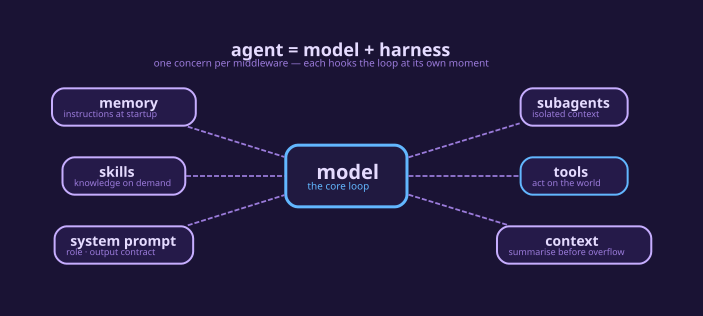
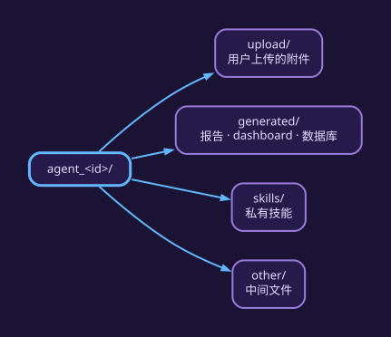
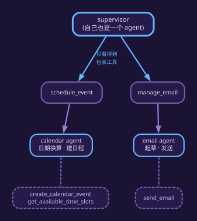
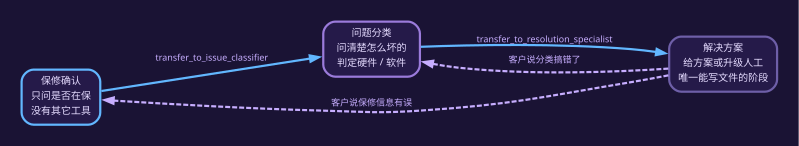
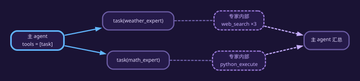
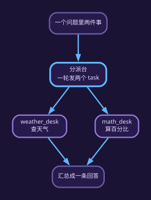
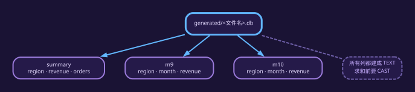

# Agent 训练 · 跟随 LangChain 官方文档

> 依据三个页面（其余内容都是它们的延伸，不是另起一套说法）：
>
> | 页面 | 取什么 |
> |---|---|
> | [langchain/agents](https://docs.langchain.com/oss/python/langchain/agents) | agent 的定义、`create_agent` 三要素、harness 与中间件 |
> | [deepagents/overview](https://docs.langchain.com/oss/python/deepagents/overview) | deep agent 的定义、四类内置能力 |
> | [langchain/multi-agent](https://docs.langchain.com/oss/python/langchain/multi-agent) | subagents / handoffs / skills / router 四种编排 |
>
> 每个案例都在 Carrier 上真实搭过、跑过；表格里的数字是实测值，不是示意。
>
> 产品叫 **EBL Carrier**，文中简称 Carrier。

**全书三部分**

| 段落 | 讲什么 | 案例 |
|---|---|---|
| 第 1 类 · 能直接用的 agent | 从最小可用到业务可用 | 1 基础 · 2 全工具 · 3 文档问答 · 4 个人助理 · 5 售后客服 |
| 第 2 类 · 机制演示 | 一个机制一个最小例子 | HITL · 6 subagents · 7 handoffs · 8 skills · 9 router |
| 案例 10–12 · 一题多步的 agent | 自己查资料写报告、按品牌语气写内容、把表格变成能问的数据 | 10 深度研究 · 11 内容创作 · 12 CSV/Excel 问答 |

## 目录

| 章节 |
|---|
| [第 1 类 · 能直接用的 agent（案例 1–5）](#第-1-类-能直接用的-agent-案例-1-5) |
| [案例 1 · 第一个 agent：三个参数就是一个能用的 agent（`case-1-basic-agent`，id 281）](#案例-1-第一个-agent-三个参数就是一个能用的-agent-case-1-basic-agent-id-281) |
| [案例 2 · 工具多到 27 个，还挑得对吗（`case-2-all-tools`，id 159）](#案例-2-工具多到-27-个-还挑得对吗-case-2-all-tools-id-159) |
| [案例 3 · 文档问答：上传附件、读它、标出来源（`case-3-doc-chat`，id 326）](#案例-3-文档问答-上传附件-读它-标出来源-case-3-doc-chat-id-326) |
| [案例 4 · 个人助理：supervisor + 两个专家（`case-4-assistant`，id 323）](#案例-4-个人助理-supervisor-两个专家-case-4-assistant-id-323) |
| [案例 5 · 售后客服：一个 agent 三步配置（`case-5-support`，id 325）](#案例-5-售后客服-一个-agent-三步配置-case-5-support-id-325) |
| [第 2 类 · 机制演示（机制一项 + 四个模式）](#第-2-类-机制演示-机制一项-四个模式) |
| [机制 · 改文件前要人批准（HITL，`acc-hitl`，id 321）](#机制-改文件前要人批准-hitl-acc-hitl-id-321) |
| [案例 6 · 主 agent 把专家当工具（`case-6-subagents`，id 301）](#案例-6-主-agent-把专家当工具-case-6-subagents-id-301) |
| [案例 7 · 把对话交给另一个角色（`case-7-handoff`，id 314）](#案例-7-把对话交给另一个角色-case-7-handoff-id-314) |
| [案例 8 · 需要时才加载知识（`case-8-skills`，id 319）](#案例-8-需要时才加载知识-case-8-skills-id-319) |
| [案例 9 · 分派台 + 专家并行 + 汇总（`case-9-router`，id 320）](#案例-9-分派台-专家并行-汇总-case-9-router-id-320) |
| [案例 10 · 深度研究：让它自己查、自己写报告（`case-10-deep-research`，id 327）](#案例-10-深度研究-让它自己查-自己写报告-case-10-deep-research-id-327) |
| [案例 11 · 内容创作：先定语气，再按技能写（`case-11-content-builder`，id 328）](#案例-11-内容创作-先定语气-再按技能写-case-11-content-builder-id-328) |
| [案例 12 · 上传 CSV 或 Excel，然后问它（`case-12-csv-chat`，id 329）](#案例-12-上传-csv-或-excel-然后问它-case-12-csv-chat-id-329) |
| [第 3 类 · 让 agent 建 agent（Agent Builder）](#第-3-类-让-agent-建-agent-agent-builder) |
| [附录 · 复建自检清单（照案例 4 复建一遍）](#附录-复建自检清单-照案例-4-复建一遍) |
## 0 · 先分清两个词：agent 和 deep agent

课上最常混的就是这两个词。先花两分钟说清，后面每个案例就都顺了。

### 0.1 agent 是什么

LangChain 官方的定义很短（[agents 页](https://docs.langchain.com/oss/python/langchain/agents)）：

> 一个 agent，就是**一个在循环里调用工具的模型**，直到把这件事做完。

循环本身很简单：模型想一想 → 调一个工具 → 看到结果 → 再想一想。模型不调工具了，就说明它答完了。



循环外面还包着一层东西，官方叫 **harness**，中文可以理解成「装配」：
提示词、工具清单，以及任何能改变模型行为的中间件。`create_agent` 就是把这层装配开放成参数：

```python
from langchain.agents import create_agent

agent = create_agent(model="deepseek-flash", tools=tools, system_prompt="...")
```

**记住一件事就够了：循环是固定的，能改的是装配。** 想让它更强，无非三种做法——
多给工具、加中间件、把提示词写清楚。

### 0.2 deep agent 又是什么

deep agent 用的还是同一个循环，区别在于**装配已经提前装好了**
（[deepagents overview](https://docs.langchain.com/oss/python/deepagents/overview)）：

> 在 LangChain 和 LangGraph 之上，直接内置了计划、虚拟文件系统、子代理和长期记忆。

官方把这些能力分成四组。对上课来说，你只需要知道每组「给你什么」：

| 这组能力 | 你拿到什么 | 在 Carrier 上对应 |
|---|---|---|
| 执行环境 | 能读能写文件、能跑代码 | 工具注册表、工作区、文件系统中间件 |
| 上下文管理 | 技能、记忆（`AGENTS.md`）、摘要压缩 | 技能库、`MemoryMiddleware`、摘要中间件 |
| 任务分工 | 可以派子代理干活，也可以先列待办 | subagents、`todo_list` 中间件 |
| 人机协作 | 关键动作停下来等人批准 | HITL 中间件 |

有两个细节容易踩：**列待办（计划）从 v0.7 起要自己挂**，不是默认就有；
**子代理是一次性的**，派出去、拿回一份报告就结束，不能来回对话。

### 0.3 两者的差别（上课就讲这张表）

| | agent | deep agent |
|---|---|---|
| 循环 | 一样 | 一样（内部仍调 `create_agent`） |
| 提示词 | 你写的 + Carrier 自动补的规则 | 只认你写的那段 |
| 自带工具 | 你勾选的那些 | 另外自带读写文件、`glob`/`grep`、`task` 等 |
| 文件系统 | 有（工作区隔离） | 有，还能换存储后端、设权限 |
| 子代理 | 支持 | 支持，且能给子代理单独指定模型 |
| 待办计划 | 要手动挂中间件 | 同样要手动挂 |
| `AGENTS.md` | 不读进提示词 | 每次运行都读进提示词 |
| 技能 | 用 `skill` 工具按需加载 | 先自动编目，再按需读全文 |
| HITL / RAG / 结构化输出 | Carrier 中间件提供 | 能配，但默认不带 |

### 0.4 在 Carrier 上怎么选

每个 agent 面板上都有一个 `use_deepagents` 开关，默认是关的。**它决定装配怎么装，并不改变模型本身的能力。**

当前这台机器上：63 个 agent，41 个是普通 agent、22 个是 deep（案例 1–9 是普通，10–12 是 deep）。

两个提醒：

1. **改了开关要开新聊天。** 旧会话不会迁移，因为提示词和工具集都变了。
2. **deep agent 的工具箱不等于配置里勾的那些。** 读写文件、`ls`、`task` 是 SDK 自带的，
   在配置里看不到，但运行时确实有 —— 别以为它们在别的页面被关掉了。

# 第 1 类 · 能直接用的 agent（案例 1–5）

> 按"从最小到完整"排：基础 → 全工具 → 文档问答 → 个人助理 → 售后客服。
> 第 2 类是机制演示（HITL + 四个模式），用到时再查。案例 10–12 不按机制分，按「一件完整的事」分：自己查资料写报告、按品牌语气写内容、把上传的表格变成能问的数据。

## 工作区约定：上传的文件和产出的文件，都留在 agent 自己的目录里

每个 agent 有一个自己的工作目录：



里面分四个文件夹，各放各的：

| 文件夹 | 放什么 |
|---|---|
| `upload/` | 用户上传的 CSV、Excel、PDF、图片 |
| `generated/` | agent 做出来的东西：报告、`.ics`、`.eml`、dashboard、数据库 |
| `skills/` | 这个 agent 自己的技能 |
| `other/` | 中间文件 |

**这条规矩一定要守住：上传和产出都必须落在工作区里。**
原因很实际 —— Files 面板就是按这个目录列文件的，放在别处，用户在界面上既看不见、也删不掉。

之前有两处没守住，现在都改了：

- **数据分析**（上传 CSV 自动出 dashboard）原来把数据库和 HTML 写进公共目录 `data/analysis_dbs/`，
  所以常有人问「我传的文件去哪了」。现在写进 `<工作区>/generated/analysis/`，同名覆盖。
- **Excel 上传**原来不在「复制进工作区」的名单里，agent 在自己的目录里根本看不到文件。
  `.xlsx`、`.xlsm`、`.xls` 已经补进去。

**想清空工作区**：在 Files 面板点右上角的删除图标，确认一次即可。
它会删掉 `upload/`、`generated/`、`other/`、`skills/` 里的文件，保留说明文档和目录结构，
同时把数据库里这份会话的文件记录一起清掉 —— 否则列表里还挂着旧文件名。

# 案例 1 · 第一个 agent：三个参数就是一个能用的 agent（`case-1-basic-agent`，id 281）

依据：[langchain/agents](https://docs.langchain.com/oss/python/langchain/agents)。

> 说白了就一件事：模型、工具、一句提示词，三样填上它就能干活，先别急着写长提示词。
> 什么时候会用到？就一个领域的活、工具也不多，先拿它试试水最省事。
> 为什么这么配？挑哪个工具是工具描述说了算，提示词里列一遍没什么用。所以先把工具弄对，规则后加。

第 0 节讲过：agent 就是「模型在循环里调工具」，外面包一层装配。这一节就把那层装配填到最简 ——
**只填三个参数，看它能不能干活。**


```python
from langchain.agents import create_agent

agent = create_agent(
    model="deepseek-flash",        # 用哪个模型
    tools=[weather, calculator],   # 手里有哪些工具
    system_prompt="You are a helpful assistant",   # 一句话说明它是谁
)
```

三个参数之外什么都不给，它就自己能跑了。想再加强，才需要动中间件。

## 这三个参数在 Carrier 上填在哪

打开 Agents → New Agent，三样东西分别落在三个地方（Temperature 记得填 `0`）：

| 代码里的参数 | Carrier 上填在哪 | 我们填什么 |
|---|---|---|
| `model=` | Overview → Model | `deepseek-flash` |
| `system_prompt=` | Prompt → System Prompt | `You are a helpful assistant` |
| `tools=` | Tools 页签 | 勾三个：`web_search`、`python_execute`、`pg_query`（写文件用的 `write_file` Carrier 自带，不用勾） |

保存后开新聊天，先发一句 `hi` 把开场白用掉，再问下面四个问题。

## 实测：四个例子

| 问 | 它挑了哪个工具 | 结果 | 用时 |
|---|---|---|---|
| 上海的天气如何 | `web_search` ×4 | 晴到多云，白天 24–25℃，夜间 15℃ | 8.1s |
| 1,234,567 乘以 891,011 等于多少？ | `python_execute` | 1,100,012,777,237 | 4.8s |
| 用 pg_query 查一下 deep_agent_templates 有多少个 agent | `pg_query` | 63 | 3.3s |
| 把这句话存成一份文档：标题《工具路由测试》 | `ls` → `write_file` | `generated/工具路由测试.md` | 9.1s |

## 两条要讲的判断

1. **挑哪个工具由工具描述决定，不由提示词列举决定。** 提示词只有 `You are a helpful assistant` 一句，
   没有一个字提工具，四个例子都挑对了 —— 这就是页面那句 *a model calling tools in a loop*。
2. **harness 只有三件东西就能工作**：模型、工具、一句提示词。后面所有案例都是在往这三样上叠中间件。

---

# 案例 2 · 工具多到 27 个，还挑得对吗（`case-2-all-tools`，id 159）

依据：还是 [agents 页](https://docs.langchain.com/oss/python/langchain/agents) —— 工具是装配的一部分。

> 27 个工具它照样挑得对。麻烦的从来不是数量，是工具名和描述写没写清楚。
> 什么时候会用到？团队共用一个啥都能干的 agent，或者分工还没想好的时候先这么起来。
> 为什么这么配？代价是慢一点、选错的机会大一点，同一道题从 8.1 秒变 11.5 秒。工具再往上加就该拆了，看案例 6 和 9。

案例 1 只给了 3 个工具，所以挑起来不难。这一节把同样的题摆到 27 个工具面前，
看它还挑不挑得对。

这个 agent（id 159）挂着 `deepseek-flash`、温度 0，工具一共 27 个：搜网页、查数据库、
跑 Python、存记忆、列待办、跑 bash、写文件……提示词里不是规则，而是一份中文的「能力清单」
（"你可以搜索信息、查数据库、写文件……"）。

## 实测：同样三个问题

| 问 | 它挑了哪个工具 | 结果 | 用时 |
|---|---|---|---|
| 上海今天天气怎么样？ | `web_fetch` → `web_search` ×2 | 19℃ 实况 + 今日温度区间 | 11.5s |
| 把这句存成文件：hello world | `write_file` | 生成了 `generated/hello_world.txt` | 6.1s |
| 用 pg_query 查 deep_agent_templates 有多少个 agent | `pg_query` | 69 | 5.9s |

对照案例 1 的同一道天气题：那边 4 次 `web_search`、8.1 秒；这边 11.5 秒。
答案一样，慢了一些。

上面划掉的五个是**一次性验证实例**，跑完就删了——数字留着是因为它证明的是「模板能建出可用的结构」，
不是「系统里一直有这五个 agent」。留下的 332/333 是课堂要用的两个私有示例。

## 三条要讲的判断

1. **工具多不是主要问题，名字和描述才是。** 27 个工具里，它每次都能挑到最具体的那一个：
   写文件用 `write_file`，查库用 `pg_query`，查天气用 `web_search`。挑的依据是工具自己的名字和描述。
2. **提示词里的能力清单只是"目录"，不是"路由表"。** 那段中文只说了它能干什么，
   没有一条"天气就用 web_search"的规定。真正拿主意的是工具描述 —— 所以**加工具比加规则省事**，
   而工具描述写含糊，准确率会立刻掉。
3. **代价是慢，而且选错的余地变大。** 同样的题，3 个工具 8.1 秒，27 个工具 11.5 秒。
   工具多到一定程度该怎么办？案例 6（拆成专家）和案例 9（加一个分派台）给的就是这个答案。

---

# 案例 3 · 文档问答：上传附件、读它、标出来源（`case-3-doc-chat`，id 326）

依据：Carrier 自己的「知识库对话」实现（`api/knowledge/doc_chat.py`）里的提示词规则，
以及 [tools 页](https://docs.langchain.com/oss/python/langchain/tools) 关于工具读写的说法。

> 文档别提前塞进去，用的时候再去读，答完还得说清出处。
> 什么时候会用到？文档多、还老改，而且你要求答出来能指到是哪份文件、哪一段。
> 为什么这么配？全塞进提示词，上下文一下就满了，答出来也说不出出处。改成用工具按需读，上下文里只装这次用到的那点。

Carrier 原本的「知识库对话」做法很直接：把整个文件夹的内容塞进提示词。库一大，上下文就满了。
这个案例把它改成一个普通 agent：**不预载文档，用工具按需读**，而且每条结论都要标来源。

它只有三个只读工具，分工很清楚：

| 工具 | 干什么 |
|---|---|
| `glob` | 看 `upload/` 里有什么附件 |
| `grep` | 在长文档里定位关键词，省得整篇读 |
| `read_any_file` | 读内容。文本、PDF、扫描件、Word、PowerPoint、Excel 都走这一个入口 |

## 从参考实现抄了三条规则

| 参考实现怎么写 | 这个 agent 怎么写 |
|---|---|
| 每条结论标 `[Source: 文件名]` | 同样格式，但去掉文件名前的 8 位存储前缀 |
| 开头说明读了多少文档 | `[Documents loaded: N file(s)]`，N 是这一轮真正读过的 |
| 读不到就明说 | 「读到的文档里没有关于 …… 的信息」 |
| 数字、金额、日期原样引用 | 同 |
| 不许拿自己的知识补 | 同 |

另外还压了两条预算：一轮最多读 3 个文件；长文件只读命中的部分
（参考实现的上限是 300 个文件、100 万字符，量级差别在这里）。

## 实测：上传真文件

| 上传 | 问 | 它怎么做的 | 结果 |
|---|---|---|---|
| `星河项目交付说明.md`（322 B） | 项目编号和预算是多少 | `glob` → `read_any_file` | `XH-2026-014`、`人民币 128 万元`，各带 `[Source: 星河项目交付说明.md]` |
| `industry_analysis_report.pdf`（612 KB，11 页） | 这份 PDF 讲什么行业？2025 年市场规模多少 | `read_any_file`，6 秒读完 | 全球眼镜行业；列出 6 家机构的口径表，逐条带来源 |
| 同一份 PDF | 有没有提到越南的监管要求？没有就说没有 | `grep` | 「读到的文档里没有关于越南监管要求的信息」，并说明监管章节只覆盖美国、欧盟、中国 |

还有一个小设计：**上传完它就开始动，不用你再补一句"请读一下"。**
附件传上去以后，界面会替用户发一句"我已上传附件 X"，agent 先回一行确认，接着就读。
换成没有读文件工具的 agent 收到同样的话，会直接说清自己缺什么工具。

## 两条要讲的判断

1. **agent 版和面板版的区别在"读多少"。** 面板版一次把能塞的都塞进提示词，大库直接顶满；
   agent 版先用 `glob`、`grep` 把范围缩小，只读命中的一两个文件。
2. **"读不到就说读不到"比"答得像"重要。** 这几条规则里最值钱的是那句缺席声明：
   它把"我不知道"从一句客套话变成了可以验收的判据 —— 验收脚本就是按这句话断言的。

---

# 案例 4 · 个人助理：supervisor + 两个专家（`case-4-assistant`，id 323）

教程：**[https://docs.langchain.com/oss/python/langchain/multi-agent/subagents-personal-assistant](https://docs.langchain.com/oss/python/langchain/multi-agent/subagents-personal-assistant)**

> 主 agent 只管分活，两个专家各带自己的工具和规矩。
> 什么时候会用到？活分跨几个明确的领域，比如日历一个、邮件一个，各自有各自的工具。
> 为什么这么配？一个 agent 扛 27 个工具，又慢又容易挑错。拆开以后主 agent 只在两个专家里选就行。代价是多一跳，专家之间还互相看不见。

## Overview（页面原文 · 中文译文）

> supervisor 模式是一种多 agent 架构：一个中心的 **supervisor agent** 协调若干专职的
> **worker agent**。当任务需要几种不同类型的专业能力时，它最合适 —— 与其造一个要在多个领域里
> 挑工具的 agent，不如造几个各自专注的专家，由理解整体流程的 supervisor 来协调。
>
> 教程要搭的是一套个人助理系统，用一条真实的工作流来演示这套结构。系统协调两个
> **职责完全不同**的专家：
>
> - **calendar agent**：排期、查空闲、管理日程事件。
> - **email agent**：负责沟通、起草消息、发送通知。
>
> 还会引入 **human-in-the-loop review**，让人**批准 / 编辑 / 拒绝**动作（例如对外发邮件）。
>
> 从 `langgraph-supervisor` 迁移过来的，参考「Migrate from langgraph-supervisor」——
> 那里有 interrupt 与 resume 的前后对照。

## Why use a supervisor?（页面原文 · 中文译文）

> 多 agent 架构可以把**工具**切分给不同 worker，每个 worker 有自己的提示词或指令。
> 试想一个直接握着全部日历与邮件 API 的 agent：它要在**很多相似的**工具里挑、要记住每套 API
> 的确切格式、还要同时处理多个领域。**如果效果开始变差**，把相关工具与配套提示词拆成逻辑组
> 往往有帮助（一部分也是为了让后续迭代更好管理）。

## 结构：一共 3 个 agent（1 + 2）

教程把 worker 叫 subagent；**supervisor 自己也是一个 agent**。





看图其实就两件事：

1. **supervisor 看不到最底下那些工具。** 它面前只有两个"派活"工具。
   这是故意留的信息差 —— 选项少，它才不容易挑错。
2. **审批要挂在外发那一层。** `interrupt_on={"send_email": …}` 写在 email agent 身上；
   写到 supervisor 上，只能拦住"派活"，拦不住"发信"。

## 教程分五步

| 步骤 | 教程做了什么 |
|---|---|
| 1. 定义工具 | 写三个占位工具：建日程、发邮件、查空闲 |
| 2. 建专家 | 一个日程专家（把"下周二下午 2 点"换算成具体时间），一个邮件专家（推断收件人、写主题和正文） |
| 3. 包装成工具 | 把两个专家各包一层，变成 `schedule_event`、`manage_email`。supervisor 只看见这两个 |
| 4. 建 supervisor | 按领域派活；一句话里有两件事，就在同一轮里调两个包装工具 |
| 5. 跑两个例子 | ①"安排明天 9 点站会" → 只调日程；②"下周二 2 点开会，并发邮件提醒" → 两个一起调 |

## Carrier 上怎么还原

1. **建 agent**：名字 `case-4-assistant`，Model `deepseek-flash`，Temperature `0`。
2. **Tools 页签只勾 `Task (Subagent)`** —— supervisor 只该看到“派人”这一件事，具体 API 由专家自己拿。
3. **JSON 页签**贴两个专家（`interrupt_on` 写在 `email_expert` 身上，不是 supervisor 上 ——
   supervisor 的中间件只看得到 `task`，看不到专家手里的 `write_file`）：

```json
"subagents": [
  {
    "name": "calendar_expert",
    "description": "日程助手：把「下周二下午 2 点」这类说法换成具体时间，并生成日程文件（.ics）。",
    "type": "dictionary",
    "system_prompt": "你是日程助手。把自然语言时间解析成具体日期与时间（今天是 2026-10-31，周六）；需要算日期或时长时用 python_execute；确定后用 write_file 生成 generated/<标题>.ics（含 DTSTART/DTEND/SUMMARY）。最后用一句话确认安排了什么。",
    "tools": ["python_execute", "write_file"]
  },
  {
    "name": "email_expert",
    "description": "邮件助手：起草并发出邮件（写出 .eml 到 outbox）。",
    "type": "dictionary",
    "system_prompt": "你是邮件助手。根据要求写一封邮件，用 write_file 写到 generated/outbox/<收件人>-<主题>.eml，内容包含 To / Subject / 正文。发出前会有人工审批，你只需写好文件。",
    "tools": ["write_file"],
    "interrupt_on": {"write_file": {"allowed_decisions": ["approve", "reject"], "when": "writes_deliverable"}}
  }
]
```

4. **Prompt 页签**：`你是一个个人助理。日程问题交给 calendar_expert，邮件问题交给 email_expert；你自己不写文件、不算日期。一件事涉及两方时，分别派活再汇总。`

## 实测（`case-4-assistant`，id 323）

| 问 | 发生了什么 |
|---|---|
| `安排下周二下午 2 点跟 Alice 开 1 小时的会` | `task(calendar_expert)` → `ls` → `python_execute` 算日期 → `write_file` → `generated/与Alice开会.ics`；答「2026-11-03 周二 14:00–15:00」 |
| 同一句 + `然后给 alice@example.com 发封确认邮件` | 一轮两个 `task`；`email_expert` 写 `.eml` 前**打断** → 点批准 → `outbox/…eml` 出现 |

点聊天窗口右上角**日历图标**：11 月 3 日格子里是 `14:00 与 Alice 开会`，来源文件与 Files 面板一致；
面板底部写明「N 个日程的文件没写时区，时间按文件字面显示」—— 只读，不替模型编时区。

## 和教程不一样的地方，要讲清楚

| 教程 | 我们这里 | 为什么 |
|---|---|---|
| 三个占位工具 | 用 `python_execute` 算日期、用 `write_file` 写 `.ics` 和 `.eml`，**不新造工具** | Carrier 不鼓励为演示造占位工具；"做完了"这件事靠文件就能看见 |
| 每个专家包成一个工具 | 用 Carrier 内置的 `task(description, subagent_type)` | 效果一样：supervisor 照样看不到专家手里的工具 |
| 真发日历、真发邮件 | 写成文件 | 教程自己也是占位的；这台机器没有真通道 |
| 审批里可以"改参数再执行" | 只给批准、拒绝两个按钮 | 改参数会让模型重新规划一遍，实测更乱 |

## 四个要讲的判断

1. **分层是为了减少选项。** supervisor 面前只有 1 个工具，每个专家只看得到自己那 2 个，挑错的概率自然低。
2. **信息差是设计出来的。** supervisor 不知道有 `write_file`，也不知道 `.ics` 该怎么写 ——
   所以**约束必须写在专家身上**，写在 supervisor 上是白写。
3. **审批放在会动真东西的那一层。** 放在 supervisor 只拦得住"派活"，拦不住"发信"。
4. **专家也要有自己的中间件。** 早先子代理既没有 `interrupt_on`，也没有文件系统，
   让它写文件根本落不了盘（Carrier 已修）。

---


# 案例 5 · 售后客服：一个 agent 三步配置（`case-5-support`，id 325）

页面：[handoffs-customer-support](https://docs.langchain.com/oss/python/langchain/multi-agent/handoffs-customer-support)。

> 还是一个 agent，只是走到哪个阶段就换哪套提示词和工具。
> 什么时候会用到？流程有固定几步，每步"能干的事、不能干的事"不一样，比如客服、审批、开户。
> 为什么这么配？拿工具当闸门：第一步手里根本没有进下一步的工具，顺序就乱不了。这比在提示词里写"请按顺序"靠谱得多。

上一节是三个角色互相转交；这一节不一样 —— **只有一个 agent，但它分三个阶段说话。**
保修确认、问题分类、给方案，每个阶段换一套提示词和工具。客户说错了，还能退回去重问。

先把页面的开头读一遍（中文译文）：

## Overview（页面原文 · 中文译文）

> 状态机模式描述的是这样一类工作流：agent 的行为随着任务走到不同状态而改变。本教程用**工具调用
> 动态改变同一个 agent 的配置** —— 按当前状态更换它可用的工具与指令 —— 来实现一个状态机。状态可以
> 来自多个来源：agent 过去的动作（工具调用）、外部状态（比如 API 返回），甚至最初的用户输入
> （比如先跑一个分类器判断意图）。
>
> 本教程要搭的是一个售后客服 agent，它会：
>
> - 先收集保修信息再往下走；
> - 把问题分成硬件或软件；
> - 给出解决方案，或升级给人工；
> - 在多轮对话里保持状态。
>
> 和 subagents 模式（把子代理当工具调用）不同，**状态机模式用的是一个 agent**，它的配置随流程推进
> 而改变。所谓“一步”，只是同一个 agent 的另一套配置（system prompt + 工具），由状态动态选中。

## 流程（页面那张图的文字版）



## 结构：1 个 agent + 3 步配置

| 步骤 | 这一步看得到什么 | 什么时候进 |
|---|---|---|
| `warranty_collector` | `transfer_to_issue_classifier` | 一开始（`default_step`） |
| `issue_classifier` | `transfer_to_resolution_specialist` | 保修状态问清之后 |
| `resolution_specialist` | `write_file` + `transfer_to_warranty_collector` + `transfer_to_issue_classifier` | 硬件/软件判定之后 |

**顺序不是靠提示词自觉，是靠工具集**：第一步手里根本没有进方案的转移工具，所以它进不去。

## 教程的步骤（9 节压成 5 行）

| 教程 | 做了什么 |
|---|---|
| 1. 定义 state | `current_step` / `warranty_status` / `issue_type` |
| 2. 建工具 | `record_warranty_status(...)` 返回 `Command(update={..., "current_step": ...})` |
| 3–4. 每步配置 + 中间件 | 字典里存 `prompt` / `tools` / `requires`；中间件读 `current_step`，覆盖 prompt 与工具，缺字段就 `raise` |
| 5. 建 agent | `state_schema=SupportState`、`middleware=[apply_step_config]`、加 checkpointer |
| 6–9. 跑 4 轮 + 回退 | 保修 → 分类 → 方案；再加 `go_back_to_*` 让客户改错的信息 |

## Carrier 上怎么还原（1 个 agent + 1 段 middleware）

Agents → New Agent，名字 `case-5-support`，Model `deepseek-flash`，Temperature `0`；
Tools 页签只勾 `write_file`；JSON 页签贴：

```json
"middleware": [{
  "type": "handoff",
  "config": {
    "default_step": "warranty_collector",
    "steps": {
      "warranty_collector": {
        "system_prompt": "你是售后客服，当前阶段：保修确认。先打招呼，再问设备是否在保修期内，不要一次问多个问题。客户回答后调用 transfer_to_issue_classifier。",
        "tools": [],
        "transfers": [{"to": "issue_classifier", "description": "客户已说明是否在保修期内"}]
      },
      "issue_classifier": {
        "system_prompt": "你是售后客服，当前阶段：问题分类。先请客户说明问题怎么发生的（即使开头提过也要确认），再判断硬件还是软件，然后调用 transfer_to_resolution_specialist。保修状态在对话历史里，自己回看。",
        "tools": [],
        "transfers": [{"to": "resolution_specialist", "description": "已判定硬件/软件"}]
      },
      "resolution_specialist": {
        "system_prompt": "你是售后客服，当前阶段：解决方案。回答最多 5 行，细节写进文件。文件名用 generated/support/<Current time 的日期时间>-<类型>.md（不要用客户名）。软件→排查步骤；硬件+在保→保修维修；硬件+过保→升级人工（写明 Carrier 没有真实工单系统）。客户说信息有误就用 transfer_to_warranty_collector / transfer_to_issue_classifier 回去改。",
        "tools": ["write_file"],
        "transfers": [
          {"to": "warranty_collector", "description": "客户说保修信息有误"},
          {"to": "issue_classifier", "description": "客户说问题类型判断有误"}
        ]
      }
    }
  }
}]
```

## 实测（`case-5-support`，id 325）

| 轮 | 客户说 | 用了什么 | 结果 |
|---|---|---|---|
| 1 | `Hi, my phone screen is cracked` | 无工具 | 只问保修状态（进不去下一步） |
| 2 | `Yes, it's still under warranty` | `transfer_to_issue_classifier` | 换配置：问"屏幕怎么坏的" |
| 3 | `The screen is physically cracked from dropping it` | `transfer_to_resolution_specialist` + `write_file` | 换配置：给保修维修流程；`generated/support/2026-10-31T1324-保修维修.md` |
| 4 | `What should I do?` | 无工具 | 只补充操作步骤（不再复述整份方案） |
| 5 | `Actually I made a mistake - my device is out of warranty` | `transfer_to_warranty_collector` | **回退**到保修确认（教程第 9 节） |

三次 hop 都落库成 `handoff` 消息，顺序 `issue_classifier → resolution_specialist → warranty_collector`。

> **回退那一轮可能连跳两次**：客户在"其实过保了"这句话里已经给出了新答案，所以
> `warranty_collector` 收到后立刻又转给 `issue_classifier`（实测出现过 4 跳）。判据要写"能回到保修"，
> 不能写"最后一跳必须是保修" —— 否则复跑会假失败。

## 和教程的差异（要如实讲）

| 教程 | Carrier | 原因 |
|---|---|---|
| `warranty_status` / `issue_type` 存进 state，prompt 用 `{warranty_status}` 插值 | 没有：事实留在**对话历史**里，prompt 写"自己回看" | Carrier 没有可编辑的 state 字段 |
| `requires` 缺字段就 `raise` | 没有这道校验；顺序靠"这一步手里有哪些转移工具" | 同上，属于要新增的能力 |
| `record_warranty_status` 返回 `Command` 写 state | `transfer_to_*` 写 `handoff_to` | 机制同构：工具改状态、中间件换配置 |
| `provide_solution` / `escalate_to_human`（stub 返回字符串） | `write_file` 写 `generated/support/*.md` | Carrier 没有工单系统，"升级人工"只是文件 + 一句告知 |
| 第 8 节：用摘要中间件压历史 | 中间件页签可加 `summarization` | 等价 |

## 三个要讲的判断

1. **一个 agent 也能"变成好几个人"**：换的是配置（prompt + 工具），不是进程，也不是子代理。
2. **顺序由工具集约束，不是靠模型自觉**：第一步没有"进方案"的工具，它想跳也跳不过去。
3. **回退要显式给**：只在方案步给 `transfer_to_warranty_collector`，客户改错才有路可走；给多了就等于没有流程。

## 复建自检（5 条）

- [ ] 第 1 轮只问保修，**没有** hop —— 判据：工具记录为空、没有 `handoff` 消息
- [ ] 第 2 轮出现 `transfer_to_issue_classifier`，回答变成"问问题怎么发生的"
- [ ] 第 3 轮出现 `transfer_to_resolution_specialist` + `write_file`，Files 面板多出 `generated/support/…md`
- [ ] 第 5 轮说"其实过保了" → 出现 `transfer_to_warranty_collector`（回退成功）
- [ ] 反证：把 `resolution_specialist` 的两个 `transfers` 删掉 → 客户说"搞错了"时它只能解释，退不回去

---


# 第 2 类 · 机制演示（机制一项 + 四个模式）

> 这些章节各讲**一个机制**，用最小例子证明它成立；业务场景请看第 1 类的案例 4（用 subagents + HITL）
> 和案例 5（用 handoff 状态机）。

# 机制 · 改文件前要人批准（HITL，`acc-hitl`，id 321）

页面：**[https://docs.langchain.com/oss/python/concepts/human-in-the-loop](https://docs.langchain.com/oss/python/concepts/human-in-the-loop)**

> 它拦的是"这一次调用"，不是"这个工具"；而且是让循环停下来等人，不是嘴上提醒模型。
> 什么时候会用到？有收不回来的动作：写库、往外发文件、扣钱。
> 为什么这么配？提示词只能算建议，模型可以不听。中间件一拦，它就必须等。

文档的写法是**中间件**，不是提示词：

```python
from langchain.agents import create_agent
from langchain.agents.middleware import HumanInTheLoopMiddleware
from langgraph.checkpoint.memory import InMemorySaver

agent = create_agent(
    model="gpt-5.5",
    tools=[write_file, execute_sql, read_data],
    middleware=[
        HumanInTheLoopMiddleware(
            interrupt_on={
                "write_file": True,                                   # 四种决策都允许
                "execute_sql": {"allowed_decisions": ["approve", "reject"]},
                "read_data": False,                                   # 显式放行
            },
            description_prefix="Tool execution pending approval",
        ),
    ],
    checkpointer=InMemorySaver(),   # 打断要靠它持久化；Carrier 聊天本来就有
)
```

Carrier 上就是 **Middleware 页签** → 勾工具 → 选“每条都批 / 只批会改东西的”，保存后**开新聊天**。

## 实测（deep agent，`bash` 设成 `bash_may_mutate`）

| 步骤                                                              | 看到什么                                              |
| ----------------------------------------------------------------- | ----------------------------------------------------- |
| 发 `hi`，它自己 `cd … && ls -la … 2>/dev/null` 扫工作区     | **没有打断**（只读命令不批）                    |
| 发「用 bash 执行：`echo approved > …/generated/approved.txt`」 | 输入框变成审批卡，显示工具名和整条命令                |
| 点 **批准这一次**                                           | 命令执行，`approved.txt` 出现，内容是 `approved`  |
| 再点一次批准                                                      | **409**：没有待批的东西了（批准只对那一次有效） |
| 15 分钟不点                                                       | 按**拒绝**处理，并告诉模型“工具没执行”        |
| agent 配 `approval_policy: "never"`                             | 直接拒绝，不等人                                      |

## 两个必须讲的判断

1. **这是“人在环里”，不是“让模型小心点”。** 提示词里写“重要操作前先问我”，模型可以不听；
   中间件是**循环停下来**，等人。页面的四种决策里，Carrier 只给 approve / reject 两个按钮 ——
   `edit`（改参数再执行）会让模型重新规划，实测批准后它常会再试一次。
2. **拦“调用”，不拦“工具”。** deep agent 用同一个 `bash` 干自己的活（扫目录、写临时文件）。
   按工具名拦，拦到的几乎都是它的簿记；所以要配谓词：只读命令放行、写文件只拦交付物
   （`other/`、`skills/` 里的不拦）。这就是 `InterruptOnConfig` 的 `when`。

> 每次决策都会在 `audit_logs` 留痕（`HitlApproval`）：谁批的、审的是哪些工具、什么决定。

---


# 案例 6 · 主 agent 把专家当工具（`case-6-subagents`，id 301）

页面：[multi-agent 总览](https://docs.langchain.com/oss/python/langchain/multi-agent/index)、[subagents](https://docs.langchain.com/oss/python/langchain/multi-agent/subagents)。

> 主 agent 把专家当工具使，一个 task 派下去。
> 什么时候会用到？要几种专业能力，而且每样的结果一两句话就能带回来。
> 为什么这么配？专家在自己那块上下文里干活，主 agent 只收一份摘要。省上下文，这是最直接的一招。

这一节讲最简单的一种分工：**主 agent 把专家当成工具来调。**
主 agent 决定派谁、给什么输入、怎么把结果拼起来 —— 所有路由都经过它。

页面原话：*a central main agent coordinates subagents by calling them as tools.*



## 实测（`case-6-subagents`，`deepseek-flash`，temperature 0）

问一句：**「上海今天的天气怎么样？另外算一下 1234567 乘以 891011。」**

| 顺序 | 发生了什么                                                                                          |
| ---- | --------------------------------------------------------------------------------------------------- |
| 1    | 主 agent 一轮里发出**两个** `task`：`weather_expert`（查天气）、`math_expert`（算乘法） |
| 2    | 子代理内部各自调用工具：`web_search` ×3、`python_execute` ×1                                  |
| 3    | 结果回到主 agent，主 agent 汇总成一条回答                                                           |
| 4    | 落库：`tool_calls` 5 条、`subagent_spawns` 2 条（`{subagent, task, status:"completed"}`）     |

## 三个必须讲的判断

1. **描述决定委派。** `task` 工具的描述就是子代理清单——
   `Available agents for delegation are: - weather_expert: … - math_expert: …`。
   模型照它挑人。这和工具路由、技能触发是**同一个机制**：写清“什么时候该找我”。
2. **上下文隔离是真的。** 让子代理在自己的 prompt 里复述“你收到的全部信息”，它答的是
   `我收到的信息：计算 1234567 × 891011` —— 它**不知道**父对话里说过的“我叫卫平、我住在上海”。
   所以要在子代理身上生效的约束（用中文、别用表情、输出格式）**必须写进子代理的 system prompt**，
   写在不进它上下文的地方就等于没写。
3. **子代理不直接面对用户。** 它只把结果交回主 agent；用户看到的是主 agent 那一句总结。
   页面把“直接交互”标成一星，就是这个意思。

> 同步执行：主 agent 会**等**子代理返回才继续（文档的 *Synchronous (default)*）。
> 文档里还有一种 *Asynchronous*（后台跑、不阻塞），这一版 Carrier 没有。

## 对照实验：改描述，委派会变吗？

同一个问题、同一套工具，只动子代理的 `description`，问三次：

| 实验                | 配置                                                                                     | 结果                                                                               |
| ------------------- | ---------------------------------------------------------------------------------------- | ---------------------------------------------------------------------------------- |
| ① 描述匹配         | `weather_expert`：「查询某个城市的实时天气」                                           | 委派给 `weather_expert` ✅                                                       |
| ② 描述改成无关     | 同一个子代理，描述改成「整理会议纪要并输出要点」                                         | **仍然委派给它** —— 没变                                                   |
| ③ 两个候选都说得通 | `data_expert`：「查询【实时】天气…」和 `archive_expert`：「查询【历史】气候统计…」 | 「现在气温多少」→ `data_expert`；「往年 10 月平均气温」→ `archive_expert` ✅ |

**结论要如实讲**：路由不是只看描述 —— 任务文本、子代理名字、以及**候选有几个**都在参与。
② 之所以没变，是因为只有两个候选、任务里又出现了“天气”这个词，模型顺着**名字**也能找对。
描述真正的威力在 ③：**当两个候选都说得通时，只有描述能把它们分开。**

> 这一组数据可以直接从 `chat_sessions.subagent_spawns` 读出来（谁被派了、派的是什么任务），
> 比看回答文本可靠。

---


# 案例 7 · 把对话交给另一个角色（`case-7-handoff`，id 314）

页面：[multi-agent 总览](https://docs.langchain.com/oss/python/langchain/multi-agent/index)、[handoffs](https://docs.langchain.com/oss/python/langchain/multi-agent/handoffs)。

> 整段对话交给另一个角色，提示词和工具跟着一起换人。
> 什么时候会用到？几个角色轮流服务同一个人，而且不该让他重开对话，比如售后接售前、售前转技术。
> 为什么这么配？对话是连着的，用户不用再讲一遍。代价是几个角色互相都看得到前面说了什么，所以每个角色都得写一句"不是你的活就直接转"。

和第 6 个案例相反：这里不是主 agent 去调别人，而是**把对话整体交给另一个角色**。
交接之后，说话的人变了，提示词和工具也跟着变，用户不用重开对话。

页面原话：*Tool calls update a state variable that triggers routing or configuration
changes, switching agents or adjusting the current agent's tools and prompt.*


## 实测（`case-7-handoff`，三个角色，CLI 验收）

| 轮次 | 用户说              | 发生什么                                           | 谁回答                                         |
| ---- | ------------------- | -------------------------------------------------- | ---------------------------------------------- |
| 1    | 我有发票问题        | `transfer_to_support` → `transfer_to_finance` | **财务**（「你好，我是财务专员…」）     |
| 2    | 另外，我有 500 错误 | `transfer_to_support`                            | **售后**（「500 属于服务端内部错误…」） |

每跳都留下痕迹，且**刷新后仍在**：`session.messages` 里是一条

```json
{"role": "handoff", "to": "finance", "reason": "…", "content": "转交给「财务」 · …"}
```

聊天里渲染成琥珀色卡片：`转交给「finance」· 用户咨询发票开错如何处理…`

> **跳数是模型判断，不是契约**：同一个问题（"发票开错了怎么处理"）复跑会得到 1 跳
> （售后自己答）或 2 跳（`support → finance`）。所以判据只能写"至少一次转交 + 回答在最后一跳之后"，
> 写死"必须两跳"会假失败。

## 四个要讲的判断

1. **转交是中间件的活，不是提示词的活。** 提示词写“遇到技术问题请转给售后”，模型可以不听；
   中间件是**换提示词、换工具**，由状态决定，不靠模型自觉。
2. **目标必须写在工具里，不能写在参数里。** 我们第一版是 `handoff(to="…")`，模型填了个
   `technical_support`（不存在的角色）→ 静默失效。改成 `transfer_to_finance` 之后，
   这类错误在结构上不可能发生 —— 和 subagents 的“一个子代理一个工具”是同一个道理。
3. **转交即交棒。** Carrier 给每个角色自动附加规则：“不属于你的直接转，不要先回答”。
   否则会出现“财务先答 500、再转给售后、售后没开口”的一轮两个嘴。
4. **这和 Subagents 正相反 —— 上下文是共享的。** 子代理只拿到那一句 `description`；
   handoff 是**同一段对话**换个角色继续说，前面的历史都在。所以：
   **要隔离用 subagents，要接力用 handoffs。**

> 页面还给了第二种实现（多个 agent 子图 + `Command(goto=…, graph=Command.PARENT)`），
> 那是把每个角色做成图节点；Carrier 这一版实现的是第一种（单 agent + 中间件），
> 对“少角色、强接力”的场景够用。

---


# 案例 8 · 需要时才加载知识（`case-8-skills`，id 319）

页面：[skills](https://docs.langchain.com/oss/python/langchain/multi-agent/skills)。

> 知识先给一张目录，真用到了再读全文。
> 什么时候会用到？领域知识又长又不常用，还得能单独改，比如写作规范、SQL 约定。
> 为什么这么配？一直挂在提示词里太占上下文，删了又不够用，技能就是中间的第三条路。代价是多读一次文件。

有些领域知识又长又不常用。全塞进提示词浪费上下文，删掉又不够用 ——
**技能就是按需加载的那一份。** 平时只给模型一张技能目录，用到时再读全文。

页面原话：*Skills are primarily prompt-driven specializations that an agent can invoke
**on-demand** —— progressive disclosure of specialized prompts and domain knowledge.*

## 实测（`case-8-skills`，只有 `skill` + `python_execute` 两个工具）

| 问题                                                   | 是否加载技能                                | 结果                   |
| ------------------------------------------------------ | ------------------------------------------- | ---------------------- |
| 帮我把这句话改得更简洁：今天天气不错                   | **0 次**                              | 直接改（7 字 → 5 字） |
| 帮我 review 这段 Python 代码：`def f(x): return x/0` | **`skill(skill_id="code-review")`** | 先加载技能，再作答     |

> 修之前两次都**不加载**：`skill` 工具的说明里没有列任何技能 id，模型不知道有
> `code-review` 这个东西。把技能清单写进工具描述（名称 + 一句话）之后才会调 ——
> 和 `task` 列子代理、`transfer_to_*` 把目标写进工具名，是**同一个机制**。

## 三个要讲的判断

1. **技能不增加能力，只改变“什么时候知道”。** 内容不变，变的是它什么时候进入上下文 —— 这就是
   *progressive disclosure*（渐进披露）。
2. **触发靠描述，不靠“存在”。** 工具描述里不写“有哪些、什么时候用”，技能就等于不存在。
   这一条和工具路由（1.2）、子代理委派、转交目标**完全同源**。
3. **技能 vs 子代理**：技能是“给同一个 agent 加知识”，上下文不断、不隔离；子代理是“另开一个
   上下文干活再回来”。知识多而任务单一 → 技能；任务长且要隔离 → 子代理。

---


# 案例 9 · 分派台 + 专家并行 + 汇总（`case-9-router`，id 320）

页面：[router](https://docs.langchain.com/oss/python/langchain/multi-agent/router)。

> 先把话分个类，再同时派出去，最后合成一条回答。
> 什么时候会用到？一句话里塞了几件互不相干的事，而用户只想看一个答案。
> 为什么这么配？一件一件做就是三倍时间，同时做只多一次汇总的功夫。

一句话里有两件互不相干的事，可以**同时派出去做，再合成一个回答**。
它和第 6 个案例的区别：第 6 个是主 agent 按需调专家，这里是先分派、再并行、最后汇总。

页面原话：*A routing step classifies input and directs it to specialized agents …
Zero or more specialized agents are invoked in parallel. Results are synthesized
into a coherent response.*



## 实测（`case-9-router`）

问：**「上海今天天气怎么样？顺便算一下 1280 的 15% 是多少。」**

| 观察点       | 实测                                                                                     |
| ------------ | ---------------------------------------------------------------------------------------- |
| 分派内容     | 一轮里发出**两个** `task`：`weather_desk`（查天气）、`math_desk`（算百分比） |
| 专家各自干活 | 子代理内部 `web_search` ×2、`python_execute` ×1                                    |
| 汇总         | 同一条回答里既有 `192` 也有上海 19.9℃ / 湿度 68%                                      |
| 记账         | `subagent_spawns` 2 条（两个都 completed）、`tool_calls` 5 条                        |

## 三个要讲的判断

1. **Router 和 Subagents 是同一个机制，两种用法。** 区别只在 prompt：Subagents 是“需要时才叫一个
   专家”，Router 是“先分类，再把每一部分都派出去”。Carrier 的差别不是能力，是**分派策略**。
2. **分类是模型做的，不是确定性的。** 这是和“真 router”（一次分类 → 固定分支）最大的差异：
   同一句话，模型可能派 0 个、1 个或多个专家。要确定性分类，得把分类拿去做成独立的工具/节点。
3. **汇总质量取决于专家返回的形态。** 实测这条回答里数字和天气挨在一起，读起来不整齐 ——
   因为子代理各说各的。要让汇总好看，得**在子代理的 system prompt 里约定输出格式**，
   而不是在分派台的 prompt 里补救（分派台看不到子代理的内部过程）。

> Carrier 没有 `Send` 的多路 fan-out（那是图层的概念）。所以“并行”在这里指的是
> **一轮里多个 `task` 工具调用** —— 模型一次发出，框架并发执行；不是图上的并行分支。

---


# 案例 10 · 深度研究：让它自己查、自己写报告（`case-10-deep-research`，id 327）

依据：[deepagents/deep-research](https://docs.langchain.com/oss/python/deepagents/deep-research)，
以及仓库里那份可直接跑的示例 `deepagents-quickstarts/deep_research`。

> 只给题目，不给步骤。走到哪了看待办清单，想清楚靠 think_tool，东西落地靠文件。
> 什么时候会用到？开放式研究，交出来的是一份带引用的文档，不是一句话。
> 为什么这么配？不框住它就乱搜，第一版搜了 13 次。提示词里写上以后压到 5 次。可它终究只是句话，不是硬闸：读网页还是跑了 11 次，Carrier 没有限制调用次数的中间件。

前九个案例都是"问一句、答一句"。这个不一样：用户只给一个题目，agent 要自己拆成几个子问题、
自己搜、自己读全文，最后写成一份带引用的报告。它用的是一个 **deep agent**：

| 项 | 配置 |
|---|---|
| 结构 | 主 agent + **1 个**研究子代理 + 待办清单 |
| 主 agent 的工具 | 搜网页、读网页、`think_tool`、`write_todos` / `read_todos` |
| 子代理的工具 | 搜网页、读网页、`think_tool` |
| 约定 | 报告写进文件；子代理回报不超过 500 字；每次搜完必须 `think_tool`；引用编号连续 |

## 实测：同一个问题改了三轮

问的是 *Compare the main approaches to context engineering for AI agents in 2025.*

|  | 第一版 | 只加严提示词 | 按官方示例重写之后 |
|---|---|---|---|
| 耗时 | 180 秒 | 261 秒 | 277 秒 |
| 派给子代理几次 | 1 | 2 | **1**（约定里写的"默认一个"） |
| `think_tool` 用了几次 | 0 | 0 | **2** |
| 搜网页几次 | 13（超了） | 12（超了） | **5**（约定上限 5） |
| 读网页几次 | 15（超了） | 16（超了） | **11**（上限 8，仍超） |
| 报告写在哪 | 只在聊天里 | 只在聊天里 | **`generated/research/<主题>/` 两个文件** |
| 引用 | 30 处 | 38 处 | **40 处 + 来源列表** |

## 三条要讲的判断

完整的报告模板另见 `docs/tutorial/deep-research-agents.md`。

1. **结果太长会被 Carrier 截断，主 agent 就会抢活干。** 工具返回的内容超过阈值时，
   Carrier 只留 500 字预览 —— 主 agent 以为"资料不全"，就自己搜起来了（第一版 13 次搜索就是这么来的）。
   对策是让子代理把细节写进文件，回报只留结论。
2. **"最多搜 5 次"只是句提醒，不是硬闸。** 写进提示词后，搜网页从 13 次降到 5 次，
   但读网页还是跑到 11 次。Carrier 没有限制调用次数的中间件，真要卡住得靠代码。
3. **一轮对话就是一条消息。** 过程中的"我先查一下"和最后的报告在同一条消息里，
   在聊天里没法只留摘要 —— 所以报告写进文件、聊天只回几句结论。

# 案例 11 · 内容创作：先定语气，再按技能写（`case-11-content-builder`，id 328）

依据：[deepagents/content-builder](https://docs.langchain.com/oss/python/deepagents/content-builder)。

> 语气天天要用，写进 AGENTS.md；写法规格太长，放进 SKILL.md。
> 什么时候会用到？对外发的东西要保持一个口吻，而且不同渠道格式还不一样。
> 为什么这么配？这两样加载的时机不同：语气每次都得在，规格用到了才读。放对地方，提示词里就不用反复写。

这一节要解决的不是"会不会写"，而是**写出来像不像这家公司发的**。做法分四块：

| 教程里的做法 | 我们怎么落 |
|---|---|
| 品牌语气写进 `AGENTS.md`，每次运行都生效 | 存进 agent 的说明文档，deep agent 会自动读进提示词 |
| 博客、社媒各写一份 `SKILL.md` | 技能库新增两个技能，产出路径和自检清单都写在里面 |
| 派一个研究子代理先查资料 | 独立提示词，且要求把结果写到指定路径 |
| 用 Gemini 生成封面图 | **这台机器没有文生图** → 改成写一张 SVG 封面 |

## 实测：用教程原句试一遍

*Write a blog post about how AI agents are transforming software development.*

- 耗时 249 秒，一共调了 35 次工具，其中派研究子代理 1 次、搜网页 9 次、读网页 11 次
- 产出两个文件：`generated/blogs/ai-agents-software-development/post.md`（139 行，7 个小标题，结尾有行动号召）
  和同目录的 `hero.svg`（封面色块 + 标题）
- 正文里 **24 处来源标注**，全部是真链接；研究笔记里还写清了互相矛盾的数据
  （Copilot 实验快 55.8%、METR 实测慢 19%、DORA 观测吞吐下降）

## 两条要讲的判断

1. **没有文生图，内容 agent 一样能做。** 用 SVG 当封面，"必须配图"这条要求仍然能验收，
   只是封面来自模板而不是模型。
2. **把要求写进技能，比写进提示词更牢。** 产出路径、封面尺寸、完成前的自检清单都在 `SKILL.md` 里，
   换一次对话也不会忘。

# 案例 12 · 上传 CSV 或 Excel，然后问它（`case-12-csv-chat`，id 329）

依据：[langchain/sql-agent](https://docs.langchain.com/oss/python/langchain/sql-agent)。

> 先把表格建成库，再让模型写 SQL。自查那张单子直接写死，别为它再做一个工具。
> 什么时候会用到？用户传上来一个 CSV 或 Excel，然后用大白话问问题。
> 为什么这么配？模型写 SQL 出错，多半栽在 NULL、UNION、边界、类型这几处。把这些钉成一张清单，比多调一次工具省事。

这个 agent 只干一件事：用户传一个表格，问问题，它写 SQL 查出来。

官方那节给的四个工具，Carrier 上没有现成的，就用两个现有的拼出来：

| 文档里的工具 | 我们拿什么顶 |
|---|---|
| 列出所有表 | `sqlite_execute` 查 `sqlite_master` |
| 看表结构和样例 | 查 `sqlite_master` 拿建表语句，再 `LIMIT 3` 看几行 |
| 执行查询 | `sqlite_execute`；出错就把错误原样还给模型 |
| 执行前让模型自查（这是文档里单独一个工具） | **写成一张自检清单**：NULL、UNION ALL、边界、类型、引号、JOIN 列 |
| —（文档假定库已经存在） | 我们多一步：**先把上传的表格建成表** |

## 多个 sheet 的 Excel 怎么处理

1. `glob("**/*", path="upload")` 找文件；
2. **`read_any_file("upload/<文件>")`** 读 —— Excel 返回按 sheet 分块的文本 `[Sheet: 汇总]` + `a | b | c` 行；
3. 每个 sheet 块当一份 CSV：`|` 换逗号 → `sqlite_load_csv(..., db_path="generated/<stem>.db")`，**所有 sheet 同一个库**；
4. 表名规则：**只能 ASCII**（`9月`→`m9`、`汇总`→`summary`），否则 `sqlite_load_csv` 直接报错重试。

## 示例：一个 3-sheet 工作簿的完整对话

比纯文本 agent 复杂的地方只有一处：**上传件不是文本，要先把"sheet"变成"表"**。
下面是一次真实运行，可以照着一字不差地复现。

**准备**（任何 3 sheet 的 xlsx 都行，这里用仓库里的样本）：

```
区域表：汇总 / 9月 / 10月
     汇总  = region, revenue, orders          （两月合计）
     9月   = region, month, revenue          （month = 2026-09）
     10月  = region, month, revenue          （month = 2026-10）
```

**第 1 问：摸清结构**

> 这个 Excel 有几个 sheet？分别建成了哪些表？

它做的事（工具轨迹）：


回答（它会自己列出对照表）：

| Sheet | 表名 | 列 | 行数 |
|---|---|---|---|
| 汇总 | `summary` | region, revenue, orders | 3 |
| 9月 | `m9` | region, month, revenue | 3 |
| 10月 | `m10` | region, month, revenue | 3 |

**第 2 问：跨 sheet 汇总**

> 9月和10月的总收入各是多少？说明用的哪张表。

```sql
-- 它实际执行的查询（原文）
SELECT month, SUM(CAST(revenue AS REAL)) FROM m9 GROUP BY month
UNION ALL
SELECT month, SUM(CAST(revenue AS REAL)) FROM m10 GROUP BY month;
```

| 月份 | 总收入 |
|---|---:|
| 2026-09（`m9`） | 2,780,000 |
| 2026-10（`m10`） | 3,042,000 |
| 环比 | **+262,000（+9.42%）** |

**第 3 问：分组对比**

> 9月到10月按 region 看，谁增长最快？

| region | 9月 | 10月 | 环比 |
|---|---:|---:|---:|
| 华北 | 540,000 | 612,000 | **+13.33%** |
| 华东 | 1,280,000 | 1,410,000 | +10.16% |
| 华南 | 960,000 | 1,020,000 | +6.25% |

**第 4 问：交叉核对**

> 汇总表和两张月表对得上吗？

结论：汇总表 `summary` 的总收入 = 5,822,000，正是 `m9` + `m10` 之和 —— **两张月表与汇总表一致**。

## 它的完整配置（照抄即可复建）

```json
{
  "system_prompt": "（见上文『多 sheet Excel』的四步流程 + 自检清单 + 硬规则）",
  "model": "deepseek-flash",
  "temperature": 0.0,
  "use_deepagents": false,
  "native_tools": ["glob", "read_any_file", "read_file", "sqlite_load_csv", "sqlite_execute", "python_execute"],
  "skills": [],
  "subagents": [],
  "middleware": []
}
```

六个工具的分工，一个都不能少：

| 工具 | 只干一件事 |
|---|---|
| `glob` | 找 `upload/` 里有什么文件 |
| `read_any_file` | 把 CSV 读成文本；把 Excel 读成**按 sheet 分块的文本** |
| `read_file` | 读 CSV 原文（纯文本场景，比 read_any_file 轻） |
| `sqlite_load_csv` | 一块 CSV → 一张表（表名必须 ASCII，`db_path` 必须显式给） |
| `sqlite_execute` | 只读 SELECT；报错就把错误串回给模型 |
| `python_execute` | 只在要画图时用（matplotlib → base64） |

## 最后落成什么



## 三个要讲的判断

1. **先看库再写 SQL**：`sqlite_master` 拿到表和结构、`LIMIT 3` 看样例，再写业务查询 —— 跳过这步必错。
2. **类型**：`sqlite_load_csv` 把所有列建成 TEXT，求和前必须 `CAST(x AS REAL)` —— agent 会自己发现并说明（实测它主动提示了这点）。
3. **中文 sheet 名**：`sqlite_load_csv` 表名只接受 `[A-Za-z_][A-Za-z0-9_]*`，所以中文 sheet 必须转写成 ASCII 表名（想保留中文得改走 `python_execute` + `to_sql`）。

# 第 3 类 · 让 agent 建 agent（Agent Builder）

前 12 个案例是人手工搭一遍。这一节把搭的过程交给一个 agent：它先写验收标准，再按模板建，
再跑探针逐条判，最后给证据。**它建过六个 agent，验证完删了四个（表里划掉的），现在库里还剩 332 和 333 两个私有示例。**

## 它凭什么能建

三件东西，缺一不可：

| 件 | 在哪儿 | 作用 |
|---|---|---|
| 事实表 | `backend/skills/builtin/agent-builder/references/facts/case-facts.md` | 12 个教学 agent 的真实配置，含"哪里和 run book 不一致" |
| 六个模板 | `…/references/templates/T1–T6.md` | 单 agent / supervisor / handoff / 技能 / 研究流水线 / 表格问答 |
| 三个工具 | `create_agent` / `update_agent` / `test_agent` | 建、改、跑探针；前两个自带审批门 |

模板只写这个结构独有的段落，通用规则留在技能正文里——这就是案例 8 讲的 progressive
disclosure，现在用在"建 agent"这件事上。

## 实测：六个模板各建一个

| id | 模板 | 结构 | 探针结果 |
|---|---|---|---|
| ~~330~~ | 手搓（模板之前）· 验证后已删 | deep 单 agent | 44.3s，`web_search`×2 + `web_fetch`×7，写出 1,844 字节 |
| ~~331~~ | T1 · 验证后已删 | deep 单 agent | 12.2s，4/5 通过；R4「读回文件」判不了（判据点名了具体读工具） |
| 332 | T2（私有示例） | supervisor + 2 专家 | 14.3s / 20.6s，**4/4**，主 agent 只有 `task` |
| 333 | T3（私有示例） | 三阶段 handoff | 三轮 11.4s / 7.7s / 3.4s：先问型号（不跳步）→ `transfer_to_issue_classifier → transfer_to_resolution_specialist → write_file` → 用户说信息有误时 `transfer_to_warranty_collector` 退回。**这一条是用独立脚本跑的三轮**，原因见下面的缺口 |
| ~~334~~ | T5 · 验证后已删 | deep + todo_list + 研究子代理 | 264s，33 次搜索 + 25 次抓取，报告 26 处引用 |
| ~~335~~ | T6 · 验证后已删 | 表格问答 | 13.8s，`glob → read_any_file → sqlite_load_csv → sqlite_execute`×2，答案与数据一致 |
| ~~336~~ | T4 · 验证后已删 | 技能驱动 | 25.9s，先 `skill("social-media")` 再落 `post.md` + `card.svg` |

## 三条要讲的判断

1. **先定验收标准，再动手。** 331 的第一版 R4 是"用 `read_file` 读回"，而那个 agent 的工具表里
   未必有这个工具——判据写得比平台能力还硬，就会得到一个"永远失败"的验收。标准要写成
   "用任一读取工具读回"，别点名具体工具。
2. **预算写在提示词里不是硬闸。** 334 一轮跑了 33 次搜索、25 次抓取；327 之前也超。
   平台没有调用次数上限中间件，所以"最多搜 5 次"只能靠 rubric 断言，不能靠自觉。
3. **审批要放对位置。** `create_agent` / `update_agent` 的审批做在**工具内部**，因为子代理
   跑自己的图，父 agent 的中间件看不到它调的工具有哪些。这和日历那次事故是同一个原因。

## 课堂流程：带学员走一遍 T2（约 25 分钟）

用 332（`weather-math-supervisor`）当例子——它是六个模板里最快能讲清「一个 agent 不干活，只分派」的那个。

**① 先给需求，不给结构（3 分钟）**

> 「我要一个 agent：问它上海天气它能查，问它算 1234×5678 它算对。别让它自己回答，要派专家。」

让学员先说结论：**这应该是一个 agent 还是三个？** 把「主 agent 只分派」这件事逼出来再往下走。

**② 选模板（2 分钟）**

打开 `references/templates/T2-supervisor-experts.md`，只读第 1 段和第 2 段。问一句：为什么不是 T1？
答：T1 是一个工具集干一件事；这里两个领域工具完全不同，且各自结果一两句话就能带回来。

**③ 写 rubric，等人批（5 分钟）**

照模板第 5 段改成四条，写在白板上：

```
R1 分派正确：问「上海天气」，序列里出现 task，且天气来自专家回报
R2 不抢活：主 agent 自己没有业务工具可调
R3 合并：一句话含两件事时，回答同时覆盖
R4 算术正确：7006652，出自 math_expert
```

**这一步必须停住等学员说「可以」**——不是流程仪式：没有标准，后面测出来的东西没人判得了真假。

**④ 建（3 分钟）**

调 `create_agent`，会弹审批卡。当场讲清两件事：
- 审批为什在工具里而不是中间件里（子代理跑自己的图，父中间件看不到它调什么）；
- 传 `middleware: []` 是真的「不要」，传 `None` 才是「用平台默认」。

**⑤ 测（5 分钟）**

`test_agent(probe="上海今天天气怎么样？然后算 1234×5678")`。看三样东西：工具序列、耗时、回答。

实测基线（332）：**14.3s / 20.6s**，序列 `task` → 两个专家 → 合并；rubric **4/4**。

**⑥ 判与改（5 分钟）**

逐条念 pass/fail。故意留一个坑让学员踩：把 rubric 写成「用 `read_file` 读回文件」——
331 就是这么写的，而那个 agent 的工具表里未必有这个工具，判据从此永远失败。
正确写法：**「用任一读取工具读回」**，或显式选 `read_any_file`。

**⑦ 收尾一句话**

它交付的不是聊天记录，是三件东西：`generated/<slug>.rubric.md`、`.config.json`、`.test.md`——
下一个接手的人照这三份就能复建、复跑、复核。

## 已知缺口（要写进课里，不要藏）

- ~~`update_agent` 没有"只改某一步"的入参~~ **已补**：`middleware_patch={"handoff": {"steps":
  {"warranty_collector": {"system_prompt": "…"}}}}` 只改一步，其余步骤原样保留。正是靠它才修好
  333 的保修逻辑（231c → 278c，另两步 208c/286c 未动），并且修完三轮实测全过。
- `test_agent(probes=[...])` 多轮已验证可用：同一组三轮探针连跑 4 次全过（32.9s / 21.3s / 38.1s，每次
  都是 3/3 轮、T3 都出现 `transfer_to_warranty_collector`）。之前出现的 354s 超时与"卡在第 2 轮"是
  **后端在验证过程中被重启**导致的，不是探针逻辑；加了每轮 150s 上限 + 轮间停顿 + 超时重试之后，
  即使再遇到也不会把整轮拖死。
- 验收判据**不要点名具体读工具**：`read_file` 在一个 deep agent 里能用、在另一个里模型报"工具不存在"。
  写成"用任一读取工具读回"，或显式选 `read_any_file`。
- 技能的 `references/` 不在正文里，要用 `skill("agent-builder", file="references/templates/T3-…md")` 单独取。目录遵循 Agent Skills 规范（`references/`、`scripts/`、`assets/`），frontmatter 的 `name` 等于目录名。

---

# 附录 · 复建自检清单（照案例 4 复建一遍）

照着做，每步都有**可观察的判据**。任一步判据不成立，先修这一步再往下走 —— 后面的现象都会失真。

## A. 建 agent

- [ ] Agents → **New Agent**，名字填 `case-4-assistant`
- [ ] Overview → Model 选 `deepseek-flash`，Temperature 填 `0`
- [ ] Prompt 页签 → System Prompt 填：
  `你是一个个人助理。日程问题交给 calendar_expert，邮件问题交给 email_expert；你自己不写文件、不算日期。一个请求涉及两件事时，分别派给两个专家并汇总结果。`
- [ ] **Save**（判据：顶部出现保存成功，工具条 `ID:` 变成一个数字）

## B. 工具

- [ ] Tools 页签 → **只勾 `Task (Subagent)`**
- [ ] 判据：面板显示 **`1/N selected`**；勾其他工具会破坏这个案例的分层

## C. 两个专家

- [ ] JSON 页签 → 找到 `"subagents": []`，替换成文档里那段（calendar_expert / email_expert）
- [ ] 判据：`"subagents"` 里两个对象，各含 `name` / `description` / `system_prompt` / `tools`
- [ ] 判据：**`email_expert` 的 `interrupt_on` 在自己的对象里**（不是写在 agent 顶层的 `middleware`）
- [ ] **Save**

## D. 开新聊天（这一步最容易漏）

- [ ] 关掉编辑器的旧聊天，**开一个新聊天**
- [ ] 先发 `hi`（首轮会带 Carrier 开场白，别拿它当结果）
- [ ] 判据：回复里出现 `case-4-assistant` 或你的 agent 名、以及工作区路径

## E. 例 1 · 单域

- [ ] 发：`安排下周二下午 2 点跟 Alice 开 1 小时的会`
- [ ] 判据 1：工具记录里有 **`task`**，且子代理是 `calendar_expert`
- [ ] 判据 2：子代理内部出现 `python_execute`（算日期）
- [ ] 判据 3：出现 **`write_file`**，Files 面板里多出 `与…开会.ics`
- [ ] 判据 4：回复里有具体日期（例：2026-11-03）与 14:00–15:00

## F. 例 2 · 跨域 + 审批

- [ ] **再开一个新聊天** → `hi`
- [ ] 发：`安排下周二下午 2 点跟 Alice 开 1 小时的会，然后给 alice@example.com 发封确认邮件`
- [ ] 判据 1：一轮里出现**两个 `task`**（calendar_expert + email_expert）
- [ ] 判据 2：**输入框变成审批卡**，待批的是 `write_file`，路径含 `generated/outbox/`
- [ ] 判据 3：点 **批准这一次** → Files 面板出现 `outbox/…eml`
- [ ] 判据 4：再点一次批准 → **409**（批准只对那一次有效）

## G. 看日程（右侧 Calendar）

- [ ] 点聊天窗口右上角的**日历图标** → 面板出现在右侧
- [ ] 判据 1：例 1 那天（例：11 月 3 日）格子里有 `14:00 与…开会`
- [ ] 判据 2：点那天，下方显示时间 / 参与者 / 来源文件 `generated/….ics`
- [ ] 判据 3：底部有「N 个日程的文件没写时区，时间按文件字面显示」（没有 TZID 时）
- [ ] 反证：删掉那个 `.ics`（或换一个没有日历的 agent）→ 刷新 → 面板显示“还没有日程”

## H. 反证（可选，但很值得做）

- [ ] 重跑例 2，这次点 **拒绝** → 判据：`outbox/` 里**没有**新文件，且答复里说明没发出去
- [ ] 把 `email_expert` 的 `interrupt_on` 删掉 → Save → 新聊天重跑 → 判据：**不再打断**
  （反向证明这次审批确实来自那一段配置）

## I. 常见失败对照

| 现象                          | 大概率原因                                                                              | 修法                                                            |
| ----------------------------- | --------------------------------------------------------------------------------------- | --------------------------------------------------------------- |
| 完全不派活，supervisor 自己答 | supervisor 的 system prompt 没写清“交给谁”，或 Tools 里没勾 `task`                  | 补 prompt / 勾 `task`                                         |
| 派了但**没有文件**      | 专家的 `tools` 里没写 `write_file`（或该环境没有工作区）                            | 在专家的 `tools` 里补 `write_file`                          |
| 例 2 **不打断**         | `interrupt_on` 写到了 agent 顶层 `middleware`，而不是专家对象里                     | 移到 `email_expert.intrrupt_on`（注意拼写：`interrupt_on`） |
| 打断后批准了但没文件          | `when: writes_deliverable` 把该路径当成了草稿（`other/`、`skills/` 不拦也不落地） | 让文件写到 `generated/`                                       |
| 刷新后转交/审批痕迹不见了     | 用的是旧会话                                                                            | 开新聊天重跑（历史记录已落库，但当前回合别复用旧上下文）        |
| 日历面板空白 | 这次会话没有写过 `.ics`，或 `.ics` 里没有 `DTSTART` | 看 Files 面板有没有 `.ics`；面板底部会列出“读不出日程”的文件名 |

> 整份清单跑完约 3–5 分钟。跑通后，这套配置就是“教程里的 supervisor + 专家 + 外发审批”
> 在 Carrier 里的完整对应物。
