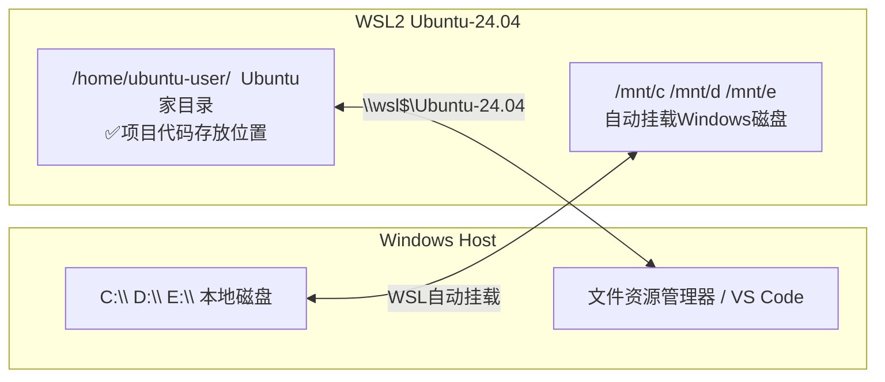

# 用户手册：EBL Carrier 预装准备（Windows 平台）v1.7‑20260918

## 1. 手册目的

统一本地环境标准，保证全员环境一致、问题一致、部署逻辑一致，彻底规避 “本地可运行、他人无法部署” 的环境差异问题。
本手册适配 FDE 日常 PoC 验证、AI 应用、RAG、Agent、前后端一体化开发场景。

## 2. 硬件设备要求（强制标准）

本环境用于本地运行大模型、向量数据库、RAG、Agent 服务以及前后端项目，对内存有硬性要求：
推荐配置：32GB 及以上内存 Windows 笔记本（SSD）
最低准入配置：16GB 内存 Windows 笔记本（SSD）
备注：16GB 为最低门槛，多服务同时运行容易内存吃紧并出现卡顿；8GB 设备不支持本套环境。磁盘预留空间≥10GB，CPU 支持硬件虚拟化技术。

### 2‑1 AI 辅助排错前置说明【新增‑Prerequisite】

部署过程中遇到安装报错、命令异常、WSL 故障等问题，可以使用 AI 工具辅助排查。
使用建议：
提交问题时附带终端完整报错信息，同时说明：正在按照《EBL Carrier Windows 平台预装准备用户手册》搭建 WSL‑Ubuntu‑24.04 开发环境。
尽量附带以下信息加速定位问题：
任务管理器 CPU 虚拟化状态
wsl --version、wsl --list --verbose 输出内容
Windows 系统版本

安全约束：
AI 仅作为辅助定位工具，环境是否合格必须以本手册自检清单、验收标准为准，不能完全依赖 AI 结论。
禁止向 AI 粘贴公司业务源码、敏感配置，仅可提交命令行日志与报错信息。

## 3. 部署前自检清单（全部项必须满足，方可开始部署）

> 备注：WSL 环境验收不再依赖 PowerShell 读取虚拟化状态，虚拟化前置条件在安装前通过任务管理器确认完毕。

- 硬件：内存≥16GB、SSD 固态硬盘、CPU 支持硬件虚拟化
- 系统：Windows 11
- CPU 硬件虚拟化已开启（任务管理器可查看）
- Windows 当前账户具备管理员权限
- C盘剩余空间 ≥10GB
- 网络可访问外网（部分包下载需要）
- 已从微软商店安装 Windows Terminal，作为标准终端工具

> ⚠️重要提示：不要直接复制 Word 文档内的 PowerShell 命令运行，Word 会自动修改减号字符，执行会报命令识别失败。复制后建议手动核对横线符号，必要时手动输入。

# 第4章 开启Windows虚拟化功能

> 前置：完成第3章部署前自检

1. 按 `Ctrl+Shift+Esc` 打开任务管理器 → 性能 → CPU，确认**虚拟化：已启用**。
2. 如果虚拟化显示禁用，重启电脑进入BIOS/UEFI，开启：
   - Intel CPU：Intel VT-x
   - AMD CPU：SVM Mode（AMD-V）
3. Windows功能开启：Win+R输入`optionalfeatures.exe`，勾选：
   - 适用于Linux的Windows子系统
   - 虚拟机平台
4. 点击确定，**重启电脑**使功能生效。

> ⚠️自检项：重启完成后，任务管理器CPU页面虚拟化状态为【已启用】。

# 第5章 WSL2安装（管理员PowerShell）

> 打开Windows终端，选择PowerShell，右键【以管理员身份运行】

```powershell
# 一键安装WSL + Ubuntu默认发行版
wsl --install -d Ubuntu-24.04
```

执行完成后，**重启Windows**。

重启后，自动弹出Ubuntu初始化窗口，设置Linux用户名（小写开头）和密码。

校验命令（PowerShell）：

```powershell
wsl --list --verbose
```

✅预期结果：Ubuntu-24.04，VERSION=2，State: Running

> ⚠️自检项：wsl版本为2，发行版为Ubuntu-24.04。

# 第6章 Ubuntu 24.04 简介

Ubuntu 是一个流行、免费开源的 Linux 发行版，基于 Debian。我们本次选用 **Ubuntu 24.04 LTS（长期支持版）**：

- LTS：Long Term Support，提供5年官方安全与维护更新，稳定性高，适合开发环境。
- WSL 内的 Ubuntu 并不是完整虚拟机，直接运行在 Windows 内核之上，启动速度快、资源占用更低。
- 可以原生运行 Linux 命令、PostgreSQL、Python、Node.js、Git 等开发组件，不需要额外虚拟机。

> ⚠️重要区别：WSL Ubuntu 没有独立开机引导、默认不带图形界面，所有操作依靠终端命令行。

# 第7章 WSL基础配置与内存限制（可选，推荐）

编辑Windows用户目录下 `.wslconfig` 文件（`C:\Users\你的用户名\.wslconfig`）

```ini
[wsl2]
memory=16GB
processors=8
swap=4GB
```

保存文件，PowerShell执行关闭WSL：

```powershell
wsl --shutdown
```

> ⚠️说明：内存值根据本机实际内存调整；32G机器可设置memory=24GB。

# 第8章 Windows 文件系统与 Ubuntu（WSL）之间文件互访

💡目标：Windows 用户经常需要在 Windows 和 WSL Ubuntu 之间共享代码、配置、日志、输入输出文件。WSL2 内置互通机制，不需要网络共享、不需要 Samba。

## Mermaid 流程图（可粘贴到支持 Mermaid 的文档工具渲染）



## 纯文本框图（直接复制到 Word 手册）

```
┌────────────────────────────────────┐        ┌────────────────────────────────────────┐
│ Windows OS                         │        │ WSL2 Ubuntu-24.04                     │
│                                    │        │                                        │
│  C:\  D:\  E:\ 本地磁盘            │◄──────►│ /mnt/c  /mnt/d  /mnt/e                │
│  文件资源管理器、VS Code、Notepad++ │        │ （Ubuntu内访问Windows磁盘）            │
│                                    │        │                                        │
│  地址栏输入：\\wsl$\Ubuntu-24.04   │◄──────►│ /home/你的用户名/                      │
│  浏览Ubuntu Linux文件系统          │        │ ✅【推荐存放项目代码】~/langconfig     │
└────────────────────────────────────┘        └────────────────────────────────────────┘
```

⚠️非常重要的警告：
不要在 Ubuntu 内部直接编辑 `/mnt/c` 下面的项目代码。跨文件系统读写性能很差，并且会出现文件权限、换行符（CRLF/LF）错乱，容易引发项目异常。
✅最佳实践：项目代码存放在 Ubuntu 家目录 `/home/你的用户名/`；Windows 只用来读取日志、导出成品文件。
在 Windows 里面修改 `\\wsl$\Ubuntu-24.04` 下面的 Linux 文件，同样容易破坏 Linux 文件权限。尽量避免直接编辑源码。
文件路径大小写规则：`/mnt/c` 是小写；Windows 盘符在 WSL 挂载点全部小写 `/mnt/c`、`/mnt/d`，不能写 `/mnt/C`。

### 8.1 Ubuntu 里面访问 Windows 文件（/mnt/c / /mnt/d …）

WSL2 自动把 Windows 所有盘符挂载到 `/mnt/` 目录：

- Windows C 盘 → Ubuntu：`/mnt/c/`
- Windows D 盘 → Ubuntu：`/mnt/d/`
- Windows E 盘 → Ubuntu：`/mnt/e/`

示例命令（在 Ubuntu 终端执行）

```bash
# 查看Windows C盘根目录文件
ls /mnt/c/
# 进入Windows C盘的Users目录
cd /mnt/c/Users
# 复制一个Windows文件到Ubuntu家目录（推荐！把文件拷进Linux内再开发）
cp /mnt/c/Users/你的Windows用户名/Documents/test.txt ~/
# 把Ubuntu生成的日志文件拷贝到Windows桌面
cp ~/app.log /mnt/c/Users/你的Windows用户名/Desktop/
```

示例说明：
`/mnt/c/Users/Administrator/Desktop` = Windows `C:\Users\Administrator\Desktop`
Windows 路径里面的反斜杠 `\` 在 Linux 要改成 `/`

### 8.2 Windows 里面访问 Ubuntu 内部文件（\\wsl$\Ubuntu-24.04）

打开 Windows 文件资源管理器，地址栏直接输入：

```
\\wsl$\Ubuntu-24.04
```

回车，就可以浏览 Ubuntu 完整文件系统。
Ubuntu 家目录完整路径：`\\wsl$\Ubuntu-24.04\home\你的Ubuntu用户名`

✅使用场景：

- 从 Ubuntu 里面导出图片、报表、日志，用 Windows 看图 / Office 打开查看
- 快速复制 Ubuntu 生成的产物到 Windows

❌不推荐：直接在 Windows 资源管理器修改、编辑 Ubuntu 里面的源代码，会破坏 Linux 权限，导致程序报错。

### 8.3 推荐工作流（团队标准，强烈遵守）

源代码、项目目录全部放在 Ubuntu 家目录：`~/langconfig`

1. 如果需要把 Windows 上的文件（模型、输入数据）给到 Linux：在 Ubuntu 里执行 `cp /mnt/c/xxx ~/` 复制文件到 Linux 内部
2. 如果需要把 Linux 输出结果（日志、导出文件）拿到 Windows：在 Ubuntu 执行 `cp ~/output.csv /mnt/c/Users/xxx/Desktop`

> Windows 仅做读取成果文件，不要直接编辑 Linux 内项目源码。

### 8.4 常见坑 & 排错

- 找不到 `/mnt/c`：WSL 没有自动挂载。执行重启 WSL：PowerShell 管理员 `wsl --shutdown`，重启 Ubuntu。
- 文件名中文乱码：Windows 文件名称中文，在 `/mnt/c` 访问容易出现编码问题，尽量使用英文文件名。
- 权限报错：访问 Windows 系统目录，Ubuntu 内会权限不足，属于正常 Windows 安全限制。
- `\\wsl$\` 打不开：确认 WSL 实例正在运行，PowerShell 执行 `wsl -l -v`，确认 Ubuntu-24.04 状态为 Running。

### 8.5 快速参考对照表

| 需求                                  | 操作方式                                  |
| ------------------------------------- | ----------------------------------------- |
| Ubuntu 读取 C 盘 Windows 文件         | `/mnt/c/`                               |
| Ubuntu 读取 D 盘 Windows 文件         | `/mnt/d/`                               |
| Windows 浏览 Ubuntu 全部文件          | 文件资源管理器输入`\\wsl$\Ubuntu-24.04` |
| 把 Windows 文件复制进 Ubuntu          | `cp /mnt/c/xxx ~/`                      |
| 把 Ubuntu 生成文件导出到 Windows 桌面 | `cp ~/xxx /mnt/c/Users/xxx/Desktop`     |

# 第9章 Ubuntu 基础命令备忘录（面向 Windows 用户）

💡重要前置说明：很多团队成员来自 Windows，Linux CLI 操作逻辑和 Windows CMD/PowerShell 有明显差异：

- Linux 区分大小写：`File.txt` 和 `file.txt` 是两个完全不同文件；Windows 不区分大小写。
- 路径分隔符：Linux 使用 `/`；Windows 使用 `\`。
- 空格处理：文件名 / 文件夹名包含空格，必须用引号包裹，或者加反斜杠转义 `\ `。尽量不要创建带空格的目录 / 文件名。
- 密码输入：输入密码时终端不会显示任何字符（无星号、无光标），属于正常安全机制，直接敲完回车即可。
- `~` 代表当前用户家目录 `/home/你的用户名`，非常常用。
- 权限：很多系统修改操作需要 `sudo`，代表临时提升管理员权限。

| Command                    | Description                                           | Windows equivalent   |
| -------------------------- | ----------------------------------------------------- | -------------------- |
| `pwd`                    | print current working directory，查看当前所在路径     |                      |
| `cd` (without parameter) |                                                       |                      |
| `ls`                     | list files in current folder，列出当前目录文件        | `dir`              |
| `ls -l`                  | list with detailed info（权限、大小、时间）           | `dir`              |
| `ls -a`                  | show hidden files（文件名以`.` 开头为隐藏文件）     | `dir /a`           |
| `cd <folder>`            | change directory，进入目标文件夹                      | `cd <folder>`      |
| `cd ~`                   | go back to home directory，回到家目录                 | `cd %USERPROFILE%` |
| `cd ..`                  | go up one level，返回上一级目录                       | `cd ..`            |
| `mkdir <folder>`         | create new folder，新建文件夹                         | `mkdir`            |
| `rm <file>`              | delete file，删除文件                                 | `del`              |
| `rm -r <folder>`         | delete folder and all contents，删除文件夹（递归）    | `rmdir /s`         |
| `cp source target`       | copy file                                             | `copy`             |
| `mv source target`       | move /rename file or folder，移动或重命名             | `move`             |
| `cat <file>`             | print file content to terminal，查看文件内容          | `type`             |
| `nano <file>`            | simple text editor，简易文本编辑器                    | `notepad`          |
| `sudo <command>`         | run command with root/admin privilege，管理员权限执行 | run as administrator |
| `clear`                  | clear terminal screen，清屏                           | `cls`              |
| `exit`                   | close current shell，退出终端                         | `exit`             |

**Nano 编辑器快速参考（前面.bashrc 配置会用到）**

- Ctrl+O：保存文件（Write Out）
- Ctrl+X：退出编辑器
- Ctrl+W：搜索文本

⚠️高危提醒：`rm -r` 删除操作没有回收站，删除后无法恢复！执行前务必确认文件名。

# 第10章 Ubuntu 24.04 系统源更新

进入WSL Ubuntu终端

```bash
# 更新软件源索引
sudo apt update
# 升级全部已安装包
sudo apt upgrade -y
```

> ⚠️自检项：update/upgrade无严重报错。

# 第11章 安装基础开发工具包

```bash
sudo apt install -y build-essential git curl wget unzip zip vim tree htop jq openssh-client lsof
```

> `lsof` 是 `start.sh` 用来查找并停止仍占用 `:1421` / `:8765` 的旧进程的。默认的 WSL2 Ubuntu 不带它，缺少时 `start.sh` 无法释放端口，前端会以 `Error: Port 1421 is already in use` 退出（Vite 配置了 `strictPort`，不会自动换端口）。

校验工具：

```bash
git --version
curl --version
```

> ⚠️自检项：git、curl输出版本号，无command not found。

# 第12章 配置Git全局信息

```bash
git config --global user.name "Your Name"
git config --global user.email "your@email.com"
```

校验：

```bash
git config --global --list
```

# 第13章 配置SSH密钥（用于代码仓库拉取）

```bash
ssh-keygen -t ed25519 -C "your@email.com"
```

一路回车，不设置密码（开发环境）。
查看公钥：

```bash
cat ~/.ssh/id_ed25519.pub
```

复制输出全部字符串，添加到代码仓库SSH密钥配置。

> ⚠️自检项：SSH测试连通仓库成功 `ssh -T git@shturl.`。

# 第14章 WSL systemd 开启（关键，PostgreSQL依赖）

```bash
sudo nano /etc/wsl.conf
```

写入内容：

```ini
[boot]
systemd=true
```

Ctrl+O保存，Ctrl+X退出。
PowerShell执行：

```powershell
wsl --shutdown
```

重新打开Ubuntu终端，校验systemd：

```bash
systemctl list-unit-files
```

> ⚠️自检项：无报错，systemd正常启用。

# 第15章 WSL网络互通校验

WSL内查看IP：

```bash
ip addr show eth0
```

Windows浏览器访问WSL内服务IP，用于后续前后端服务访问测试。

# 第16章 WSL环境备份与重置说明

- 关闭WSL：`wsl --shutdown`
- 导出备份（PowerShell管理员）：`wsl --export Ubuntu-24.04 D:\backup\ubuntu2404.tar`
- 重置WSL（故障无法修复时，会清空所有数据）：`wsl --unregister Ubuntu-24.04`

# 第17章 WSL+Ubuntu基础环境整体验收清单（必须全部通过）

- [ ] CPU虚拟化已开启（任务管理器预先确认）
- [ ] wsl -l -v 确认Ubuntu-24.04，版本2
- [ ] sudo apt update && upgrade 执行无报错
- [ ] git/curl等基础工具安装成功，版本可正常输出
- [ ] SSH密钥配置完成，可连通代码仓库
- [ ] /etc/wsl.conf 已配置 `systemd=true`，wsl重启生效
- [ ] 文件共享规则理解：项目代码存放于WSL家目录 `~/`，不使用Windows挂载盘 `/mnt/c`
- [ ] 网络：WSL可访问外网，Windows可访问WSL内IP

> ✅全部通过，方可进入【第18章 应用部署：Langconfig】

---

# 第18章 应用部署：Langconfig（Application）

> 前置条件：第1~17章 WSL+Ubuntu24.04 基础环境全部部署完成，并通过第17章全部自检项。本章完成向量数据库、后端、前端完整项目部署。

## 18.1 代码拉取与环境配置文件准备

```bash
# SSH 克隆代码仓库
git clone git@xxx:xxx/langconfig.git
cd langconfig

# 复制环境模板文件，生成后端 .env 配置文件
cd backend
cp env_example .env
nano .env
```

编辑 `.env`，填入数据库连接信息：

```env
DB_HOST=localhost
DB_PORT=5432
DB_NAME=langconfig
DB_USER=langconfig
DB_PASSWORD=langconfig_dev
```

保存退出：Ctrl+O → 回车确认 → Ctrl+X

> ⚠️注意：克隆仓库后**必须执行 env_example 复制**，后端启动依赖该配置文件，缺失会导致数据库连接失败。

## 18.2 安装 uv 包管理器

```bash
# 执行 uv 官方安装脚本
curl -LsSf https://astral.sh/uv/install.sh | sh

# 加载更新后的环境变量
source ~/.bashrc

# 验证 uv 是否安装成功
uv --version
```

## 18.3 安装 Node.js 22 LTS + npm（**Node安装完成后立刻校验 node/npm，校验通过再执行前端依赖安装**）

```bash
# 添加 NodeSource 源，安装 Node.js 22 LTS（自带 npm）
curl -fsSL https://deb.nodesource.com/setup_22.x | sudo -E bash -
sudo apt install -y nodejs

# Node安装完成后，立即校验 node、npm 版本，确认安装生效
node -v
npm -v

# ✅ node、npm 版本正常输出，方可继续；若报错 command not found，停止后续操作排查
# 进入前端目录，安装前端项目依赖
cd ~/langconfig/frontend
npm install
```

> ⚠️注意：**Node.js 安装完毕后必须马上执行 node -v、npm -v 校验。只有校验成功，才允许执行 npm install。**
> 如果 npm -v 报 command not found，代表 Node/npm 安装未生效，不能继续前端依赖安装。前端代码拉取完成后必须执行 `npm install`，下载前端依赖包；不执行此步骤前端开发服务无法启动。

## 18.4 PostgreSQL + pgvector 向量数据库部署

```bash
# 开启 WSL systemd（PostgreSQL 服务管理必需；第14章已配置可跳过）
sudo nano /etc/wsl.conf
```

写入配置内容：

```ini
[boot]
systemd=true
```

保存退出。

> 切换至 Windows PowerShell，执行 `wsl --shutdown`，关闭并重启 WSL 终端，使 systemd 配置生效。

```bash
# 更新软件源并安装 PostgreSQL 主程序
sudo apt update
sudo apt install postgresql postgresql-contrib -y

# 安装适配 Postgres16 的 pgvector 向量扩展包
sudo apt install postgresql-16-pgvector -y

# 启动 PostgreSQL 服务，并设置开机自启
sudo systemctl start postgresql
sudo systemctl enable postgresql
sudo systemctl status postgresql

# 校验：确认 Postgres 在5432端口正常接收连接
pg_isready -h localhost -p 5432          # 预期返回：accepting connections

# 校验：确认 pgvector 系统包成功安装
dpkg -l | grep postgresql-16-pgvector    # 预期输出包含：ii  postgresql-16-pgvector ...

# 清理旧库、旧角色，新建超级用户角色 langconfig 与数据库 langconfig
sudo -u postgres psql
```

在 psql 交互终端内执行下面 SQL：

```sql
DROP DATABASE IF EXISTS langconfig;
DROP ROLE IF EXISTS langconfig;
CREATE ROLE langconfig LOGIN PASSWORD 'langconfig_dev' CREATEDB SUPERUSER;
CREATE DATABASE langconfig OWNER langconfig;
\c langconfig
CREATE EXTENSION IF NOT EXISTS vector;
SELECT extname FROM pg_extension WHERE extname='vector';
\q
```

```bash
# 校验：确认 langconfig 数据库已启用 vector 向量扩展
psql -U langconfig -d langconfig -h localhost -c "SELECT extname FROM pg_extension WHERE extname='vector';"

# 可选：手动测试数据库连通性
psql -U langconfig -d langconfig -h localhost
```

> ⚠️部署踩坑备注：
> 不要在 bash 单行命令中执行 `ALTER ROLE ... PASSWORD` 修改密码，容易产生密码哈希异常，导致密码认证失败；
> 在 psql 交互式环境使用 `\password` 修改密码时，如果两次输入密码不一致，密码不会保存；
> 推荐先清理旧数据库、旧角色，一次性重建整套资源，规避残留对象引发的认证报错。

## 18.5 Backend 依赖安装、数据库迁移 & Seed 种子数据初始化

```bash
cd ~/langconfig/backend
uv sync

# 执行 alembic 数据库迁移脚本，自动创建业务数据表
uv run alembic upgrade head

# 创建 outputs 输出目录，防止种子脚本因目录缺失报错
mkdir -p outputs

# 执行 Seed 种子脚本，初始化项目基础业务数据
WORKSPACE_ROOT="$HOME/langconfig/backend/outputs" uv run python scripts/seeds/in/seed_all.py
```

> ⚠️注意：
>
> 1. 必须**先完成数据库迁移（alembic upgrade head），再执行 Seed 种子脚本**；顺序颠倒会导致数据表不存在，种子数据导入失败。
> 2. 种子脚本运行前必须创建 outputs 目录，否则脚本抛出文件路径异常。

## 18.6 启动前后端服务（WSL2 暴露服务给 Windows 浏览器）

```bash
# 启动后端服务，必须绑定 0.0.0.0，否则 Windows Chrome 访问报 ERR_CONNECTION_REFUSED
cd ~/langconfig/backend
./start.sh
# Backend: http://localhost:8765  (docs: http://localhost:8765/docs)

# 启动前端开发服务，增加 --host 0.0.0.0 参数，暴露给 Windows 主机访问
cd ~/langconfig/frontend
npm run dev -- --host 0.0.0.0
# Frontend: http://localhost:1421
```

> ⚠️注意：WSL2 默认服务监听在 `127.0.0.1` 仅WSL内部可访问；必须绑定 `0.0.0.0`，Windows主机浏览器才能访问。

## 18.7 Langconfig 应用部署验收清单（全部项必须通过）

- [ ] `pg_isready -h localhost -p 5432` 返回 accepting connections
- [ ] `dpkg -l | grep postgresql-16-pgvector` 可查到 pgvector 安装包
- [ ] psql 查询语句返回 `vector`，确认向量扩展已加载
- [ ] uv sync 依赖安装无报错
- [ ] alembic upgrade head 全部迁移脚本执行成功
- [ ] Seed 种子脚本 seed_all.py 完整执行完成
- [ ] node -v、npm -v 正常输出版本号
- [ ] 后端服务 8765 端口可在 Windows 浏览器正常访问
- [ ] 前端服务 1421 端口可在 Windows 浏览器正常访问

## 18.8 应用部署常见故障排查

1. **浏览器访问 localhost:端口，提示 ERR_CONNECTION_REFUSED**

> 服务仅监听 WSL 内部 `127.0.0.1`，未绑定 `0.0.0.0`。停止当前进程，修改启动命令增加 `--host 0.0.0.0`，重新启动服务。

2. **Postgres 连接报错 FATAL: password authentication failed**

> 不要使用 bash 单行命令修改密码；进入 psql 交互式终端，先 DROP 清理旧角色与数据库，再重新创建。密码两次输入不一致会导致密码不生效。

3. **Seed 种子脚本执行报错：找不到 outputs 目录 / 表不存在**

> - 找不到 outputs：提前执行 `mkdir -p outputs` 创建输出文件夹。
> - 表不存在：执行顺序错误，**必须先执行 alembic upgrade head，再运行 seed_all.py**。

4. **WSL systemd 不生效，PostgreSQL 服务无法启动**

> 确认 `/etc/wsl.conf` 配置 `systemd=true`，在 Windows PowerShell 执行 `wsl --shutdown` 重启 WSL。

5. **前端 npm install 命令提示 command not found: npm**

> Node.js / npm 未安装或者环境变量未刷新。回到18.3章节，执行 Node.js 安装命令，**安装完成立刻校验 node -v、npm -v**，输出版本号成功后，再执行前端依赖安装。

---

你可以直接全选复制，保存为 `EBL_Carrier_WSL_Manual.md`。
要不要我再输出一份纯文本版本（不带markdown语法，直接粘贴到Word）备用？
